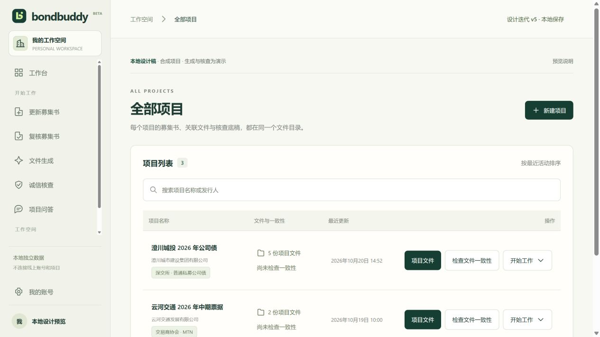
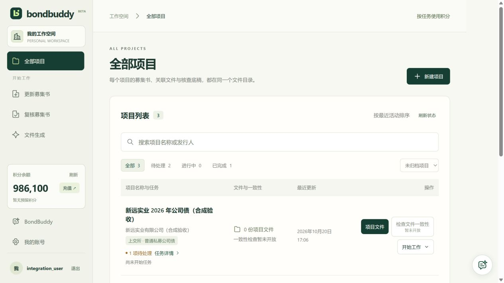

# 全部项目 E2E 开发证据（#716）

开发和定向自测完成；本功能的隔离本地环境可操作。用户尚未验收，尚未部署。这是本开发分支的测试环境，不是集成测试 chat 汇总后的统一集成版。

## 实现与依赖

- 全部项目替代工作台，导航首项、默认首页；旧 `#dashboard` 链接重定向。
- 根项目聚合更新工作区和关联文件生成任务，避免重复项目；搜索、归档/恢复、状态筛选和完整分页。
- 行内显示进行中/待处理及最近结果；默认收起，展开真实任务历史，链接到对应进度/结果及复核版本记录。30 秒刷新，失败保留上次数据并提示。
- 项目文件直接展示二级分类、已有材料/成功成果、版本记录及授权下载；下载核验精确版本、归属及 SHA-256。
- 开始工作菜单沿用项目进入更新、复核和文件生成；文件生成默认选中该项目和其材料。
- 检查文件一致性禁用并标注“暂未开放”；本次没有一致性扫描或冲突更新实现。

分支 `feat/all-projects-e2e-20261020` 从 develop `f52d5a16` 起始并包含前置更新/复核实现，前置 HEAD 为 `7a3b6e91df8ccf2146cd76fa0a16b5e4a3eba203`。PR 以 develop 为 base，依赖 #713（更新）与 #715（复核），须按依赖顺序集成。本次无新增数据库迁移或 npm 依赖；所依赖迁移为 0107–0110，API/web/contracts 需同步集成。worker 业务逻辑未改。

## 原型对照

用户截图 `codex-clipboard-24ee85a9-1a48-4ef1-a877-5df1783543cd.png` 为列表依据。原型工作区 `BondBuddy-project-materials-design-20261019`，commit `eed245e16a482c56c073275e39bb50de72387d65`，源码 `project-design/project-list-view.ts`、`project-design/catalog.ts`。实现 commit 在本 PR 正文固定；截图随本提交保存。

用户在本会话已明确确认：移除工作台；全部项目排首位；任务摘要点击展开且默认收起；一致性检查留下一批并标注未开放。列表新增状态筛选及归档范围承接原工作台能力。原型的合成文件/任务换为实际账号数据；未开发的诚信核查与问答能力不冒充可执行功能。

桌面对照均为 1265 × 712：

| 原型 | 实现 |
| --- | --- |
|  |  |

其他页面证据：

- [任务运行中](implementation-running.jpg)
- [任务展开与完成结果](implementation-task-expanded.jpg)
- [项目文件分类](implementation-files.jpg)
- [精确文件版本记录](implementation-version.jpg)
- [文件生成默认关联当前项目](implementation-file-source.jpg)
- [390 × 844 移动页面](implementation-mobile.jpg)；另实测 320 宽无水平溢出。

## 自动化验证

| 命令 | 结果与边界 |
| --- | --- |
| `npm run build` | 全仓构建通过；最后前端修改另经 web build/typecheck 通过 |
| `npm run build -w @bondbuddy/contracts`、`npm run check:contracts` | 最终契约通过；171 个合成 + 12 个内部样例，4 个生命周期样例，29 个 OCR + 11 个发行人绑定测试 |
| `node --test apps/web/dist-test/*.test.js` | 107 通过，0 失败，0 跳过 |
| `BB_LOCAL_INSTANCE=projects-20261020 node scripts/local-integration/test-projects.mjs` | 真实隔离 PostgreSQL/Azurite 4 通过，0 失败，0 跳过 |

后端定向测试覆盖根项目去重、真实上传/下载、材料精确版本不存在返回 404、账号隔离、任务游标分页、失败后保留旧成果、成功重试清除旧待处理、历史成果保留及归档恢复。队列测试使用 synthetic 执行，不冒充真实模型调用。

已新增/更新 Playwright 用例并通过类型检查，**未运行完整 Playwright 浏览器套件**。实际浏览器操作使用 CUA 连接本地真实服务；下述链路有独立真实模型证据。远端 CI 状态见 PR，不能以本地通过代替远端 CI 或用户验收。

## 真实浏览器链路

使用合成发行人和合成 Word，真实 API、独立 PostgreSQL、Azurite、Linux worker 及模型调用，未连接生产数据库或修改生产账务。

1. 页面创建更新项目，再从该项目进入复核，上传两份 Word 并明确开始。
2. 全部项目显示该任务运行状态，完成后显示复核已完成；结果页有 8 项发现。
3. 项目文件显示 2 份材料 + 3 份成果；修订版、清洁版从文件目录实际下载，下载 SHA-256 与后端记录一致。
4. 实测搜索、已完成筛选、任务展开及精确结果链接；另一草稿归档后出现在归档列表，恢复成功。
5. 从开始工作进入更新保留同一项目与两份材料；进入文件生成默认当前项目，材料选择器列出实际材料。创建了关联话题，未启动文件生成。
6. 旧工作台链接转向全部项目；手机布局 390 和 320 宽无水平溢出。

脱敏 run、call、文件 hash 与操作记录见 [real-e2e.json](real-e2e.json)。真实调用 status=completed、usage_status=measured，不是模拟输出；业务内容准确性和用户验收仍待确认。

## 本地访问、重启与停止

- 页面：<http://localhost:5193/#tasks>
- 实例：`projects-20261020`；端口 web 5193 / API 3023 / PostgreSQL 15443 / Blob 10023。
- 测试账号名：`integration_user`。密码在父工作区 `work/local-integration-runtime-projects-20261020/test-accounts.json`，未写入仓库；对话交付提供登录方法。
- 从本分支工作区执行下列 PowerShell 命令；只操作本实例，保留测试数据。需已配置本地 Node、PostgreSQL、Azurite 和 Linux worker，其他机器不能仅凭此 URL 访问。

```powershell
$env:BB_LOCAL_INSTANCE='projects-20261020'
node scripts/local-integration/status.mjs
# 如需停止，生命周期工具会校验进程归属和活动任务。
node scripts/local-integration/stop.mjs
# 重新启动同一实例。
node scripts/local-integration/start.mjs
```

本地 Linux worker 沿用已验证业务镜像 `sha256:27691609ec141592e3ada0760f0b834558bfbcf19685593c4ff0488748661245`，仅更新本地实例边界的派生镜像为 `sha256:3310061bf9dec719498b8e516fa9dd8579ad254651a99828eca060ffbc4d1fe7`。镜像、运行目录和凭证不提交；凭证保存在本机独立 ACL 目录。`status.mjs` 的通用 `endToEndVerified` 标志未由本次专用证据脚本改写，应以此处具体 run/call/hash 记录判断本功能已验证的范围。

用户可先展开澄川项目的任务查看结果，再打开项目文件下载两个 Word；也可用新远/云河草稿测试搜索、归档恢复和开始工作菜单。一致性检查明确留待下一批。
