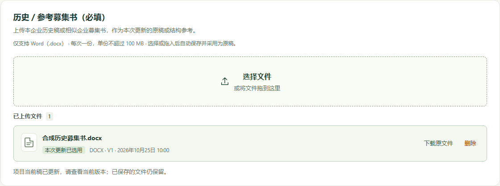
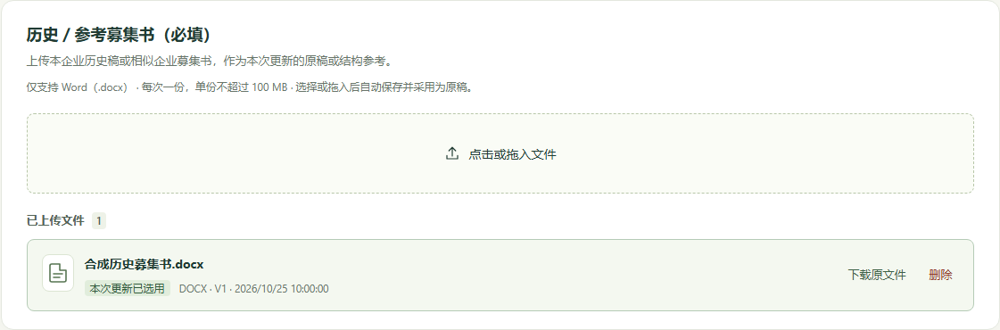
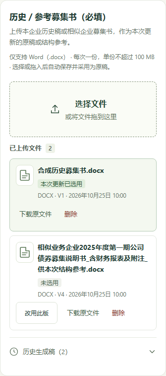

# 文件版本详情移除验证

关联 Issue：#1311。用户于 2026-11-13 根据上传文件卡片截图明确要求不展示“文件版本详情”。

本 PR 删除共用 ProspectusPanel 中的技术详情与展开入口，并清理专用样式及展开/焦点状态。文件名、简明版本和时间、选用状态、下载、选用、删除功能继续保留；内部版本校验与 API 数据未改。对应原型 `product-prototype/public/prospectus-reference.html` 同步移除详情。

基线：`92bbba8fe04ef7f367c8ecba814ff834bea2a677`。实现与原型截图均来自本 PR 的相同源码修改集。环境为 Windows、Node 24.22.1、Vite 8.3.0、Playwright 1.63、Microsoft Edge；独立端口 5277，基线对照端口 5278。

## 验证结果

- 共享包及 API 编译后，`tsc --noEmit -p apps/web/tsconfig.json` 通过；Web Vite build 通过，保留已有大 bundle 提示。
- 三组现有浏览器测试：**131 passed / 6 failed / 1 skipped**。跳过的是需单独截图开关的原有 `M2 deferred charge prototype screenshots`，本次页面原型截图用例实际执行并通过。
- 本次相关检查通过：详情入口消失、当前稿下载、版本采用确认、同名文件的准确字节下载、生成稿下载、定时刷新后的历史展开与焦点、只读状态、删除/替换文件、1440/390/320 px 布局。
- 六项失败均在未修改的固定基线源码及测试上复现，断言相同；未放宽或跳过这些用例。基线原始日志为 `baseline-msedge-playwright.log`、`baseline-reentry-playwright.log`；修改后错误上下文在 `failures/`。

| 原有失败 | 数量 | 相同断言 |
| --- | ---: | --- |
| deduplicated first draft | 2 | `#execution-progress` 未出现“任务已暂停” |
| lost upload acknowledgement restores start | 2 | `lost.pdf` 仍显示“已发送 100%，正在保存” |
| unknown upload receipt retries the original session | 1 | 未出现 `[data-resume-prospectus]` |
| native generation source step discovers the same retained candidate | 1 | 找不到“项目文件”返回链接，30 秒超时 |

执行命令（在 `apps/web`，使用现有依赖的直接 CLI）：

```powershell
$env:BB_E2E_BASE_URL='http://127.0.0.1:5277'
$env:BB_E2E_BROWSER_CHANNEL='msedge'
node ../../node_modules/@playwright/test/cli.js test tests/prospectus-panel.spec.ts tests/prospectus-saved-reentry.spec.ts tests/project-execution.spec.ts --output=../../work/version-details-test-results
```

截图通过 `BB_REFERENCE_EVIDENCE` 和 `BB_PROSPECTUS_CAPTURE_DIR` 收集。基线用相同浏览器和独立输出目录，仅复跑六项失败；基线源文件与 Git blob 核对一致。

## 页面核对

`implementation-saved-{1440,390,320}.png` 与同宽 `prototype-saved-*.png` 成对保存；另保留多文件窄屏及版本历史截图。已目视核对详情移除、操作按钮和换行，无新增遮挡或横向溢出。实现的上传按钮文案、日期格式和动态状态提示沿用既有行为；本次展示调整由用户当前截图要求确认。







测试使用合成文件及 HTTP 夹具，未调用真实模型或生产服务。无 API、worker、依赖和数据库迁移变更。**代码完成，尚未部署，待统一发布；用户尚未验收。** 统一集成时需沿用本批截图，并另行处理上述基线回归问题。
