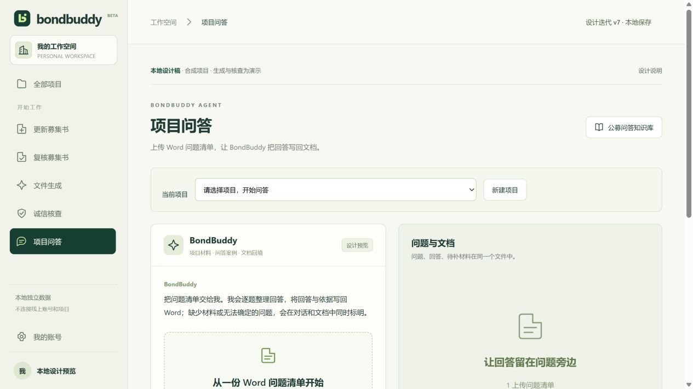
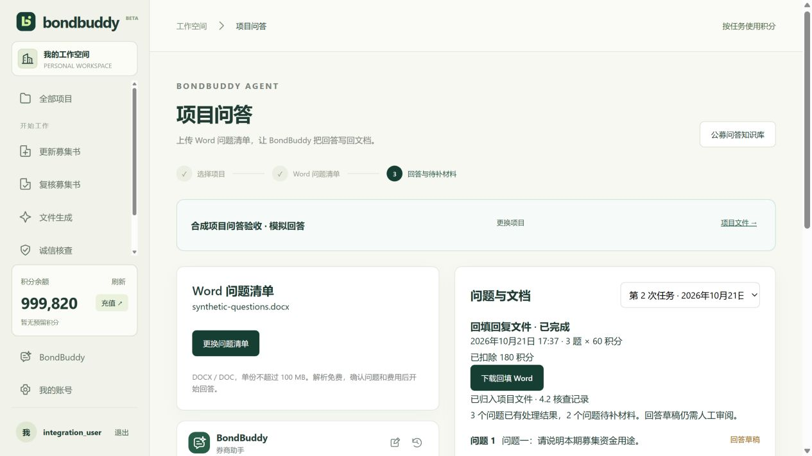

# 项目问答界面对照

实现源码：`5fe3207af8dcc955b5fb9ead3bc30687dedae1e7`。原型：`35da7b8c9bc649abea4aadd66ab59a624be7e7b4`，`apps/web/src/project-design/qa-view.ts`、`qa-model.ts`。以下全部使用合成项目，无生产数据。原型确认不代表本实现已由用户验收。

同尺寸主页面对照（实际截图像素均为 1265 × 712；文件名中的 1440 是测试时设置的目标尺寸，保存像素以本表为准）：

| 原型工作区 | 实现的历史成果 |
| --- | --- |
|  |  |

保留项目问答导航、左侧上传与 BondBuddy 对话、右侧问题/成果及知识库入口。项目选择按用户后续要求改为统一 ProjectEntry；费用确认、段落定位、后台任务、结果逐题显示和知识库审核权限是实际接入所需增量，详细偏离及确认状态见 [开发验证](../../../../docs/acceptance/issue-722/README.md)。

其他证据：

- [项目选择 1440 × 1000](qa-project-entry-1440.png)
- [准备工作区 1425 × 990](qa-workspace-1440.png)
- [知识库 1425 × 990](qa-knowledge-1440.png)
- [两题 120 积分确认 1265 × 712](qa-price-confirmation.png)
- [项目文件 4.2 归档 1265 × 712](qa-project-files.png)
- [390 像素手机页面全页](qa-mobile-390.png)：实测 clientWidth = scrollWidth = 390，嵌入对话不使主页面失去交互。

浏览器真实验证了新建、上传、免费解析、合并段落、补料、保存/刷新、报价与下载。已完成回答来自明确标注的 synthetic adapter，没有真实模型调用。实际 Linux worker 完成免费解析。
