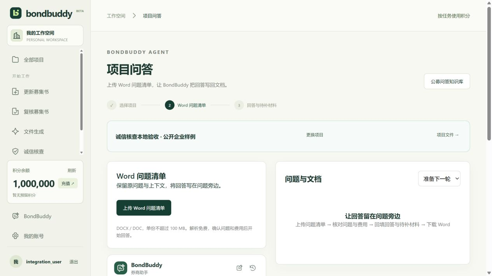
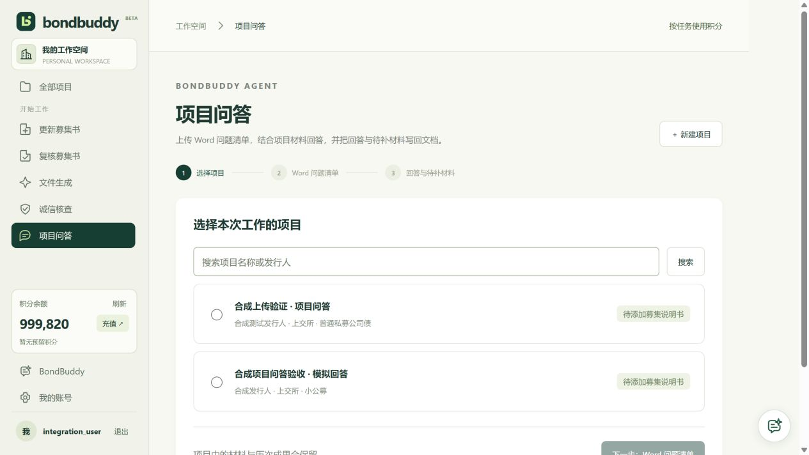

# 项目问答导航可见性（2026-10-22）

Refs #722。基线为已合入完整功能的 `0036ab75`。用户反馈项目问答不见后，合并验收发现另一处显示问题：1280 × 720 浏览器中，积分/账号区占用侧栏底部，主导航需要滚动才能看到项目问答。

仅调整 `apps/web/src/credit-wallet.css`：桌面宽度大于 760、窗口高度不超过 800 时压缩品牌、工作空间、钱包与账号间距；主导航与底部链接为 40 px 行高。保留工作空间卡、积分信息和滚动兜底。手机规则不受此媒体查询影响，不改变产品功能或计费。

- `npm run build -w @bondbuddy/web` 通过，只有既有大 bundle 提示。无新增依赖或迁移，后端链路沿用 [完整合并验证](../../../../docs/DEVELOP-WORKFLOWS-20261022.md)。
- 实际浏览器主导航六个入口全部位于容器内；`clientHeight = scrollHeight = 334`，每项 40 px；选择项目问答后 `aria-current=page` 且无需滚动。
- `before.png`：0036ab75，5195 实例；`after.png`：本修复，5197 实例。相同浏览器窗口捕获，实例的合成测试项目与主内容不同，本次只比较公共侧栏可见性。
- 无真实模型调用。用户验收仍待完成；代码交付不代表已经部署。

| 修复前 | 修复后 |
| --- | --- |
|  |  |
