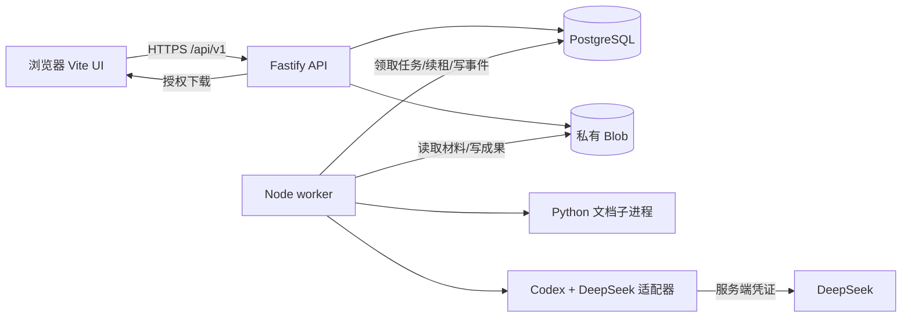

# M1 统一技术栈与四人协作基线

## #18 试用限制暂停的浏览器消费（2026-09-28）

浏览器复用 `packages/contracts` 的 `RUN_PAUSE_STAGES` / `RUN_RUNTIME_REASONS` 类型，为 `trial_limit` 在既有同页进度区显示额度或服务停用原因及自动恢复提示，等待后台解除限制，不主动调用 resume。run.state/stage 优先于迟到事件；阶段变化清除旧原因，事件读取失败仍保留真实暂停。运营拒绝按 failed/TRIAL_ACCESS_DENIED 展示。无新 DTO、迁移、输入或配额策略变化；合成浏览器证据见 [#18](../apps/web/ux-evidence/issue-18-trial/README.md)，不替代 #35 真实配额/模型验收。

## #370 原型控件与启动入口更正（2026-09-28）

按用户在 #370 的明确确认，财务截止日恢复年份与四季度末，删除目标期间编辑器及额外启动卡片/字段/材料重选/确认框；上传流程仅留政策页链接。`readUpdateForm` 保留初次读取的不可见字段，因此旧 `target_reporting_periods` 及其状态不会随其他编辑清空；不从一个截止日推导并确认整套期间。页脚主操作仍串行保存草稿/不可变输入/预检/execute，新输入省略可选 `target_confirmation`，服务器沿用 unconfirmed；#76/#17 的 cutoff＋材料证据→期间/目标消费接缝已在 Issue 交接，前端不伪造法规日、用途或批准。按钮置灰旁显示实际原因，执行未开放仅在 API 返回相应错误后显示。无公共 DTO 或迁移变化。原型版本、截图和边界见 [#370 验收记录](../apps/web/ux-evidence/issue-370/README.md)；此前 #361/#18 段落涉及额外输入区域的实现记录由本段覆盖。

## #361 原型体验恢复（2026-09-28）

`apps/web` 直接导入 `product-prototype/public/styles.css` 与 `project-workspace.css`，按 app.js/project-workspace.js 和 #85 连续工作区组织工作台、独立项目表、创建→材料阶段、固定材料分区、持续右侧补充及同页进度/成果。新增 TypeScript dashboard 与少量控件适配 CSS；没有导入旧原型服务或模拟数据。保存/预检/execute 由主操作顺序编排，实际待确认条件就地展示，输入版本/幂等/归属/日志语义仍由原 API 掌握。细材料角色从公共契约映射到四类产品分区，保持原值与版本。#18 真正多轮接口、全量历史成果和受控测试授权发现仍是剩余依赖；M2–M4 入口明确未开放。来源、截图和验收边界见 [原型迁移记录](../apps/web/PROTOTYPE-MIGRATION.md)。

2026-09-28 #31 内部测试历史基线修复见[证据与接续](acceptance/issue-31-localized-baseline-2026-09-28.md)：授权后服务端选择独立工作稿策略，保留 parser 1.0.7 的完整辅助对象/作用范围、原 warning 和校正画像未核状态；仅已知可定位辅助对象及带干净正文锚点的正式用户校正不再全局阻断。未知/损坏/截断、证据冲突仍拒绝。`historical_generation_input` 绑定策略版本，测试模板升至 v2，不能静默复用旧模型绑定；生产路径不变。Word 批注和摘要消费完整待核清单，无公共 DTO 或迁移变化。

状态：供 M1 团队评审的技术方案。产品范围和验收以 `product-prototype/product-specs/`、GitHub M1 issue 为准；本文件固定实现方向和跨模块接口。若需改变选型或公共契约，先在同一个 PR 更新本文件及受影响的接口契约，再合并实现。

## #18 浏览器保存输入与任务提交切片（2026-09-27）

`apps/web/src/project-execution.ts` 在既有项目工作区接入已保存材料选择、目标意图确认、不可变 input revision、预检、显式 execute 和同页 run/事件恢复。目标沿用草稿的完整报告期及公共市场/发行方式，法规日不从财务截止日推断。所有 HTTP 复用 `api.ts` 与 `packages/contracts`；不新增契约、迁移、规则选择或终态。

执行键由项目/输入版本/hash 确定，重试及刷新不创建重复 run；input_manifest_ref=输入 hash、workspace_id=项目 ID 仅作稳定请求关联，API/worker 始终重验数据库归属及不可变清单。无幂等键的输入保存响应丢失时先读回核对，不自动重发。预检 blocked 与实际暂停原因明确显示；显式提交仍受服务端门禁约束。恢复读取精确输入、分页 owner 项目列表及 run 事件；旧成功成果保留，离页销毁请求与轮询。此 UI 切片的 Chromium synthetic 回归不能替代 #35 真链路，也不实现 #18 消息/回复/流式持久化。复现命令与限制见 `apps/web/README.md`。

## #34 浏览器成果交付切片（2026-09-26）

`apps/web/src/artifact-page.ts` 通过现有 `ArtifactResponse` → `RunResponse` → 本人项目读取路径展示成果摘要、待人工确认项与修订/清洁/有效基线下载，不新增契约、迁移或运行状态。项目列表沿用最新成功成果引用，后续 run 失败不覆盖该入口；同一成果 URL 可在刷新后恢复。成果页和列表快捷下载均重新获得短期授权，核对成果与成功 run 的关联，由公共 API client 验证同源精确成果路径、完整响应和 SHA-256，并处理会话、取消和失败；两处共用临时下载文件的释放逻辑。没有 `word_delivery` 的旧成果保持通用文件展示；不推断其修订或无历史稿身份。完整项目成果历史目录缺少公开列表接口，未在此实现。浏览器合成验收不替代 #35 真实交付与 #146 Office 实机矩阵，详见 `apps/web/README.md`。

## #34 历史 DOCX Word 交付切片（2026-09-25）

worker 将 #31 锁定的 `historical-update-plan-v1` 交给 Python OOXML writer，产出原稿有效基线、真实修订版与清洁版；原上传材料保持不变。三份成果各自复用现有 `promoteWordArtifact` 检查和 Blob 读回，全部通过后才结束 run。`ArtifactResponse.word_delivery` 可选字段包含三份成果 ID、源和基线 hash、writer 版本、变更计数及局部待确认摘要；公开下载仍使用原有 owner-scoped 临时 grant。没有新增迁移或公开写接口。writer 只处理 #31 当前有历史 DOCX 的上交所普通私募计划；其他场景继续按能力门槛停下，Windows WPS/Word 操作兼容性由 #146 实机验收。

## #12 上传后续实现（2026-09-25）

新增迁移 `0018_m1_upload_reuse.sql`，通过 owner/project/role/hash/大小/MIME 和项目锁复用已保存材料版本；私有不可变完成凭证保存冗余 upload → 原材料精确版本关系。保留原 `MaterialResponse` 结构和材料事件格式，复用只写 `upload.reused` outbox，不重复写 `material.persisted`。冗余字节沿既有 received → deleting → purged 清理流程，完成凭证独立保留，清理后仍可重放；已删除材料不恢复、原对象缺失不报成功。公共 `M1_UPLOAD_LIMITS` 固定已保存版本 60 份 / 500 MiB，单份 100 MiB；临时上传空间由 #8 生命周期管理，尚不是预留配额。前端最多并行两份、真实字节进度、先核对旧 session 再续传。详见 [实现与验收记录](../apps/web/UPLOAD-ACCEPTANCE.md)；#8 生产存储/压测与 #76 消费识别闭环仍是交付条件。

## 1. 技术栈

| 层 | M1 选型 | 采用方式 |
| --- | --- | --- |
| 用户界面 | Node.js 22、Vite、原生 ES modules、现有 CSS | 以 `product-prototype/public/` 的页面结构和交互为基准逐页迁移，逐页接真实 API；对照与偏离确认规则见 `AGENTS.md`「界面变更与原型对照」。新模块用 TypeScript；旧 JS 用 JSDoc 和 `// @ts-check` 渐进检查。M1 不做 React 重写。 |
| Web API | Node.js 22、TypeScript、Fastify、JSON Schema/OpenAPI | 单个 API 服务处理身份、项目、材料、对话、任务查询和后台管理。所有公开接口统一 `/api/v1`。 |
| 持久化 | PostgreSQL 16、SQL migration、`pg` | 用户、项目、版本、任务、租约、参考库、审计和 outbox 存关系库。正式运行数据不再写到原型的 JSON 文件。 |
| 大文件 | Azure Blob Storage；本地开发使用 Azurite | 原件、OCR 派生文件、Word 成果和受控 prompt 正文使用私有容器。数据库只保存引用、hash、版本和授权范围。 |
| 后台执行 | 独立 Node.js worker 进程 + PostgreSQL 任务表/租约 | API 在事务中创建任务及事件；worker 用 `FOR UPDATE SKIP LOCKED` 领取，定期续租，崩溃后按检查点恢复。M1 不另引入 Redis/BullMQ。 |
| 文档处理 | Python 3.11+；`python-docx`、`pdfplumber`/`pypdf`、`openpyxl`、`pypdfium2`、Tesseract | 复用 `product-prototype/python/` 与 `backend/` 中可验证的解析、OCR 和 Word 逻辑，通过受控子进程传入文件引用/结构化清单，输出版本化 JSON；不让 Python 直接改业务数据库。 |
| AI 接入 | 隔离的 Codex 执行进程、DeepSeek 适配器 | 以 #16 的真实协议联调结果确定 Codex CLI / app-server 接口和准确模型 ID。适配器统一记录请求、重试、usage 与结构化输出；凭证只在服务端。联调未通过不启用真实更新。 |

供应商 HTTP 402、401、429 由服务端解析为稳定模型错误码；余额、认证或限流拒绝在用量证据不足时保留 `unknown`，run 暂停于 `provider_reconcile` 并通过公共事件给出安全原因码。余额恢复后的重试只经现有运维对账命令和外部调用门执行。定时余额探针经出站代理访问供应商余额端点，仅记录可用性和余额区间，告警写入现有运营告警表；见 `docs/runbooks/log-alert-recovery.md`。
| 部署 | Docker Compose、Nginx + TLS、Azure VM | 基于现有 `deploy/vm/` 演进为 web/api/worker/PostgreSQL/Azurite(仅开发) 的独立进程。生产 Blob 使用 Azure 服务；密钥由部署环境注入。先保持单区域部署，后续再按负载拆分。 |

版本号为兼容基线；具体补丁版本由 lockfile、容器镜像 digest 和部署清单锁定。DeepSeek 实际模型 ID、存储地域与保留期限必须在真实接入时记录，不在代码中猜测。

## 2. 一张图看边界



浏览器只负责输入、展示和显式操作。API 是身份、权限、版本和任务提交的权威入口。worker 不接受浏览器直接调用。Python 只处理文件和结构化文档数据。规则包和参考库在服务端选用；个人上传材料不会自动进入公共参考库。

现有 `product-prototype/server.mjs` 的内存队列、JSON 账号/项目、演示短信和模拟积分只能作为交互与算法参考；`backend/server.py` 是旧 Cowork 路线，不作为 M1 第二套线上 API。M1 是平台承担成本的受控试用，记录真实 token 和用量，但不创建模拟余额或扣费。

## 3. 首批必须固定的契约

四个人从同一份 OpenAPI 及数据库迁移工作。公共 DTO 的字段、枚举、错误码在 API 仓库目录定义并生成前端类型；不得在页面和 worker 各自复制枚举。实现目录建议如下：

```text
apps/web/            # 现有产品 UI 逐页迁移；唯一 API client
apps/api/            # Fastify 路由、鉴权、权限、OpenAPI
apps/worker/         # 领取任务、编排、检查点、模型调用
packages/contracts/  # JSON Schema/OpenAPI、枚举、错误码、事件格式
packages/domain/     # 与 HTTP/数据库无关的事实、适用性、规则判断
python/              # 文档解析、OCR、Word 生成与结构化输入输出
db/migrations/       # 单一顺序的 SQL migration
deploy/              # Compose、Nginx、部署与回滚
```

这是一条迁移目标路径，不要求先移动所有原型文件。新代码进入目标目录；移植原型逻辑时在 PR 中写明来源、覆盖边界和旧入口处理方式。

### 最小数据和 API 契约

| 契约 | 固定规则 |
| --- | --- |
| 身份 | `user_id` 为所有个人项目资源的 owner；Cookie 为 HttpOnly、Secure、SameSite，写操作校验 CSRF/Origin；服务端逐对象校验 owner。 |
| 项目输入 | `project_id`、`input_revision`、`input_hash`；每次提交执行锁定不可变输入清单。更新草稿用 revision 乐观锁，冲突返回 409。 |
| 材料 | `material_id` + `material_version` + SHA-256 + Blob 引用 + role；上传完成时服务端校验大小和 hash，才进入解析队列。 |
| 事实/证据 | 值与 `entity`、期间、口径、单位、材料版本、原文锚点、置信/确认状态绑定；OCR 不确定数字不能变成已核实事实。 |
| 任务 | `run_id`、`execution_request_id`、`input_revision/hash`、`state`、`stage`、租约和检查点。用户重复提交同一键只得到同一 run；不同输入返回 409。 |
| 事件 | 每条含 `event_id`、`schema_version`、`trace_id`、`run_id`、序号、时间、阶段、状态；数据库事务同时写业务变更与 outbox。UI 按事件游标恢复。 |
| 模型调用 | `logical_call_id`、`attempt_no`、供应商请求 ID、模型/规则/模板版本、prompt 引用、真实 usage 与来源。usage 缺失为 `unknown`，不得写 0 或按估值冒充实耗。 |
| 成果 | `artifact_id`、`run_id`、文件版本/hash、质量检查结果、授权下载引用；仅成果验证可获取后标记 `succeeded`。 |
| 规则/参考库 | `rule_pack_version`、`reference_version`、`index_release` 在 run 开始时锁定。只有审核发布且授权有效的参考稿可被选用，内部候选不下发普通用户。 |

### 受控非生产测试通道（#17 #35）

`0056_m1_non_production_test_grants.sql` 在 #319 的 0055 之后追加精确 user/project/input revision/hash、样本 manifest SHA-256、候选 taxonomy 与 rule-pack hash、期限和授权理由。授权记录不可改；撤销只能一次性填写 `revoked_at/by/reason`。运维通过 `deploy/m1/scripts/non-production-test-grant.sh` 在 ops 服务中执行 `create`、`revoke`、`list`，创建和撤销各自与 outbox 事件同事务提交。无公开授权路由。部署必须显式设置 `BB_DEPLOYMENT_TIER=preprod` 和 `BB_NON_PRODUCTION_TEST_CHANNEL=enabled`；其他组合拒绝测试提交，生产层开启测试开关时部署脚本直接拒绝。

`ExecuteRequest.test_grant_id` 可选；省略时沿用生产通道。提交时验证授权账号、项目、输入版本/hash、期限和撤销状态；请求指纹同时锁定 channel/grant，同一 `execution_request_id` 的相同请求重放，切换通道或授权则 409。`RunResponse` 增加 `channel`、`test_grant_id` 和 `uncovered_items[]`，其唯一 schema/type/运行校验在 `packages/contracts/src/test-coverage.ts`。`kind=coverage_gap` 固定 `manifest_id/manifest_version/item_id/candidate_asset_sha256`，保留 `disposition=uncovered`、area、rationale、source_ref_ids 和可为空的 rule_ids；`kind=rule_check` 保留真实 rule_id 及 source_ref_ids；二者都有 reason_code 和可空 evidence_ref。不能用 item_id 冒充 rule_id 或猜测同名映射。`not_applicable` 保留在锁定的覆盖评估与候选指导中，不进入缺口列表；worker 的纯投影 `toTestCoverageGap` 会拒绝将它改写成缺口，不赋予适用性/执行权限。job、操作记录和模型尝试保留 channel。worker 领取、阶段门禁、模型调用前和终态前重新核验授权；失效时暂停，不转入生产规则选择。#19 候选能力接缝需返回匹配的三个 hash 及逐项未覆盖清单；未安装时明确暂停为 `test_rule_capability_not_ready`，绝不使用生产 registry/loader 代替。

测试通道输入锁可接受 `InputRevisionCreateRequest.test_rule_applicability_context_ref` 作为精确审核引用断言，仅在 preprod 且测试开关启用时处理。API 核对同 owner/project 的来源 input revision/hash、完整材料 ID/版本/角色/SHA、当前材料、主体身份、审核状态及 context 内容 hash；只有全部通过才把同形状的 `test_rule_applicability_ref` 写进不可变 manifest，由 `input_hash` 覆盖。正式 taxonomy 尚未发布只阻止生产规则选择，不否定已审核 context 的测试引用；其他审核或来源失败仍拒绝引用，并把稳定 `test_rule_applicability_block_reason` 锁入 manifest。worker 在候选能力加载前检查 manifest hash 与引用形状；缺失时以 `test_reviewed_applicability_pin_missing` 暂停，审核或来源失败使用锁定原因，hash 不符以输入冲突失败。测试授权须绑定该 revision/hash；生产规则 pin 和选择流程不读取测试字段。

测试 Word 在交付检查前写入首页和页眉标记“内部测试工作稿·未经专业审核·不得对外使用”；未覆盖项在有 Word 定位时保留对应“待人工确认”批注，其他定位保留独立待确认段落与批注。通过检查的测试成果标记 `test_only`，只向当前有效授权账号提供限时下载。成果详情与下载、测试 run 详情与事件、运维视图中的测试成果或 prompt 元数据在当前部署不满足 `preprod` 且开关启用时统一返回 404；生产成果读取不受此门禁影响。测试 run 终态为 `test_completed`，不能进入 `settlement_pending` 或 `succeeded`，`billing_mode=non_billable_test`，不计费。生产 run 不可进入 `test_completed`。`quality_status` 仍记录真实交付检查结果。此通道不是规则发布或专业验收；在 #19 候选能力接入前，只能验证授权与暂停路径。

第一批 OpenAPI 至少覆盖注册/会话、项目草稿、上传完成、预检、执行/取消/恢复、任务事件、成果下载和右侧对话。请求与响应按 `16-数据模型接口与状态机.md` 细化；分页、错误码、时间格式、空值含义在 schema 中写明。新接口不直接暴露现有原型的文件路径、运行目录或内部参考稿 ID。

### #6 首批契约与可运行骨架（2026-09-24）

仓库根目录用 npm workspaces 管理 `packages/contracts/` 与 `apps/api/`，不接管现有 `product-prototype/` 的独立包。`packages/contracts/src/index.ts` 以 TypeBox 定义可导入的值、TypeScript DTO、JSON Schema 和 OpenAPI 操作目录；`examples/synthetic.json` 与 `npm run check:contracts` 验证合成样例。`apps/api/` 的 Fastify 服务只实现 `/health` 和 `/openapi.json`，其余 `/api/v1` 路由在 OpenAPI 标为 `contract-only`，不能当作已实现或上线。Node 22 环境从干净检出运行 `npm ci && npm run build && npm run check:contracts && npm run test:api && npm run start:api`。

公开路径统一 `/api/v1`。产品规格 16 的 `/platform/v1` 是较早的前缀，按本架构与仓库协作约定采用 `/api/v1`；#8 依赖 CTO 对 #6 公共契约的技术验证与集成。Web 材料的账号隔离服务端副本、云端/模型处理、加密、保存/删除和备份清理文案草案及尚待发布决策见 `packages/contracts/WEB-DATA-LIFECYCLE.md`。生产期限、地区和供应商条款仍需发布前确定并实测，骨架不宣称已经做到。

此切片没有持久路由，因此本地 PostgreSQL/Azurite 尚不启动。#8 接入身份、owner、材料、事务/outbox 时再加入数据库迁移、本地对象存储与真实隔离/恢复集成测试；#79 完成日志持久化与检索，#16 确认真实模型标识和协议。关闭浏览器后同一 run 可查询的行为在契约样例中演示，并非已部署验收。Chris、Felix、Xuefeng、Maxy 的字段消费与待实现边界见 `packages/contracts/README.md`。

#6 契约修订采用规格 04 的七类普通材料格式及现有 `project-fields.js` 的 M1 更新材料分区；声明 MIME 不可信，服务端核对真实内容。历史稿识别响应逐字段保留来源、不确定性和报告期集合；公开的项目材料 `ProjectEvent`、运行 `RunEvent` 与仅供受信服务使用的 `InternalObservabilityEvent` 分开。草稿 PATCH 在服务端合并旧值后校验市场/发行方式组合，不能只校验局部 JSON。具体值、错误码与交接说明仍以 `packages/contracts/` 为唯一公共定义；#79 的日志持久化不因本次 DTO 定义而视为完成。

### #6 用户删除与数据说明（2026-09-25）

保存与删除期限只有一个来源：服务器配置 `BB_STORAGE_MATERIAL_RETENTION_DAYS`（删除后清理天数）、`BB_STORAGE_ORPHAN_GRACE_HOURS`、`BB_LOG_CONTENT_RETENTION_DAYS` 和部署负责的 `BB_BACKUP_RETENTION_DAYS`。清理任务读取这些变量，公开的 `GET /api/v1/data-policy`（`DataPolicyResponse`，定义在 `packages/contracts/src/data-lifecycle.ts`）也从同一组变量生成；未配置时返回 `null`，不写成 0。上传区和 `#/data-policy` 页面只根据这个接口渲染文案，不会声称原件只存在浏览器里。

`DELETE /api/v1/projects/{id}` 与已有的材料删除一样只做墓碑：在同一事务里软删除全部材料版本（沿用 0006 触发器写入存储墓碑）、撤销成果下载、写 `project.deleted` outbox；项目仍有未结束的 run 时返回 409 `PROJECT_DELETE_BLOCKED`。删除之后项目、材料、run 和输入快照都返回 owner-safe 404，删除不可撤销。迁移 `0026` 用 `bb_material_bytes_pinned` 替换原来“被任意输入快照引用就一直保留”的规则：只有项目未删除、且引用该版本的 run 尚未结束时才保留字节。`deletion-lifecycle.ts` 负责按批串联三步：0006 原件清理、0026 衍生内容清理（解析证据正文、OCR 页面与结果、没有其他在用材料的解析缓存、项目的 Word 成果）、#79 `purgeLogContent`（已删除项目的提示词与模型返回，原因记为 `user_deleted`）。Blob 删除可以重放，并且都发生在 PostgreSQL 写回执之前，所以中途崩溃后再跑一次即可补齐；回执 `bb_deleted_content_purges` 只增不改。哈希、大小、run/任务状态、模型调用与用量、审计记录会保留。命令：`npm run deletion:lifecycle -w @bondbuddy/api`，未启用 `BB_STORAGE_PURGE_ENABLED` 时不做任何改动。验收映射见 [docs/acceptance/M1-01.md](acceptance/M1-01.md)。

### #11 更新项目表单与草稿持久化切片（2026-09-24）

2026-09-26 收尾见 [四项验收映射](acceptance/issue-11-closeout-2026-09-26.md)。原生/OCR 共用 DFI 原稿分类：注册覆盖工具列表不自动转为本期工具；明确本期工具、否定和冲突分别保留具体分类或待确认。原生识别版本 v3（读取兼容 v1/v2）、OCR v2（读取兼容 v1），旧画像不改写，无公共 DTO/迁移变更。Python 普通/流式桥固定 UTF-8，接受主机绝对暂存路径并继续拒绝相对路径；四组授权 DOCX 已复验，不代替 DFI 专业验收。

在 #10/#12 已有的 `apps/web/` 中扩展新建及编辑表单，保留同源 API client、登录/会话隔离、项目列表、串行自动保存和材料上传。新增历史稿有/没有、展开的选填信息、市场/发行方式联动、灵活债券与机构描述、多项资金用途和右侧补充说明。DFI 仅属于交易商协会下的发行方式，未定金额为 null；不增加注册模式问卷。409 保留本页输入，用户可自行复制后明确放弃并加载服务器新版；不自动覆盖。嵌套值比较忽略 JSONB 对象键顺序，资金用途数组顺序仍影响草稿变化。运行与测试说明见 `apps/web/README.md`。

`packages/contracts/src/update-project.ts` 补充规格 05 已确认的草稿输入，POST/PATCH/GET 的 `update_details` 为兼容旧客户端而可省略；PATCH 省略时保留，出现时完整替换，null 表示未知。`0013_m1_update_project_details.sql` 仅新增项目 JSONB 列，服务端合并默认值并校验真实日期和不同单位的金额比较。项目改动及 outbox 同事务；新 input manifest 包含完整用户输入，旧快照不重写。目标字段独立于原稿识别；补充输入未经模型处理/证据确认。表单数据与真实 PostgreSQL 16 联调，不代表材料事件恢复、真实多轮对话、模型调用或 Word 交付已打通。公共契约、迁移和 UI 随集成验证；本切片不解除 #8/#16/#18/#79 的剩余联调与上线门槛。

### #76 source-profile correction contract extension

`RecognitionPatchRequest` remains compatible with market/offering correction callers, while allowing either field to be omitted and adding an optional complete replacement `reporting_periods` list. Each corrected period carries its own `evidence_refs`; the top-level list retains its existing source-market/offering meaning. The schema requires at least one correction target. The worker checks all cited anchors against the exact owned material-version/parser snapshot, appends an immutable profile, and derives the latest cutoff only from valid period spans. Periods and the derived cutoff remain `user_asserted` with uncertainty even when anchors exist, so a correction cannot make the profile ready. No API route or UI is added by this contract/repository slice.

### #76 project target reporting-period input (2026-09-26)

`packages/contracts/src/update-project.ts` now defines the optional public `target_reporting_periods` project field, separate from historical-profile `reporting_periods` and the legacy single `reporting_cutoff`. Each target entry carries start/end, annual/interim kind, consolidated/parent scope, `user_asserted` or `needs_confirmation` status, and an empty evidence-reference list; the draft API never promotes user input to verified evidence. Missing dates, period kind or scope require `needs_confirmation`; invalid dates, reversed spans and exact duplicates of kind/span/scope are rejected. Overlapping annual/interim periods and distinct accounting scopes remain representable. The project JSONB stores the field and the immutable input manifest/hash locks it with the draft revision; no migration is needed. For older clients, omitting this one new field during a full `update_details` PATCH preserves its saved value, while explicit `[]` clears it; existing legacy fields keep replacement semantics. This slice does not wire target periods into `UpdateDifficultyInput`, estimate invalidation/recalculation, pricing or a browser target-period editor, so those remain #76 work.

### #76 pre-lock target-period candidate handoff (2026-09-28)

`packages/contracts/src/target-period-candidate-snapshot.ts` defines an internal versioned candidate snapshot and ID/version/content-hash reference; neither is a public HTTP operation. The pure worker extractor in `apps/worker/src/target-period-candidates.ts` proposes periods from exact financial-material and native/OCR evidence pins. Its candidates remain `needs_confirmation` with `completeness=not_determined`; it never confirms user intent, financial values, issuer identity or N. Each period-end anchor retains the token in its own exact source record. Native/OCR response, record and page-image identities, source warnings and unresolved anchors remain traceable, including empty proposals. The proposal hash is not the enclosing snapshot hash and must not be substituted for it.

`buildTargetPeriodCandidateSnapshot` adapts the proposal into canonical versioned content with server-resolved owner/project/draft/cutoff/material/requirement pins. It checks internal consistency and computes the envelope content hash; migration `0066_m1_target_period_candidate_snapshots.sql` and the internal worker `appendTargetPeriodCandidateSnapshot` repository then persist an append-only envelope and outbox event in one transaction. On new writes the repository locks the project `FOR UPDATE` before material and source rows, verifies the current highest active version of each selected financial material, current native parse snapshot and complete record inventory, or the current OCR source-preflight snapshot with hash-checked private result JSON and every page image. Exact request replay remains readable after later draft or material changes but cannot create a new stale candidate. The producer still has no public HTTP entry or runtime call site. The input-lock transaction must independently revalidate identities, current versions and canonical content hash, then pin the candidate-set reference into the immutable input manifest/hash using compatible project→material→source lock order. Later evidence creates successor candidate/input versions, never edits an existing run. User-confirmed target intent stays separate and the four authorized sample target confirmations remain valid; a single cutoff is not a substitute for that set. A later review must explicitly bind the candidate-set version/hash and check source consistency.

This slice supplies the contract, extractor/builder, durable repository, synthetic checks and an opt-in authorized XLSX regression. The XLSX path proposes from visible financial worksheets; all parser record hashes, including hidden records, remain pinned for provenance. Repository tests cover PostgreSQL 16, native/OCR source verification, stale replacement rejection and historical request replay. The worker producer call, lock-transaction consumer, reviewer binding, concurrent upload/lock integration, N integration and professional acceptance remain #76/platform work. Existing confirmed-period decisions require all four anchors from one parse response, so multi-source proposals cannot pass straight into that API. Nonempty supplementary messages need #18 immutable message content/version/hash storage; current creation rejects those IDs. Runtime checks must verify raw token-to-period meaning and current source/grant status against trusted stored evidence. This does not add a target-period form or change UPD-GAP-01 for authorized internal drafts, and parser regression is not industry acceptance or Word delivery.


### #76 locked target-input assembly for update difficulty

`apps/api/src/update-difficulty-repository.ts` exposes `loadLockedUpdateDifficultyInput` as the trusted assembly seam used by production preflight. It accepts only owner/project/input-revision/hash/request identity and derives the target-period set, the single selected historical material/profile version and selected financial-material versions from that owner's immutable `update` manifest and active database rows. The stored hash is matched against the caller's hash and the current project lock. Legacy manifests retain their stored-hash check because JSONB loses the original API key ordering; manifests declaring `production_rule_pin_v1` additionally recompute the canonical key-sorted digest and reject mismatches. The loader rejects non-update, malformed, duplicate or reversed target periods, inconsistent material manifests, stale locks and missing/ambiguous historical or financial selections. A target-period internal type intentionally has no evidence provenance: copied user entries stay `user_asserted`/`needs_confirmation`, never become recognized/ready, and therefore cannot produce a determinate N. A single legacy `reporting_cutoff` is never used to infer the target set.

`createUpdateDifficultySnapshot` rechecks the lock, target-period equality, active material versions and latest source profile before persisting; the legacy manually supplied evidence-bearing test path remains available when no input lock is provided. The existing owner-scoped `getUpdateDifficultySnapshot` remains an immutable by-ID read for audit/pinned consumers, while `getCurrentUpdateDifficultySnapshot` additionally requires the current draft/input lock, source profile and (for new locked snapshots) exact reviewer/evidence ledger identity. A newer target/material lock, source profile, decision, parse response, withdrawal or grant state makes the prior row non-current, not deleted or rewritten; same evidence-state replay continues to return the original immutable snapshot. OCR currentness requires the private Blob adapter so the loader can verify OCR result/page bytes. Pre-0058 rows without an identity retain legacy currentness while no reviewer ledger exists; a later decision makes them non-current. Estimate pricing and execution-time pinning remain later #76 work.

`POST /api/v1/projects/{id}/preflight` now calls `ensureCurrentUpdateDifficultySnapshotWithClient` inside its existing owner/input transaction for `manifest.kind=update`. The repository derives the source profile, target periods and financial versions from the exact lock; the HTTP request cannot supply them. Repeating a locked input with the same evidence state reuses its deterministic snapshot; recording a review after an earlier pending preflight appends a new immutable estimate, while withdrawal or stale evidence yields a new pending estimate and leaves earlier rows readable by ID. The optional `update_difficulty` DTO is a conservative summary of the stored estimate (`snapshot_id`, status, nullable `estimated_n` and `structure_adaptation_required`, confirmation reasons and source profile version); non-update projects omit it. Pending source/financial selections remain blocked with a pending code. An old immutable input still returns the existing 200 preflight shape with an explicit stale missing-input reason and no current difficulty summary; a caller-supplied hash mismatch remains 409. Malformed persisted inputs fail closed with 503. `needs_confirmation` estimates add preflight uncertainty; a user-entered target period stays unverified and cannot yield ready N. This summary does not make execution available or imply industry acceptance.

### #76 per-target financial-period review decision (2026-09-28)

Migration `0057_m1_target_period_evidence_decisions.sql` adds a separate exact-project `target_financial_period_reviewer` grant, append-only complete-set decisions, and append-only withdrawal events. Migration `0058_m1_update_difficulty_evidence_identity.sql` versions immutable difficulty estimates by the exact assembled evidence and decision/grant/withdrawal state, replacing the earlier target-only unique key with a scoped composite identity guard. Grant/revoke uses the database-owner CLI operation; this authority is distinct from rule-applicability and issuer-identity review. The public request carries revision/hash, source profile version and each target period with specific evidence refs. The API derives owner, exact locked material IDs/versions/SHA, the unique historical source profile ID/version/recognition hash and reviewer authority from the database/session. Each confirmed period requires table-header, entity, scope and period-end anchors from one exact current native parse or OCR response. Native refs bind parser/response/record hashes; OCR refs additionally bind actual processor version, exact OCR record uncertainty, page number and verified page-image SHA from private Blob. OCR uncertainty mentioning date, period, issuer/entity or scope blocks `confirmed`; non-period OCR warnings (including amount/formula review) are preserved and never cleared by this decision. The decision does not assess amounts or formulas.

`loadLockedUpdateDifficultyInputWithClient` reads only the newest non-withdrawn decision for the exact input lock, and converts each period independently only while all material hashes, source profile hash/version, current reviewer grant, parser/response/record hashes, and latest parse/OCR snapshot still match. A pending sibling period does not erase a separately confirmed period; the domain estimator still keeps overall `N=null` when any target/source requirement remains uncertain. Any missing, conflicting, withdrawn, stale, or revoked evidence leaves affected user-asserted periods unchanged. Target intent in the manifest and `bb_input_revision_target_confirmations` remains user intent and is not modified by this review. Automated contract/service tests and synthetic N cases establish the code path only; real financial accuracy, OCR/Blob integration acceptance, professional sign-off and full #76 acceptance remain open.

### #79 log operations (2026-09-25)

`0021_m1_log_operations.sql` adds deny-by-default operator grants, leased outbox forwarding with idempotent delivery keys, an append-only evidence gate and alerts, usage corrections (`bb_call_usage_effective`) and retention tombstones. `/api/v1/admin/*` provides filters, a job timeline, metrics and an audited prompt view gated by a separate `prompt_viewer` role. Contracts live in `packages/contracts/src/admin-logs.ts`. See [M1 log operations](M1-LOG-OPERATIONS.md) for the field dictionary, event catalog, metric definitions and retention config, and the [alert/recovery runbook](runbooks/log-alert-recovery.md). The evidence is synthetic. Real anonymised provider evidence (#16), external alert channels (#35) and browser UI remain open.

The #79 archive slice uses private Azure Blob as the independent durable destination for sealed NDJSON segments. Migration `0041_m1_log_blob_archive.sql` follows #207's reserved `0040`; segment identity, length, SHA-256, record count and immutable readback receipt remain in PostgreSQL. A stable filesystem flock joins PG permanent-key lookup, local append/rotation, Blob verification and local retirement. Archive mode is explicitly disabled until the dependency and deployment cutover are reviewed; an unavailable PG/Blob or exhausted local budget keeps outbox rows pending and pauses new external calls. Blob archival does not imply a future external collector ACK. Migration `0069_m1_log_archive_retention.sql` adds a separate current-object lifecycle, scoped legal holds and immutable action audit. With archiving enabled, a scheduled task checks Blob bytes against PostgreSQL evidence before 180-day expiry deletion (minimum configurable window: 30 days); closed-account records in mixed-user segments are removed by verified copy/switch, preserving the old object until the new receipt commits. Holds defer either operation, and the archive switch remains disabled by default. Backup copies retain their separate policy; see [M1 log operations](M1-LOG-OPERATIONS.md).

`0042_m1_orphan_prompt_blobs.sql` adds a durable intent before each new prompt Blob write. The writer holds the intent row lock until its reference and event commit; retention locks the same row, confirms no snapshot reference exists, and then removes orphan bytes. Failed Blob deletion remains replayable. Apply 0042 only after #207 migration 0040 and #236 migration 0041; this does not change public DTOs or the independent provider-result lifecycle. The one-hour abandoned-write grace, pre-0042 orphan inventory limit, and rollback restriction are documented in [M1 log operations](M1-LOG-OPERATIONS.md).

`0074_m1_storage_inventory.sql` adds bounded, resumable private-container reconciliation. The ops scheduler scans the `users/`, `parse-cache/` and `log-archive/` roots read-only, groups counts and bytes by key kind and database-reference state, and warns on unreferenced objects. The manual deletion mode is restricted to pre-intent prompt snapshots: it locks the snapshot reference and intent tables, rechecks both, enforces at least 24 hours of grace, and deletes only the listed Blob ETag. Other object kinds remain inventory-only because some writers publish the Blob before the database reference; deleting them without a durable intent would race a live write. No public API or browser state changes. See [log alert recovery](runbooks/log-alert-recovery.md) for the operational procedure.

`0062_m1_user_submission_versions.sql` adds an immutable version chain for submitted user text with private prompt Blob references, input/material version pins and a run link. The run submit DTO adds an optional committed user prompt; the controlled message persistence DTO is disabled by default until #18 wires the right-side conversation UI and ownership contract. Job timelines expose the reference chain and attempt association without plaintext; a separate audited `prompt_viewer` job index enables version discovery, while the existing audited prompt view and retention purge handle the body. See [M1 log operations](M1-LOG-OPERATIONS.md).

### #35 trial guard (2026-09-25)

`0025_m1_trial_guard.sql` and `apps/api/src/trial-guard.ts` add the controlled-trial limits. Per-user quotas (active runs, runs per day, upload bytes per day, model tokens per day), a global active-run cap and an emergency kill switch come from `BB_TRIAL_*` configuration. They are checked at submit time and again by the worker before each model call intent (`recordPotentialCall`). Unmeasured usage counts at a conservative fixed charge. Per-account and per-source limits on project creation and uploads store only a keyed source hash, and allow/deny overrides reuse the #79 `log_operator` grant. `bb_platform_cost_ledger` gives one record per attempt, plus daily aggregates. `/api/v1/health` reports liveness and `/api/v1/ready` checks the database, Blob, evidence gate and worker heartbeat (`bb_worker_heartbeats`). Trial alerts go to the #79 alerts table. Contracts are in `packages/contracts/src/trial-guard.ts` (new error codes `TRIAL_QUOTA_EXCEEDED`, `TRIAL_ACCESS_DENIED`, `MODEL_CALLS_SUSPENDED`). The runbook is [M1 trial operations](runbooks/m1-trial-operations.md). The evidence is synthetic. External alert delivery and real capacity sizing remain with #35.

`0061_m1_model_cost_attribution.sql` extends that per-attempt view with M1 platform cost attribution and immutable, exact provider/model rate versions. No price is seeded pending #16 verification. Only measured effective usage with a matching reviewed rate is priced; missing rates and unresolved usage retain explicit states. The additive management fields and calculation are documented in [M1 log operations](M1-LOG-OPERATIONS.md#model-attempt-cost-attribution-migration-0061). This changes no user credit or trial quota behavior.

### #79 logging foundation slice (2026-09-24)

`0005_m1_observability.sql` adds append-only operation, snapshot reference, model usage observation, structured error and internal event records on top of #17 queue state/outbox. The internal event writer validates the shared `InternalObservabilityEvent` contract; each event is committed with an outbox reference. Trusted owner-scoped service queries record an access audit. Usage aggregation counts failed attempts but returns null token totals when measured observations conflict, until explicit reconciliation; unknown, pending and conflict remain unresolved. Cached and reasoning subsets are not added to totals. The database binds snapshot references to runs in the same owner's project. Snapshot metadata points to a verified private Blob object but the privileged prompt retrieval workflow, log forwarder, alarm sink, retention purge and real supplier adapter remain release gates. Production execute/cancel/resume stay 501; owned production execute rejections retain requested revision/hash without creating a run. Details and restore guidance are in `apps/api/README.md`.

`0040_m1_preflight_logical_jobs.sql` lets completed free preflights and owned pre-run rejections retain a terminal `bb_jobs` row without a run. The server records the owned operation, job, two ordered timeline events and their outbox rows in one transaction. The job binds request/trace, project, input revision/hash and operation; rejected input hashes describe the submitted claim and do not assert that the revision was verified. Execute rejections use the #17 owner-scoped `execution_request_id` and canonical full-body hash: a matching retry keeps one logical job and appends a separate operation/outbox audit for its new HTTP request, while conflicting content receives `IDEMPOTENCY_CONFLICT` without changing the first job. A free preflight has no business idempotency key, so each distinct HTTP submission is a new assessment; replaying one HTTP request ID reuses its job. Foreign projects retain only an unassociated rejection operation. The operator timeline exposes these bindings and a separate rejected job count; zero model attempts yield null measured token totals. Fastify body-schema 422 rejections pass session/CSRF and owner checks before evidence is stored. Owned malformed submissions use `preflight_schema_rejected` or `execute_schema_rejected`; only well-formed individual revision/hash claims are retained, and null never means verified. Valid owner-scoped execute keys bind a bounded canonical request fingerprint; a missing/unsafe key creates a separate HTTP assessment. Foreign or unparseable project references retain only an unassociated operation. Oversized or un-fingerprintable execute bodies retain only minimal operation evidence. The API never stores the raw body, headers, credentials, or attacker text in observability rows. This does not execute preflight models or enable a production update run.

Migration allocation: `0037` is #19's rule-pack sample binding; `0038` is #15's pinned fact-candidate ingestion; `0039` is #19's rule-applicability context; `0040` is #79's logical job and rejection evidence.

Run-less execute rejections accept the contract's 1–128 character opaque business key, including punctuation, NUL and Unicode. `0040` stores its SHA-256 key digest on the logical job instead of logging the submitted key; the digest is computed over the key's UTF-16LE code units so distinct JavaScript strings such as an isolated surrogate and U+FFFD cannot collide through UTF-8 replacement. The operator timeline exposes that digest for correlation. A normal run stores ordinary keys unchanged for compatibility with existing runs; keys containing NUL or unpaired surrogates use an internal ASCII encoding in `bb_runs.execution_request_id`, outside the contract-valid key namespace, and API run responses decode the original string. The owner-scoped lookup and advisory lock use the same key identity for new submissions and replays. Recursive JSON key sorting makes bounded schema-rejection fingerprints independent of object field order, while preserving array order. A claimed revision outside PostgreSQL's positive `integer` range is omitted from rejection evidence rather than causing the original 422 to become 503. Missing keys and bodies too large to fingerprint retain only the safe per-request evidence described above.

A body that passes the public schema but claims an input revision above PostgreSQL's positive `integer` range receives `VALIDATION_FAILED` (422) after ownership is established and before an integer query or write. The owned rejection has a terminal job and transactional operation/events/outbox, with null input revision/hash because neither was verified; the execute job retains only its business-key and request digests for replay. A foreign project leaves a project-unassociated operation only. Existing run and rejected-job replay checks precede range validation, preserving 202/409 and prior rejection outcomes for the same execution key.

## 4. 关键流程

### #17 queue implementation slice (2026-09-24)

`0004_m1_durable_jobs.sql` and `apps/api/src/queue.ts` implement PostgreSQL job leases, checkpoints, owner-bound run events and transactional outbox transitions. `apps/worker/` is a separate Node process with an injectable synthetic processor; its shipped CLI refuses production execution. The existing run and event DTOs remain the public contract. The API's real entry point still returns 501 for execute/cancel/resume until #16 provider verification, #79 operation/prompt/attempt/usage/error logs and a real checked Word generation path are integrated. A pending provider attempt pauses on recovery and requires supplier reconciliation before resume. This slice establishes queue mechanics and does not assert real update acceptance. The explicit test-only queue option is for local integration tests, and the existing prototype and Cowork applications are untouched.

`0007_m1_provider_result_reconciliation.sql` appends immutable owner/project/job/run/call/attempt bindings for provider result candidates and observations; it is independent of the concurrent #8 `0006` storage migration. A result is stored as JSON in the private Blob container by content hash; a single candidate with measured, non-conflicting #79 usage is added to the job checkpoint in the same transaction as its observation and outbox event. The worker must read and revalidate that checkpoint result before calling a provider, so a completed attempt is reused after restart. Missing/unknown/conflicting evidence remains paused; a second result hash is retained as a conflict rather than selected. A measured supplier failure ends the run as failed with no automatic retry. A verified `confirmed_not_sent` observation requires an explicit resume and a new attempt number before sending. These seams remain synthetic/internal only and do not enable the production routes or replace Word delivery checks.

### #13 native document parser slice (2026-09-24)

`python/bondbuddy_document_parser/` is the versioned Python subprocess boundary for native DOCX, PDF, XLSX, CSV and TXT parsing. The trusted worker stages an owner-authorized immutable material version, passes only the internal `document-parse-request-v1` request, and revalidates the `document-parse-response-v1` material ID/version/hash before accepting records. The parser also re-hashes staged bytes and never returns the local path. DOCX uses an effective view that includes insertions and excludes deletions without changing the source, with paragraph/table/cell anchors rather than invented page numbers. PDF records retain one-based pages and source coordinate boxes; XLSX/CSV/TXT retain native cell or line positions. Uncovered Word parts, image-only PDF pages, hidden sheets and uncached formulas remain explicit `needs_confirmation` conditions; encrypted, damaged, hash-mismatched or over-limit input fails without partial-success claims.

This slice does not add public HTTP DTOs, database persistence or production queue activation. OCR/image parsing remains #14, durable evidence/fact/cache persistence remains #15, and #8/#17 must connect private Blob staging, parse jobs, events/outbox and recovery before production use. The old Cowork service and prototype JSON storage remain untouched. Reproducible synthetic tests and the internal protocol are documented in `python/README.md`.

### #19 rule-pack domain and release gate (2026-09-24)

`packages/domain/` owns the HTTP/database-independent `rule-pack-v1` schema, validation, immutable content hashing, exact applicability gate, production publication, withdrawal and append-only rollback event. It imports market/offering values and combination validation from `packages/contracts/`; pages, workers and individual rule packs must not copy those enums. A pack is scoped to one exact market/offering pair, so `public_all` cannot cover `public` and an NAFMII pack cannot cover an exchange context. Runtime capability selection returns only eligibility/reason codes and applicable rule IDs, never a compliance conclusion or prompt text.

Production publication requires verified sources, source/pack validity, enabled non-research rules, authorized real positive/negative/boundary sample results, and separate industry/technical attestations completed before release. Draft, test-channel, withdrawn, expired, source-expired, mismatched or evidence-incomplete packs cannot advertise capability. Rule/source text remains data under a strict schema with no prompt/system/tool fields; any future model rendering is a separate versioned boundary. The checked-in example is explicitly synthetic, unverified, disabled and draft-only, and does not claim coverage for any product. `0018_m1_rule_pack_release_ledger.sql` remains a separate test-only ledger; it is never queried as production evidence.

The #19 production-review content contract in `packages/contracts/` freezes pack, chapter template and coverage IDs/versions/SHA-256, exact market/offering/instrument/stage scope, exceptions/uncovered items, and immutable source/date and authorized-sample evidence IDs/hashes. Each authorized sample pins a unique case ID and its canonical positive/negative/boundary polarity; an industry `approve` requires all three polarities, while an incomplete manifest remains retainable for `request_more_evidence`. Industry, investor and issuer applicability dimensions are explicit unions: `reviewed_unrestricted` carries dimension-specific evidence ID/version/hash; `explicit_codes` requires a nonempty sorted code set plus dictionary version; `needs_review` carries a reason and asserts neither codes nor unrestricted scope. `needs_review` may be content-hashed and retained for follow-up, but the industry attestation binding helper rejects `approve` while any dimension remains in that state. Empty code arrays or fake all-codes never encode unknown. Rule-level `special_feature_scope=reviewed_unrestricted` means only that the generic rule adds no restriction; it never asserts that a project has no special feature. Each source row includes a reviewed applicability-basis ID/version/hash, exact source-document hash, applicability-scope snapshot, time basis and locator; the semantic guard requires the snapshot and source hash to match the manifest row. That exact scope is the reviewed release slice for the source, not a claim that it enumerates the source's entire legal universe. This is separate from legal effectivity: an undated source keeps `legal_effective_date=null`; an undated binding rule remains ineligible for approval, while undated guidance can carry its separate applicability basis. Internal methods retain their separate approved enablement window. `@bondbuddy/rule-pack-registry` computes SHA-256 over this content only with its existing sorted-object-key, array-order-preserving canonical JSON; the content includes `bondbuddy:production-review-content:v1` and the canonicalization label. The manifest envelope ID/version/hash, reviewer attestations and final release event are outside the content hash, avoiding a signing cycle. Set-like arrays must be sorted/unique before hashing; content or evidence drift requires a new manifest and both approvals. Source withdrawal/current status and actual authorization remain runtime gates, not claims made by this pure content helper. This slice supplies contract, semantic validation, hash helper and synthetic cases only, not authenticated attestation submission or a production writer.

The adjacent industry/technical attestation DTOs distinguish source/effectivity, chapter, exception and sample conclusions from checker/converter, test and template/coverage evidence. Self-submission requests pin manifest ID/version/content hash but cannot supply reviewer role, user ID, grant or server time; those appear only on server-authored append-only event DTOs. Withdrawal requests reference an existing event and cannot overwrite it. DTO shape alone does not prove session identity, active exact-scope grants, two distinct users, completeness against every pinned source/sample, or transactionally persisted approval/release/outbox; the authenticated writer must enforce those gates.

Source revision/signing/official publication/acquisition dates are separate from legal effective/expiry and transition dates. A publication-based legal effective date needs source text and a reliable official publication date with locators; absent legal effectivity stays null and requires the separately pinned source applicability basis in this review contract. Internal methods have a separately approved enablement window, not a fabricated regulatory effective date. The existing 0036 source-check column and selector require non-null effective dates, and domain currently requires one for official interpretations; an additive migration and coordinated selector/domain changes are necessary before this newer date contract can safely drive production release. Null or contradictory dates must remain pending review, never automatically valid or expired.

`0036_m1_production_rule_pack_registry.sql` adds a distinct append-only production registry, database-provisioned operator/reviewer grants, exact-hash source checks, authorized sample-evidence records and a transactional outbox guard. It seeds no grants, source checks, authorizations, samples or release events. `0037_m1_rule_pack_sample_expectation_binding.sql` corrects the 0036 sample guard's reference to a nonexistent `SampleCase.expected_outcome`: each case must bind uniquely by polarity and exact `evidence_ref` to a rule example, and the database-observed result must equal that example's outcome. The same additive migration requires source `verified_by` to match the verifier user on the scoped database grant. Its registry/selector boundary is the API-neutral workspace package `@bondbuddy/rule-pack-registry`, shared by API and worker and kept outside the pure `packages/domain` layer. `selectProductionRulePack(db, request)` returns a selected rule/template/coverage bundle and immutable pin or structured blocked reasons; `revalidateProductionRulePackPin(db, pin, lockedApplicabilityContext)` reads the exact pinned event (never substitutes the latest release), rechecks applicability, hashes, current evidence/grants and rejects a later withdrawal or lifecycle event. The pin includes the full issuer/investor/industry/special-feature context, market/offering/instrument/stage and as-of date. The #17 API/worker call sites are described below. No production grant, real sample authorization, current-source attestation or expert acceptance is supplied by this engineering slice; production selection remains blocked without them.

Migration `0064_m1_rule_source_legal_date_evidence.sql` is preparatory: it permits unknown legal effective dates to remain null and stores date-basis/evidence fields, but creates no attestation or production approval. Legal effective date is distinct from webpage publication date: `explicit_text` is independently evidenced and need not equal publication date; only `publication_commencement` derives effective date from the verified official publication date. A null legal date remains pending and cannot pass production selection or mean perpetual validity. The authenticated dual-review record and exact approved-basis selector wiring remain unfinished; #367 is still a separate contract dependency, and this slice does not enable production.

#### #17 immutable production rule pin and recovery gate (2026-09-25)

Migration `0053_m1_input_revision_target_confirmations.sql` adds one append-only, owner-scoped target declaration per input revision. `POST .../input-revisions` may carry `target_confirmation` with the shared market/offering codes, nullable registration/issuance purpose and rule date, and the complete target reporting period set from the current draft. The API rejects a different market/offering or period set, canonicalizes duplicate/order-independent periods, and derives `confirmed_by` and `confirmed_at` from the authenticated request and server clock. The confirmation is in the immutable manifest and input hash; the response and exact revision GET return `confirmed` or explicit `unconfirmed`. A trusted owner-scoped revision lookup is available to rule and background consumers. This records only user-declared target intent, not a historical source fact, verified financial period or professional review. The field ledger and rule selector do not automatically adopt it; target changes require a new revision.

#17's rule-pin slice adds no applicability producer or reviewer rule. #15/#19 own `createRuleApplicabilityContextDraft` and `loadReviewedRuleApplicabilityContext` per [#19 producer interface](https://github.com/ITSophiaXu/BondBuddy/issues/19#issuecomment-5836631999) and [boundary decision](https://github.com/ITSophiaXu/BondBuddy/issues/19#issuecomment-5836689799). The API accepts only an optional selector reference (`context_id`, `version`, `content_hash`, prior `source_input_revision` and `source_input_hash`). In the new input revision transaction it locks the owner/project source row, checks its hash and draft revision, and compares every source material ID, version, role and SHA-256 with the newly resolved material lock and its live rows. A changed draft or added/replaced/stale material blocks selection before the owner loader runs. The API then passes the reference, exact #206 verified issuer identity binding, `currentDraftRevision` from the locked project row and complete `currentMaterialVersions[{materialId,materialVersion,sha256}]` from owner-scoped material rows to the internal loader in that same transaction. Preflight and Worker recovery derive these arguments from the immutable server input row and its material snapshot, cross-check the row's draft/material references and recheck live material hashes before accepting the loader. If the loader is absent or returns `needs_review`, the manifest records a stable blocked reason. The #19 draft loader has no approved branch yet and is not installed as a production selector, so no real reviewed context can select a pack.

The loader must return a full, serializable context pin with individual field value, source, status, reviewer, version and hash, plus a complete `ProductionRulePackRequest`. #17 verifies the pin hash equals the exact reference hash and market/offering match the locked project, then calls the shared selector using the same PG transaction client. Market/offering are draft values checked against the reviewed context; `instrument`, `documentStage`, `issuerScope`, `investorScope`, `industry`, `specialFeatures` and `asOf` have no independent trusted platform producer. Unknown values stay null; `specialFeatures=[]` requires explicit review of absence. `asOf` is the reviewed target-document rule date, never financial `reporting_cutoff` or #31 target reporting periods. The issuer entity ID/name cannot establish issuer scope. These semantic and reviewer checks belong to the #15/#19 loader, which remains closed until Maxy's taxonomy and review policy exist.

The canonical input hash covers the full selected release pin, applicability context pin, source reference, exact pack/template/coverage versions and hashes, and release event ID. Blocked reasons are hashed too. Each new business state gets a new input revision; existing runs keep their original revision and release event. API preflight and Worker `input_lock`/immediate pre-model gate use the same exact-pin revalidator: they recompute the manifest hash, compare mirrored version and snapshot references, recheck the source draft/material lock and owner loader, compare the complete reviewed context and request, then call `revalidateProductionRulePackPin` on the stored release event. Preflight reports a current `rule_pack:*` blocked reason rather than stale readiness. A missing loader, revoked review, changed source or withdrawn/expired release pauses before external model calls. A tampered manifest fails the Worker lock. Synthetic release tests run only inside rolled-back PG16 transactions and do not represent industry acceptance or a production release.

#### #15 exact structured credit-supplement input references (2026-09-26)

`InputRevisionCreateRequest.credit_facility_supplements` is an optional bounded list of shared `{supplement_id, version, request_hash}` references. Inside the existing input-lock transaction, the API resolves each exact immutable row by authenticated owner/project, takes a row share lock, checks the stored request hash and server-recorded status, and hashes only server-derived pin metadata into the manifest. Duplicate supplement IDs are rejected; omitted and empty lists canonicalize identically. The input response and exact GET expose the same refs without asserting review or verification. Preflight rechecks the exact rows and emits only local uncertainty for `user_asserted`, `needs_confirmation` or `conflicted`; it does not globally block otherwise processable content. The worker has a standalone, fail-closed read-only loader for the exact input lock and supplement versions; it yields a typed uncertainty projection. No run stage, prompt or manuscript consumer is wired to that projection, and none of these declarations is promoted to a verified fact or manuscript value. Revising a supplement requires a new input revision; old input snapshots and runs are immutable. This seam does not persist #18 messages or cause automatic execution.

新输入的选择和 API 预检继续要求项目当前草稿修订与锁定来源一致。已有规则 pin 的 run 由服务端选择回放模式；恢复及模型调用前仍校验来源 revision/hash、完整材料 ID/版本/角色/SHA-256、上下文哈希、已审核身份和原发布事件，但项目之后编辑草稿不会单独暂停历史 run。材料失效、审核撤回或发布撤回仍会阻断。无历史稿尚无可信发行人身份绑定时继续记录 `issuer_identity_not_bound`，其接入依赖 #33 提供经过审核的绑定来源。

#### #19 fail-closed run input lock and production selector (2026-09-26)

The #19 shared selector/revalidator was delivered before the #17 call sites above. The synthetic PG16 release fixture exists only inside a rolled-back test transaction; it is not a production release, authorized customer sample, industry acceptance or source verification. No production grants are seeded, and #19 / #20–#30 acceptance remains blocked on real independently provisioned grants, current official-source verification, authorized sample materials and Maxy's professional review. No public DTO was added.

#### #19/#15 owner-scoped applicability context producer (2026-09-26)

`@bondbuddy/rule-applicability-context` and additive migration `0039_m1_rule_applicability_context.sql` provide an internal append-only draft/evidence slice. Each immutable context pin stores the original source input revision/hash/draft revision and the complete sorted material ID/version/SHA set (not just the selected parse target), exact selected parse snapshot, #206 issuer identity record/version/hash/entity binding, and per-field candidate provenance/status/conflicts/evidence anchors. The 0045 migration changes new context pins to reference the review row's `verified_entity_id`; its insert guard and current-source checks compare that reviewed subject, while existing pins remain readable for audit. At the #17 integration boundary, `loadReviewedRuleApplicabilityContext` additionally requires server-derived `currentDraftRevision` and the complete server-resolved `currentMaterialVersions` set; #217's platform loader interface now passes both, while the owner loader independently rechecks them against the pin and owner-scoped material rows so same-draft add/remove/replace operations cannot reuse an old context. Drafts/candidates stay immutable `needs_review` evidence; migration `0054` adds the aggregate reviewer decision consumed by an approved-loader branch. That branch remains fail-closed until a server-published mapping catalog is professionally reviewed, and does not manufacture an approved rule request or production value. Old pins remain readable for audit; changed current source/material/identity evidence fails the current gate closed. This infrastructure does not close #19 or #15 acceptance.

The #20 business handoff is [APPLICABILITY-POLICY.md](../knowledge/exchange-bonds/drafts/sse-private/APPLICABILITY-POLICY.md), with a separate [review worksheet](../knowledge/exchange-bonds/drafts/sse-private/REVIEW-WORKSHEET.md). A01–A06 now have [user-authorized method decisions](../knowledge/exchange-bonds/drafts/sse-private/APPLICABILITY-DECISIONS-20260926.md), bound to the prior document blobs and commit; #19 need not wait for those method decisions again. This does not create actual project/source/release attestations. Producer `documentPurpose` maps to selector `documentStage`; target intent must not overwrite historical classification, and overlapping issuer focus categories must not disappear into a single industry label. Migration `0054` adds grant-scoped aggregate review/withdrawal records and a reviewed-context loader branch, but runtime selection stays blocked at `rule_applicability_taxonomy_not_published` until #19 integrates a server-published, professionally reviewed industry/feature mapping. #281 and #286 provide draft access and fail-closed runtime wiring; actual rule release and authorized-sample validation remain separate work.

Migration `0051_m1_rule_applicability_reviewer_grants.sql` adds a separate append-only `rule_applicability_reviewer` grant ledger, exact owner/project foreign-key scope, database-enforced owner self-review rejection and a one-time audited revocation. It is intentionally separate from issuer-identity reviewer grants and exposes no self-service route. `apps/api/src/rule-applicability-reviewer-grants.ts` provides the privileged table-owner/superuser ops mutation (grant/revoke plus outbox in one transaction), `authorizeRuleApplicabilityReviewer` for resolving only the server-authenticated principal against an exact active owner/project grant, and `isCurrentRuleApplicabilityReviewer` for checking the exact returned grant ID again at each new review/selection. A branded context is not durable authority and cannot survive revocation. This is authorization infrastructure only: no applicability review decision or eligible loader is added. Current compose still shares the `bondbuddy` login across migration/API/worker, so DB-role separation remains a deployment limitation and must be completed before table-owner checks constitute distinct operator-vs-runtime credentials.

Migration `0052_m1_rule_applicability_field_reviews.sql` adds an append-only per-candidate field-action ledger without changing the immutable candidate rows. `apps/api/src/rule-applicability-field-reviews.ts` derives the reviewer solely from the authenticated server principal, rechecks and locks the exact active 0051 grant in the same transaction, binds each record to the context version, input revision/hash, exact candidate snapshot/hash and server-derived parse evidence refs, and writes its outbox event atomically. The bounded action names are `adopt_candidate`, `request_more_evidence` and `out_of_scope`; this slice does not support correction/new candidate versions. Candidate snapshot hashing is PostgreSQL-derived and database-guarded using PostgreSQL 16 `sha256(bytea)`. Adoption is deliberately unavailable for target-intent market/offering, industry, specialFeatures, unknown, conflicting, user-asserted or evidence-free candidates; A01 target intent still needs exact locked project-goal consistency, while industry/specialFeatures need the separately reviewed codebook and complete absence evidence. A recorded field action is audit evidence only: it does not alter candidate `needs_review`, aggregate context status, loader behavior, selector eligibility, rule release or production approval. Migration `0054` supplies grant-scoped aggregate review and reviewed-absence evidence; the professionally reviewed taxonomy mapping and real rule publication remain separate #19 work.

For aggregate applicability review, `GET /api/v1/reviewer/projects/{project_id}/materials/{material_id}/versions/{v}/parse-evidence` exposes only the latest immutable native parse snapshot to an authenticated reviewer with an active, exact owner/project `rule_applicability_reviewer` grant. A live material version and matching material/snapshot/evidence hashes, parser version, native extraction method and complete record inventory are required; a newer failed or inconsistent snapshot never falls back to an older one. The bounded `q` search and snapshot/project/material/version/query-bound cursor return record IDs, hashes, locators, literal quotes and uncertainty with `private, no-store`. Successful reads write an outbox access audit without copying excerpts. This lookup supplies evidence references, not approval, a grant, or a production rule release; owner-safe denials and revoked grants cannot read it.

Migration `0054_m1_rule_applicability_overall_reviews.sql` adds append-only aggregate review, request-more-evidence and withdrawal events bound to the exact owner/project/context version/content hash/input revision/hash. The authenticated reviewer API route first scopes visibility to the active reviewer grant, then repeats the grant and source-pin checks in the same transaction as the row and outbox insert; same request/content replays one row, while a later withdrawal or request-more-evidence is the latest decision and prevents fallback to an older approval. Approval requires the persisted target confirmation to match market/offering/document stage/as-of, parse evidence for instrument/issuer/investor/industry, and explicit evidence for all nine A03 focus dimensions across the full locked material set; present feature codes must exactly equal `specialFeatures`. The aggregate review does not mutate draft candidates or claim legal, sample, or generated-document acceptance. `loadReviewedRuleApplicabilityContext` consumes only the latest active-grant approval and rechecks exact context, source, material, parse and identity pins. It currently returns `rule_applicability_taxonomy_not_published`: no server-published #19 industry/feature mapping catalog has been professionally reviewed, and a reviewer-supplied version string is not sufficient. Synthetic review fixtures prove the fail-closed boundary only; they are not signoff. A server-controlled taxonomy catalog with Maxy's source/version/mapping approval, real authorized samples and production rule-pack publication are remaining blockers; no production selector or task is enabled by this slice.

### #78 全量收入排名证明（合成契约）

`0063_m1_reference_revenue_rank_proof.sql` 为每个已发布画像版本增加一份不可更新的证明快照。内部 `LibraryRevenueRankProof` 契约包含画像版本与内容 hash、最近完整年度合并主营业务收入的全部同单位行、分母与逐页原文引文、前三名及第三名并列的选取/排除理由、分类审核人/版本/结论。服务端用精确十进制核对行合计和分母，并重新计算排名；证明读取时核验快照 hash、当前画像版本和发布状态。画像升级须新增证明，撤回后旧证明不得用于新选择。证明仅供受信服务，公开 OpenAPI 不包含这些字段。

这只提供合成数据下的持久化与判定边界。v1.1 对外锁定开关仍为关闭；开放须先由 #77 提供商业使用授权的真实参考稿、全量逐页证据、分母、第三名并列与分类审核签认，并完成对应生产样本验收。已有前三行和可比性 attestation 不代替该证明。

### #16 contained Codex→DeepSeek adapter (2026-09-25)

`apps/worker/src/codex-adapter.ts` is the server-side model adapter for material-bearing calls. It is not installed in `runOnce` until the CTO live check on the authorized host passes. Server config comes from `BB_CODEX_*` env (`deepseek-flash` via Codex provider `deepseek`, `wire_api=responses`, config version `BB_CODEX_CONFIG_VERSION`). The credential is referenced by env var name (`BB_CODEX_CREDENTIAL_ENV`, passed to the child only under that name) or by `auth.json` path (`BB_CODEX_AUTH_FILE`, symlinked into the per-attempt `CODEX_HOME`). The adapter never reads, logs or returns the credential. Pricing stays `unknown`.

- **Containment.** Each attempt spawns `codex exec --json --ephemeral --ignore-user-config --ignore-rules --sandbox read-only` with a new `CODEX_HOME`, an empty `--cd`, HOME/TMPDIR inside the attempt directory, a minimal env and the prompt on stdin. All config is passed as `-c` overrides (`approval_policy=never`, `sandbox_mode=read-only`, `web_search=disabled`, `shell_environment_policy.inherit=none`, `mcp_servers={}`, `project_doc_max_bytes=0`), and tool features (`shell_tool`, `unified_exec`, apps, plugins, browser, computer use, multi-agent and others) are passed as `--disable`. `danger-full-access`, `workspace-write` and bypass flags are rejected. Materials go through `composeContainedPrompt` as fenced, untrusted data with a random per-call boundary. Any item other than `agent_message`/`reasoning`/`todo_list`/`error` (for example `command_execution`, `file_change`, `mcp_tool_call`, `web_search`) is a breach. The adapter SIGKILLs the process group, records `MODEL_TOOL_ATTEMPT_BLOCKED`, discards the output and does not retry. The adapter does not enforce network egress. The deployment still needs a container or network policy that allows only the provider endpoint.
- **Events and usage.** The adapter parses `thread.started`, `turn.started`, `item.*`, `turn.completed.usage`, `turn.failed` and `error`. Per the live record, `input_tokens` already includes `cached_input_tokens` and `output_tokens` already includes `reasoning_output_tokens`, so `total = input + output` and nothing is added twice. With no `turn.completed`, usage is `unknown` with null counts, never 0. `provider_request_id` stays null with `provider_request_id_status=unknown`, and the Codex `thread_id` is recorded separately as `framework_thread_id`.
- **Recovery.** Stable internal codes are in `MODEL_ADAPTER_ERROR_CODES` (`packages/contracts`). Schema-invalid JSON after a settled turn with measured usage gets up to `BB_CODEX_MAX_SCHEMA_REASKS` (default 1) re-asks, each a new attempt number. `recordProviderCallObservation(..., {retryable:true})` marks the attempt failed but keeps the job running under the same lease. Timeout (SIGTERM then SIGKILL to the process group), cancel, broken JSONL, output cap and non-zero exit without `turn.completed` all leave the attempt `pending_reconcile` and pause the job, with no automatic resend. The intent row is committed before spawn. Before every call, `latestProviderAttempt` is checked: a completed attempt is reused from the checkpoint, and an intent without an observation (crash) is recorded as `MODEL_PRIOR_ATTEMPT_UNRESOLVED` and paused, never resent.
- **#79 rows.** Every attempt writes `bb_model_call_attempts`, `bb_provider_call_observations` (outcome, finish reason, token breakdown, model config version) and the append-only `bb_model_call_attempt_runtime` from migration `0019` (adapter version, thread id, start time, duration, exit code/signal, tool attempts, `provider_request_id_status`, `pricing_status`), all correlated by trace/job/run/logical call/call id and prompt snapshot ref. The redacted record shape is `ModelAdapterAttemptRecord`.
- **Multi-turn.** `session: {mode:'start'}` keeps a session `CODEX_HOME` under the work root (no `--ephemeral`). `{mode:'resume', thread_id, codex_home}` runs `codex exec ... resume <thread> -`. `disposeCodexSession` removes the session home. Resumed turns re-bill the whole prior context.
- **Evidence limits.** Tests use a synthetic fake `codex` (`apps/worker/test-fixtures/codex/`) replaying the #16 live shapes. On the worker host, codex-cli 0.156.1 accepted the adapter's full argument list (all `-c` overrides and `--disable` features). It was pointed at an unreachable localhost base URL with an unset credential env name, so no provider request was made. It emitted `thread.started`, an `error` item (`deepseek-flash` model metadata not in its catalog), `turn.started`, then `turn.failed` for the missing env key. The adapter maps that sequence to `MODEL_TURN_FAILED`. The CTO still needs to run `npm run -w apps/worker probe:codex -- --prompt-file <synthetic.txt> [--schema-file s.json] [--material-file m.txt]` on the authorized host to confirm them against the deployed Codex, the `auth_file` provider mode and real tool refusal.

### #79/#16 operator-only platform probe (2026-09-25)

`POST /api/v1/admin/probes/model` (`log_operator`; contract `packages/contracts/src/platform-probe.ts`) enqueues the fixed synthetic template `bb_probe_json_echo_v1` as `job_type=platform_probe`. The long-lived `WorkerRuntime` starts a separate probe loop only when `BB_PLATFORM_PROBE_ENABLED=1`; `apps/worker/src/platform-probe-job.ts` saves its model-request snapshot through the 0042 prompt Blob intent writer, then runs it through `runContainedModelCall` with `CodexDurableJournal`, which writes the normal #79 attempt, usage, runtime and cost-ledger rows. Every evidence table is keyed by owner/project/run, so migration `0027` adds a reserved platform principal that cannot sign in. It has one synthetic project and input revision, and triggers keep probe work and user work apart. `claim()` takes run jobs and probes separately. A probe run may be `succeeded` without Word only with a completed, stored, measured attempt. The trial kill switch, overrides, quotas and evidence gate apply unchanged. The worker image pins codex-cli 0.154.0, and the adapter passes only `HTTPS_PROXY`/`NO_PROXY` to the child so traffic goes through the egress allow-list. Env credential mode only. Runbook: `docs/runbooks/platform-probe.md`.

### #17 Word delivery validator and promotion gate (2026-09-24)

`0010_m1_word_delivery_evidence.sql` is the append-only #17 Word quality/delivery gate after accepted account lifecycle migration 0009 (0008 is the #7 username/password migration). `inspectDocx` checks the actual ZIP package, CRC/decompression, XML, required OOXML parts, content types and relationship targets/references under fixed archive, part, XML, entry-count and compression-ratio bounds. The trusted worker seam validates candidate bytes before writing; it records immutable owner/run/hash-bound evidence and promotes only after a bounded private-Blob readback has the same size and SHA-256. Duplicate promotion and lease recovery reuse the same artifact/evidence identity. `queue.finish` repeats the bounded read, rechecking evidence and Blob bytes; a later missing/mismatched Blob read appends unavailable evidence and revokes the row. Owner-scoped metadata/download routes also use evidence-sized reads and compare the stored hash. Database triggers reject available artifacts or successful runs without matching evidence. The validator is structural only: it does not render, assess financial/legal content or substitute for professional review. No real Word generator is installed, so worker integration fixtures are synthetic and production execute/cancel/resume remain 501.

### #17 material parse/preflight durable hook (2026-09-25)

`0020_m1_material_parse_jobs.sql` reuses the `bb_jobs` lease model for run-less material work: `job_type='parse'`, `subtype='material_parse'` (constants in `packages/contracts`: `MATERIAL_PARSE_*`). `run_id` becomes nullable only for this type; a CHECK and trigger bind each job to owner + project + material id/version + SHA-256 + deployment parser version (`BB_DOCUMENT_PARSER_VERSION`, default equal to the Python `PARSER_VERSION`), keep that binding immutable, forbid leaving a final state (`succeeded`/`failed`/`cancelled`) and require `error_code` exactly when failed. A partial unique index makes enqueue idempotent per owner + material version + parser version.

- **Enqueue**: `enqueueMaterialParse` runs inside the verified `POST .../uploads/{id}/complete` transaction (new version, reuse receipt and replay paths), together with the `material_parse.enqueued` outbox row, the #79 `job.state_changed` timeline event and a `material_complete` operation. Rejected completions are recorded as `rejected` operations without a run.
- **Claim/lease**: `claimMaterialParse` uses `FOR UPDATE SKIP LOCKED` on queued jobs or expired leases; `attempts` counts claims and is bounded by `max_attempts` (default 3). A lease lost on the final attempt fails with `DATA_UNAVAILABLE`.
- **Parser timeout**: The DOCX/XLSX/CSV JSON bridge has a 15-minute subprocess deadline, separate from the 30-second renewable job lease. A deadline hit becomes the shared `MATERIAL_PARSE_TIMEOUT` error, is logged as retryable, and returns the job to `queued` while attempts remain. It does not claim the material is corrupt. The final exhausted attempt fails with that code and retains its timeline and material version.
- **Checkpoint contract**: `checkpoint.stages.<stage>` is written by `completeMaterialParseStage` under the lease row lock. Stages, in order: `parse_evidence` → `{snapshot_id, parse_status, parser_version}` (`parseAndPersistAuthorizedMaterial`: #13 parser bridge, parse cache where supported, and evidence snapshot); `historical_profile` → `{profile_version, state}` (historical DOCX/PDF only: `recognizeHistoricalNativeText` + `appendHistoricalRecognition`; an existing user correction is kept). On resume a recorded stage is re-read from the immutable snapshot, using a compact evidence view only for historical recognition and metadata for other material roles; parsing is not repeated. `awaiting_ocr` is a paused stage: images, or PDFs with `PDF_PAGES_WITHOUT_TEXT`/`PDF_IMAGES_NOT_OCRD`, pause with `outcome=pending_ocr`, `pending_capabilities=['ocr']`.
- **Parse cache**: parse-enabled production runtime installs the owner-scoped `bb_parse_cache` repository using PostgreSQL and the private Azure Blob adapter. Cache blobs use a SHA-256 hash of the owner ID as a namespace; content identity also includes the shared `documentParserVersion()` plus required deployment settings `BB_PARSE_CACHE_OCR_VERSION` and `BB_PARSE_CACHE_BASIS_VERSION`. Those two values must be bumped when OCR behavior or evidence-basis correction logic changes. Cache lookup/integrity errors fail the parse rather than silently re-running the parser.
- **Stream cache boundary**: the new PDF/TXT disk-spooled path currently writes immutable evidence snapshots directly and does not populate or read the older whole-response parse cache. A lease retry reuses its checkpointed snapshot, but identical PDF/TXT bytes uploaded as a different material are parsed again. This avoids materializing a large cached JSON response in the 160 MiB V8 heap; a future file-backed cache adapter can restore cross-material reuse without relaxing owner isolation.
- **Retry/terminal**: repository error codes map to public `ERROR_CODES` (`classifyMaterialParseError`). Retryable infrastructure/parser failures requeue until `max_attempts`; integrity, authorization, format and parser-reported failures are terminal. Every retry and terminal failure writes `bb_observability_errors` (`retry_scheduled`/`terminal`) plus `error.recorded`.
- **Capacity (#17)**: the worker streams the private Blob into the staging file while hashing it (`readToFile`; no whole-file buffer) and stages under the disk-backed `BB_PARSE_STAGING_DIR` in Compose. Before any byte is read, `M1_PARSE_BYTE_LIMITS` (`apps/worker/src/material-parser.ts`: DOCX/PDF 100 MiB, XLSX 20 MiB, TXT 20 MiB, CSV 2 MiB) is checked. PDF/TXT use a versioned NDJSON subprocess protocol: validated evidence rows are spooled to disk, hashed incrementally and inserted into PostgreSQL in bounded batches, while the full page/line anchors and PDF word boxes remain in evidence storage. This path caps total stdout at `BB_PARSE_STREAM_MAX_OUTPUT_BYTES` (default 256 MiB) and extracted text at 16 MiB; DOCX/XLSX/CSV retain the 16 MiB buffered JSON output budget (`BB_PARSE_MAX_OUTPUT_BYTES`). A Python child killed by the kernel (`SIGKILL`), an explicit parser limit, or a record exceeding the evidence limit ends with terminal `MATERIAL_TOO_LARGE` and is never retried. A Node worker killed by the kernel still loses its lease and ends `DATA_UNAVAILABLE` after `max_attempts`. Measurements and limits: `docs/acceptance/m1-capacity-2026-09-25.md` §2a–2b.
- **Events**: outbox `aggregate_type='material_parse_job'`, `event_type` in `MATERIAL_PARSE_EVENT_TYPES` (`enqueued`, `claimed`, `stage_completed`, `retry_scheduled`, `paused`, `succeeded`, `failed`, `cancelled`); payload `{job_id, project_id, material_id, material_version, parser_version, state, stage, attempts, reason?, error_code?, outcome?}`. Each transition also writes an internal event with `job_kind='parse'`.
- **Cancel vs complete**: `POST .../materials/{id}/parse-job/cancel` and worker completion both lock the job row; the loser gets `409 ALREADY_TERMINAL`, and the trigger rejects any later change.
- **API**: `GET .../materials/{id}/parse-job` returns `MaterialParseJobResponse`. `GET .../source-profile` returns the latest persisted historical recognition, or `409 CAPABILITY_NOT_READY` (or the job's `error_code`) while no profile exists; it never synthesizes one. `POST /projects/{id}/preflight` evaluates the pinned input revision against parse jobs and profiles (`missing_inputs`/`uncertainty` codes such as `material_parse_pending:<id>:<v>`, `ocr_pending:…`, `source_profile_needs_confirmation:…`). Foreign/unknown IDs share 404. `PATCH .../source-profile` now enforces owner/material scope and matching `If-Match`/`profile_version`, verifies cited native/OCR anchors, and appends a `user_asserted`/`needs_confirmation` correction with operation audit and outbox in one transaction; it never changes the target fields or treats a correction as verified OCR.
- **How #13/#76 plug in**: `apps/worker/src/material-parse-job.ts` (`runMaterialParseOnce`) is the only composition point; new stages add a contract stage name, a checkpoint value and an idempotent repository call keyed by `${job_id}-<stage>`. OCR integration resumes `awaiting_ocr` jobs (re-queue, then `processOcrMaterial` + `recognizePersistedHistoricalOcr`) instead of creating another job. `node apps/worker/dist/material-parse-job.js` is a one-shot drain (`BB_PARSE_JOB_BATCH`, default 10) using the Python parser; scheduling it in Compose, and backfilling materials completed before 0020, are not done yet; material state columns and public project parse events are not updated by this slice.

### #76 free source-preflight processing cost (2026-09-25)

`recordMaterialParseProcessingCost` writes measured OCR/parse consumption under `bb_jobs.checkpoint.processing_costs.<stage>:<attempt>` and an atomic `bb_outbox` event with `event_type='platform.processing_cost'`. The outbox key is `(job_id, stage, attempt)`; a worker retry gets a new attempt, and completed OCR/parse stages are not re-run after lease recovery. Payloads record the OCR pages attempted (null if a failed process cannot measure them), Tesseract engine/version when available, processing milliseconds, document/page unit and outcome. The internal schema is in `packages/contracts/src/platform-processing-cost.ts`, separate from model-attempt usage. Every event is `billable=false`, `cost_payer=platform`, `pricing_status=unknown`, and `unit_price_ref=null`; this adds no accounting table or user-credit reservation/deduction. A configured OCR engine unavailable before processing pauses without a consumption event. No migration is needed: job checkpoints and outbox payloads are JSONB.

### #14 additive OCR v2 physical-page contract (2026-09-26)

**Contract only; runtime NOT YET IMPLEMENTED.** `packages/contracts/src/ocr.ts` adds `ocr-request-v2`, `ocr-response-v2`, `ocr-page-checkpoint-v2` and `ocr-aggregate-v2`, while `ocr-v2.ts` exports semantic validators and browser-compatible SHA-256 helpers. They reuse v1 material/page/record primitives and stay out of public OpenAPI. The existing v1 processor, maximum 50-page full OCR, snapshot/correction storage, API and worker remain unchanged.

An immutable document identity binds owner/project, material ID/version/MIME/SHA-256, physical page count, processor, engine/version/language-data hashes and complete OCR/render configuration hashes plus renderer/version/DPI/pixel budget. Each successful physical-page checkpoint binds that identity and source request to its result digest and page image digest; raw OCR remains `needs_confirmation`, never eligible manuscript or audited facts. Batches contain at most 50 explicitly selected physical pages, retain per-page failures and nullable attempt accounting, and never claim complete coverage. A separate aggregate validates every read-back checkpoint/image against trusted expected identity and exact ordered coverage 1..N; 70/74-page completeness cannot be obtained by enlarging a v1 budget or labelling partial output complete.

Source preflight stays platform-paid and limited to the first five physical pages; full OCR requires explicit run/input pins and remains platform-paid in M1. Identity hashes are not authorization: a future storage reader must revalidate ownership, live material/input/run state, immutable private Blob readback and persisted completion before reuse. No automatic v1 conversion, migration, runtime activation, engine deployment or new billing path is included. #15/#35 scoped review precedes runtime integration; checkpoint persistence/leases/outbox/processing-cost replay, correction/profile consumers and authorized real OCR quality/performance remain follow-ups. See [OCR v2 contract and migration handoff](../python/OCR-HANDOFF.md#v2-物理页批次与-checkpoint-契约2026-09-26) for exact fields, hash serialization, schema-plus-semantic validation and synthetic evidence.

### #17 worker runtime, run pipeline and event streams (2026-09-25)

Engineering slice for #17 (task BB-M1-12-RUNTIME). All tests use synthetic data, a fake `codex exec` and a synthetic DOCX; no real provider, OCR engine or professional content is exercised.

- **Process / container entrypoint**: `node apps/worker/dist/runtime.js` (`npm start -w @bondbuddy/worker`), the worker image's PID 1 command in `deploy/m1/Dockerfile`. Compose enables API run submission with `BB_RUN_RUNTIME_ENABLED=1` and starts the runtime after migrations. General slots (`BB_WORKER_CONCURRENCY`, default 2, max 16) alternate `run` and `parse` claims (`BB_WORKER_JOB_KINDS=run,parse`). Dedicated parse-only slots (`BB_WORKER_PARSE_SLOTS`, default 1, range 0–4) continue claiming uploads while all general slots wait on long runs; 0 restores the prior scheduling. Dedicated slots are inactive for single-kind workers. Production uses one general slot and one dedicated parse slot under a 512 MiB worker container limit, so at most one run executes at a time. The database pool reserves capacity for both slot classes plus background loops, and the #35 heartbeat `concurrency` and ops view report the total active slot capacity. `/api/v1/ready` continues checking heartbeat freshness. Slots poll every `BB_WORKER_POLL_MS` (1000) and hold `BB_WORKER_LEASE_SECONDS` (30) leases renewed by heartbeat. A sweep loop (`BB_WORKER_SWEEP_MS`, 15000) re-queues paused work whose blocker cleared and, if `BB_LOG_NDJSON_PATH` is set, forwards #79 logs to that NDJSON sink. Required: `DATABASE_URL`, `AZURE_STORAGE_CONNECTION_STRING`. Optional OCR: `BB_OCR_ENABLED=1` (image needs Tesseract + `python/bondbuddy_ocr`; `BB_PYTHON`), `BB_OCR_RETRY_SECONDS` (300). SIGTERM/SIGINT stops claims in both slot classes, drains for `BB_WORKER_DRAIN_MS` (20000), then aborts run work and releases held run/parse leases so another runtime resumes from durable checkpoints; the stopped heartbeat is recorded before exit. Compose uses a 30-second stop grace period. The operator probe loop remains opt-in with `BB_PLATFORM_PROBE_ENABLED=1`; the separate `ops` command is unchanged.
- **Execute**: `POST /runs/execute` stays 501 (with an `operation.rejected` row) unless the API runs with `BB_RUN_RUNTIME_ENABLED=1`. Then the run and its job (`subtype=update_pipeline_v1`) commit in one transaction with the outbox rows; the per-owner advisory lock + `UNIQUE(owner_user_id, execution_request_id)` make repeated clicks return the same run (10 concurrent submissions → 1 run, 1 job). Cancel/resume use the same flag.
- **Stages** (`RUN_PIPELINE_STAGES`, `apps/worker/src/run-pipeline.ts`): `input_lock` → `materials_ready` → `model_generation` → `word_delivery`. Stages checkpoint under the lease; model stages replay through the durable journal without blind resend. Both the `WorkerRuntime` constructor and production `workerRuntimeOptionsFromEnv` install `modelGenerationRouter()` and the replayable `historicalWordDeliveryStage()`. Update runs retain #31's bounded SSE-private historical stage; generation runs pause until trusted #33 adapters are supplied. The historical Word stage requires a valid hashed plan and server-locked DOCX, then uses #34's Python writer and #102 inspection/Blob readback. Missing historical material or unreviewed rule capability still pauses before model generation; installing the Word stage alone does not make a run successful. See [#31 model-stage handoff](../apps/worker/HISTORICAL-MODEL-STAGE.md) for exact input pins, scope, recovery and remaining owners. `wordDeliveryStage` remains a test and extension hook.
- **Model stage**: saves the scrubbed prompt as a #79 `model_request` snapshot and checkpoints its id before any call; the text sent is read back from that snapshot. Calls go through `runContainedModelCall` with `CodexDurableJournal` (PostgreSQL + private Blob). On restart a completed call is reused (no new attempt row); an attempt whose outcome is unknown makes `claim` pause the run at `provider_reconcile`. The runtime sweep then asks a `ProviderCallReconciler` about every unresolved attempt **before** any retry: `confirmed_not_sent` → attempt marked, run re-queued, retry as the next attempt number; `completed` → the observation is recorded through `reconcilePausedProviderCall`; `unknown` → stays paused. The default `codexNoLookupReconciler` always answers `unknown`, because `codex exec` exposes no provider request ID or lookup (#16); an operator or a future supplier lookup must resolve those runs. The owner's `resume` is refused while reconciliation is pending.
- **Delivery and terminal states**: `word_delivery` uses #102 `promoteWordArtifact` + `finish`; a run is `succeeded` only after inspection and Blob readback, and the artifact is then retrievable via `GET /artifacts/{id}`. Cancel and finish lock the run row; exactly one terminal event is written and the loser gets `409 ALREADY_TERMINAL` (a worker that loses the race stops, its heartbeat aborts in-flight work). A failure keeps the checkpoint, input revision and materials, records `bb_jobs.error_code` and a #79 structured error (internal `WORD_*` → `DELIVERY_FAILED`, `MODEL_*` → category `model_provider`). Infrastructure errors release the lease and retry from the checkpoint up to 3 claims. Browser closure has no effect: streams are read-only.
- **Event streams (SSE)**: `GET /api/v1/runs/{run_id}/stream` and `GET /api/v1/projects/{project_id}/materials/{material_id}/parse-job/stream` send only rows read back from PostgreSQL (`bb_run_events`, new append-only `bb_job_events` from `0024_m1_worker_runtime.sql`, written in the same transaction as every parse-job transition). Owner check first (foreign/unknown → 404), then `Last-Event-ID` (or `?after=`) → 422 if malformed. Without a cursor a `snapshot` frame comes first; each persisted event has `id: <seq>`; the stream ends with `stream.end` (`terminal` / `max_duration` 25 s / `client_closed`) and the client reconnects with the last id. Contract: `packages/contracts/src/worker-runtime.ts`.
- **OCR hook**: `runMaterialParseOnce` accepts `ocr` (production: `processOcrMaterial`, purpose `source_preflight`) and `ocrProfiles`. With OCR configured, a job that needs OCR runs the checkpointed `ocr_evidence` stage (never re-run after a crash), a historical PDF appends an OCR recognition via `appendHistoricalOcrRecognition` (a user correction stays authoritative), and the job ends `needs_confirmation`: OCR output is never a confirmed fact. `OCR_PROCESS_UNAVAILABLE` (engine missing) pauses at `awaiting_ocr` with reason `ocr_unavailable`. Without OCR the job pauses as before. The sweep re-queues `awaiting_ocr` jobs (`material_parse.resumed`), backing off `BB_OCR_RETRY_SECONDS`; the pausing claim does not count against `max_attempts`. `completed_stages` in `MaterialParseJobResponse` keeps its existing enum, so `ocr_evidence` shows in `stage`, events and the checkpoint only.
- **Legacy backfill**: `node apps/worker/dist/backfill-parse-jobs.js [--dry-run]` enqueues the same idempotent parse job for every live material version whose upload completed and that has no job for the deployed parser version; re-running is a no-op.
- **PATCH source-profile correction boundary**: `packages/domain/src/historical-profile-correction.ts` owns the pure correction and recognition invariants; `apps/api/src/historical-profile-corrections.ts` owns the single owner-scoped persistence/evidence transaction, and the worker's `correctHistoricalRecognition` delegates to it. The API requires the current decimal profile version in both `If-Match` and the request body. Every correction remains an immutable user assertion with explicit uncertainty; neither cited anchors nor user input promote it to verified fact. The browser correction control and professional acceptance remain #76 work.
- **Timeline**: success, failure (structured error with stage), cancel (`user_cancelled`), recovery (`lease_recovered`, `lease_released`, `provider_reconciliation_required` → `provider_call_reconciled` → `provider_reconciled`) and pauses are visible in `GET /admin/jobs/{job_id}/timeline`; rejections before a run exists are `operation.rejected` events in `GET /admin/logs/events`. Terminal events are committed with the state change; a log-sink outage leaves them pending in the outbox and they replay when the sink recovers.

### #15 parse-evidence to fact-candidate ingestion boundary (2026-09-26)

`apps/worker/src/fact-candidate-producer.ts` is an internal trusted handoff from an exact, persisted `document-parse-response-v1` snapshot to append-only project facts. Its versioned `semantic-fact-extraction-request-v1` / `semantic-fact-extraction-v1` boundary requires a separately supplied semantic extractor to return an explicit metric, entity scope, complete period dimension, currency, unit, basis, source category, value and exact evidence record IDs; this code does not infer those dimensions from parser text, a reporting cutoff, OCR or a user correction. The trusted producer binds the result to the owner/project, immutable `input_revision`/`input_hash`, pinned material/version/hash, parser snapshot/response hash, currently reviewed issuer-identity binding and evidence anchors. An extractor result with unsupported content must return exact evidence references and reason codes in `needs_review`.

Migration `0038_m1_fact_extraction_runs.sql` stores the immutable extraction ledger, including candidate IDs and unresolved review references. Candidate IDs bind the owner/project, input revision, exact parse snapshot, extractor version and locked reviewed issuer-identity record/version/hash/entity, so an identity correction in a later input revision produces separate candidates without replacing the previous identity. Candidate inserts, the ledger row and bounded `fact.extraction.completed` outbox event commit together under an advisory idempotency lock while the input, material, parse snapshot and issuer-review grant rows are revalidated/locked. Replaying the same pinned extraction version returns its stored candidates; competing candidate values remain distinct rather than overwriting one another. All producer-created facts remain `extracted` (or `needs_confirmation` when source evidence requires it), with `auditCheck=null`; `source_kind='audited'` is only an evidence-source label, not proof of an audited report or a verified fact. OCR uncertainty and user corrections are preserved as uncertainty and are never promoted.

The production worker options install the controlled native extractor at `materials_ready`. It reads the exact pinned parse snapshot and reviewed issuer identity through PostgreSQL; missing or mismatched evidence leaves the run paused or failed before model generation. The extractor recognizes only its narrow supported financial table shape, retaining unsupported or uncertain content for review. The PG16 producer test uses explicitly synthetic output and proves transactional/idempotent persistence, not authorized-sample semantic correctness, professional review or #15 completion. Actual periods must come from explicit period evidence, never one cutoff date. There is no public DTO change.

### #15 complete fact-evidence review pin (2026-09-28)

Migration `0060_m1_fact_evidence_context_sets.sql` persists the worker-derived, immutable context; `0065_m1_fact_evidence_reviews.sql` adds the grant-authorized append-only review ledger after `0059`, `0060`, and current `develop` migration `0061_m1_model_cost_attribution.sql`. Before a new review is appended, the API and SQL trigger compare the current candidate identity/hash, source, value, status, uncertainty and confidence with the manifest, and verify its input, material and parse pins against the stored context and parse snapshot. Decimal text is canonicalized with the shared exact `normalizeDecimal` helper from `@bondbuddy/domain/facts` (no floating-point conversion, insignificant fractional zeros removed, negative zero becomes `0`); the SQL guard applies the equivalent text-only normalization when it compares the manifest to the locked current candidate. The SQL guard compares confidence as JSONB numbers against every candidate evidence anchor, avoiding floating-point casts. Missing or stale pins, including contexts written before value pinning, fail closed; the fixed `FactEvidenceContextManifest` contract and synthetic example make the shape reviewable. This ledger records evidence impact only: it cannot modify candidate value, uncertainty, source, confidence or verification status; stale idempotent replays return the original audit row and do not create a new review. Tests use PostgreSQL 16 and synthetic fixtures.

### #12 browser material processing and source-profile read (2026-09-25)

`apps/web/src/material-processing.ts` consumes the existing `MaterialParseJobResponse` and `RecognitionResponse`; no new public schema, enum or migration. Upload byte/save feedback stays separate from asynchronous parsing. The browser discovers saved material IDs through project events, reads owner-scoped material metadata, then reads `/materials/{id}/parse-job` instead of inferring progress from the unchanged `MaterialResponse.state`. Only historical materials with an available profile stage/result read `/source-profile`; source values never update the user's target form.

- A controller belongs to one authenticated project view; entries are keyed by material ID/version/SHA-256. Job project/material/version/hash and profile/provenance bindings must match before display. Navigation, logout and session/account changes dispose the controller, abort requests and reject late results. No material/profile data goes to browser persistent storage.
- Reads are limited to three in flight, with a 15-second deadline per job/profile read cycle. Queued/running jobs poll at 3/6/12/15 seconds without overlaps; hidden pages stop scheduling. Visibility restoration verifies the account first. Paused/terminal/read-error states stop polling and offer a read-only refresh, without re-enqueue, correction, execution or charging. Duplicate/reused versions share a read entry.
- A missing job is distinguished from unavailable material by an owner-scoped material read. No record is treated as queued indefinitely. Read errors discard prior source results; uncertainty and `user_asserted` stay explicit. The UI shows source market/offering, annual/interim periods, consolidated/parent/unknown scope, cutoff, original text and source/profile versions; the DTO does not expose full page/anchor navigation, so the page does not invent it.
- Recovery/progress updates preserve file input nodes; rebuilding a picker while its native file-selection event is pending can otherwise lose that selection. Parsing updates only replace the processing regions, leaving the project form intact.
- Remaining integration blockers, updated after #187: the continuous runtime, OCR hook, idempotent backfill CLI and source-profile correction API now exist; this deployment slice wires the runtime into Compose and exercises synthetic readiness/recovery, while production engine/configuration, actual backfill and live restart evidence remain release acceptance work for #17/#35 (muhualing). #14/#76 need real OCR/uncertainty acceptance (ChrisLiu95/loooo139); #76 + #8 still need source/target review and professional acceptance. Browser completion does not close these issues or certify full update delivery. Evidence and environment limits: `apps/web/MATERIAL-PROCESSING-ACCEPTANCE.md`.

1. 用户完成用户名密码登录，API 建立会话；前端创建项目草稿并按 revision 保存。
2. 上传经 API 创建受限会话，Blob 接收字节；API 核对 hash 后登记不可变材料版本，worker 解析/OCR 并登记证据锚点。
3. 用户预检和执行时，API 校验 owner、材料、目标市场/品种、规则能力与输入版本；事务内写 run、首次 job event 和 outbox。M1 标记 `billing_mode=platform_trial`。
4. worker 领取任务，保存每阶段检查点；读取锁定的材料、规则、参考库版本；执行 Codex/DeepSeek；每次模型尝试写可追溯 usage 或 `unknown`。
5. Python 生成 Word 修订/清洁版，worker 检查文件完整性、来源和交付清单，再写成果版本与终态。浏览器关闭不改变 run；重开后用 `GET /runs/{id}` 和事件游标恢复。
6. 外部模型、存储或日志故障时，按同一 run 和检查点恢复。已经发出的模型请求先对账，不能直接重发；无法持久化关键事件时停止新的外部调用并告警。

### #78 backend reference library (2026-09-25)

2026-09-25 #77 业务口径确认：目标和候选的自动三业务匹配均限定 `accounting_scope=consolidated` + `revenue_basis=main_business_revenue`，见产品规格第 15.2 节 LIB-01A。现有 `operating_revenue` 等枚举可保留原始披露，不授予自动选择资格；不能将双方收入基础相同当作唯一判断。#33 目标画像/匹配与 #78 查询/锁定/重放需执行一致校验，并按 #77 审核全量主营业务收入行与第三名并列证据。此次只记录用户决策与验收要求，未更改 schema、迁移或生产实现，也未解除商业授权、完整性证明和真实库验收门槛。

`0023_m1_reference_library.sql` adds the platform-owned prospectus library: source registry (authorization basis, usage rights, cursor, last success), documents and immutable document versions (bytes in private Blob under `library/`, SHA-256 in PostgreSQL), append-only business profile versions, review queue, immutable index releases with exactly one active release, task selection locks, audit (written by trigger with reason and actor) and sync run/item logs. A deferred constraint trigger enforces at commit that the active release lists exactly the published versions with their published profiles, so body and index cannot diverge. Library jobs run on `bb_jobs` (`job_type='library'`, system owner `system-reference-library`) with per-item checkpoints and #79 events/errors. `apps/worker/src/library-pipeline.ts` runs discover → fetch → hash dedupe → existing Python parser bridge → classify/profile → review; only an operator review publishes. Adapters: the SSE bond project platform (real public disclosure, registered `evaluation_only` per the SSE legal notice until written permission is recorded) and operator bulk import. The internal task query `reference-library-query-v1` in `packages/contracts/src/reference-library.ts` adopts @loooo139's minimal contract from #77; it returns only published, licensed, complete-profile candidates and is excluded from the public OpenAPI. `0030_m1_library_comparability.sql` and the additive `reference-library-query-v1.1` add the reviewed profile's comparability facts (`accounting_scope`, `revenue_basis`, `currency`, `unit`, `fiscal_year`) and reviewer attestation, immutable per profile version and required by trigger before first publish, plus accepted chapter-mapping versions with explicit source→target scopes; the query attaches only mappings whose scope covers the requested target. v1 callers keep the v1 shape. Operator routes live under `/api/v1/admin/library/*`, deny-by-default via `bb_library_operator_grants` until the #79 grant table (PR #152) lands. Runbook, alerts and recovery drill: `docs/runbooks/reference-library.md`.

`0032_m1_library_scheduled_sync.sql` puts the library on the #79/#35 ops scheduler as the opt-in `library_sync` task (`apps/worker/src/library-scheduler.ts`). Each enabled public-disclosure source has its own `sync_interval_seconds` (default daily), `next_sync_due_at` with ±10% jitter, and a conditional-UPDATE source lease. The task enqueues the existing lease/checkpoint `library_sync` job and drains it through the shared pipeline, so cursor, dedupe, retries and crash resume are unchanged. Terminal or partial syncs increment `consecutive_failures` and raise `library_sync_failed`. A source with no success for longer than `BB_LIBRARY_STALE_FACTOR` × its interval raises `library_source_stale`. Both alerts go in `bb_ops_alerts`, deduplicated per source. The admin overview lists cadence, next due time and failure count per source; user routes and the public OpenAPI expose none of it. `evaluation_only` sources are synced but never selectable.

### #33 no-history library selection bridge (2026-09-25)

`apps/worker/src/reference-library-selection.ts` requests `reference-library-query-v1.1` and checkpoints an internal `reference-selection-v1` trace. The internal v1.1 response carries a bounded `revenue_rank_proof` decision pin (profile/version/profile hash/proof hash/sufficiency/reasons), not revenue rows or source quotations. The API derives it from #389's immutable full-universe proof and exact published profile version; proof creation advances the query-cache key. The domain matcher requires consolidated scope, main-business revenue basis, matching currency/unit/year, valid operator attestation, a sufficient profile-bound proof and exact target applicability; cross-market or offering use also requires an accepted chapter mapping for the exact source, target, document stage and rule version. The API revalidates the persisted proof and all lock conditions in the transaction. Migration `0034_m1_v11_reference_selection_locks.sql` and the existing lock contract pin the reviewed profile version and accepted mapping version; legacy v1 request/replay shape is unchanged. The production lock feature remains disabled pending #77 commercial data, licensing and business acceptance, so even a synthetic sufficient proof cannot select a reference or authorize a model call. Query outcomes remain explicit (`no_match`, `unavailable`, `index_version_mismatch`); selection does not expose reference body bytes or proof source quotations. The #33 target-profile review gate and exact loader are implemented in the following section; they do not imply candidate-side #77 commercial rights or professional signoff. The shared runtime still routes generation to a fail-closed stage until trusted server adapters and the required data acceptance are supplied. No commercially authorized reference batch, production rule selector or Word acceptance is present; #33 and #77 remain open.

### #33 target annual issuer-profile evidence review (2026-09-28)

Migration `0059_m1_issuer_annual_profile_reviews.sql` adds a distinct, project-scoped target-profile reviewer grant and append-only approve/request-more-evidence/withdrawal ledger; there is deliberately no public grant route. The API derives the actor from the trusted session, enforces CSRF for decisions, and pins each review to the exact immutable profile, owner/project/run/input revision/hash, source material version/hash, latest parsed snapshot/hash, per-record parser evidence hashes, and current #15 issuer-identity binding. The worker append path only stores `pending_review`; the existing `loadReviewedIssuerAnnualProfile` exact loader accepts one latest approval only when the profile version is still latest, reviewer grant and #15 identity are current, annual target year matches, and the complete revenue proof is reconcilable. Persisted proof includes same-year consolidated/main-business basis + currency/unit denominator, all profile rows/taxonomy version, row evidence anchors, and third-place tie set. Withdrawals, new profile versions, source/parse/evidence changes, unresolved #15 observations, conflicting verified identity bindings, or grant revocation fail closed. `manual_source_evidence_review` records a reviewer attestation against displayed parser evidence; it is not automated extraction acceptance or professional signoff. This slice does not implement candidate-side #77 proof, reference publication/commercial rights, or real-material professional acceptance.

## 5. 四人工作面与交接

### #20 SSE private documentary evidence overlay (2026-09-26)

`scripts/build_exchange_knowledge.py` now composes the SSE-private-only overlay in `scripts/build_sse_private_knowledge.py` and `scripts/sse_private_knowledge_content.py`. The immutable official attachment/notice catalog is `knowledge/exchange-bonds/verification/2026-09-26/catalog.json`; rebuilding verifies both hashes and the notice-to-attachment link, then produces existing #19 RulePack/ChapterTemplate/CoverageManifest shapes and an authoring evidence map. Ten official artifacts reuse four exact intake files and add six independent originals. `OV-*` records use the existing prototype source-record shape; `NOTICE` locates the archived announcement body. Other five exchange scopes retain their prior bundles. SSE-private research retrieval excludes the superseded EX009 optimization text and uses the directly obtained disclosure attachment instead of EX003's different bytes.

This is 31 disabled research candidates, not a production checker or release. Official type/date observations remain separate from real source-verifier identity, professional result acceptance and #19 publication. No public contract, migration, grant or worker install is changed. `drafts/sse-private/ACCEPTANCE.md` defines evidence requirements for existing applicability-context fields and four authorized samples; the producer's `needs_review` state is not changed. #19 applicability/release/pin integration and #35 real generation logs/artifacts remain relevant to #20. Per the user's later 2026-09-27 decision, #146 WPS/Word desktop compatibility is tracked separately and does not block closing #20.

### #20–#25 exchange archive intake and research refresh (2026-09-26)

The subsequent [31-member intake](../knowledge/exchange-bonds/intake/2026-09-26-archives/README.md) reuses 30 exact originals and adds EX039 (SZSE 2026 optimized review), with separately retrieved official explanation EX040. The intake keeps container/member hashes and the notice-to-attachment evidence. The common catalog now has 36 unique originals and 40 aliases; repeated receipts and the prior ten-item SSE official catalog remain separately counted. The [reading guide](../knowledge/exchange-bonds/intake/2026-09-26-archives/READING-GUIDE.md) distinguishes six scopes, financial windows, rule dates, recognition letters, conditional concessions and industry taxonomy evidence.

The other five bundles now use `2026.09.26-draft.2`; SSE private now uses its draft.5 overlay and eleven bounded checks (see the September 27 integration below). Three new SZSE candidates remain manual research placeholders. All current prototype views exclude superseded EX009/EX028, while originals and existing task snapshots remain immutable. DOCX body anchors are unchanged; footnotes/endnotes retain native IDs and paragraph associations. Research retrieval includes these source notes and excludes comments. This does not introduce public DTOs, migrations, a production selector or an enabled rule. `scripts/check_exchange_archive_intake.py` verifies hashes, provenance, note links, scope isolation and unpublished status offline; `--archive-dir` additionally checks the supplied ZIPs.

#19/#15 still need the complete industry classification standard/version/code mapping and actual evidence/review bindings; the supplied rules identify the standard name but are not its code table. SZSE investor-protection reference No.2 remains missing. Source review, real scope-specific result acceptance and #19 publication are separate from this research refresh; #35 cannot use the new candidates as an approved production release. See the [per-issue handoff](../knowledge/exchange-bonds/intake/2026-09-26-archives/ISSUE-HANDOFF.md).

### #31 历史原文修改计划切片（2026-09-25）

`packages/domain/src/historical-update.ts` 以锁定的本发行人有效历史正文、#76 profile、#15 事实和上游语义引用清单生成 `historical-update-plan-v1`。它使用精确算术，在原文 UTF-16 锚点上计划局部替换/简单表格新增期间列，保留旧年、风险与未改文字，输出修改前后、理由、公式、来源状态和证据。2026-09-28 阶段决定下，正文局部缺失或疑义在全文处理时保留定位并标记，不作为上传阶段必答项。仅服务端授权的 `non_production_test` 可让完整、干净定位、同结构的待确认源画像候选伴随有依据的修改生成内部工作稿；候选原状态及 evidence refs 随 plan/Word 保留，不提升为已核验画像、难度/计价或合规结论。错误/冲突画像、PDF 重建、结构不匹配、主体/材料版本/授权/目标缺失继续阻断。生产运行不接受此候选例外，并继续受正式画像、目标、规则发布和执行授权门禁约束。`apps/worker/src/historical-update.ts` 核验材料 hash、解析快照、识别版本及不可变候选清单，读取 owner/project/精确身份的最新事实决策并将决策版本绑定到计划 hash；未解决冲突、OCR 存疑和用户陈述不会升级为已核实事实。内部计划不使用参考库。

修改计划是内部 TypeScript handoff，不新增公共 DTO/迁移/任务状态，所有计划 `deliverable=false`。后续 #31 模型阶段已安装到 runtime，复用 #16/#79 调用与日志链路，在原文块上生成受约束的语义清单；M1 成本仍由平台承担。`planned` 不等于专业覆盖或 Word 验收。#15/#17 仍需生产事实和可信发行人绑定，#19 需生产规则 selector/pin，#34/#146 需真实修订、清洁版、comments 及 WPS 验收。PDF 重建、跨市场条款重组、完整财务分析与真实全流程验收未完成。细节见 [模型阶段开发交接](../apps/worker/HISTORICAL-MODEL-STAGE.md) 和 [历史稿修改交接](../apps/worker/HISTORICAL-UPDATE-HANDOFF.md)。

### #10/#12 浏览器项目与材料上传切片（2026-09-24）

2026-09-26 上传侧收尾与剩余依赖见 [#12 验收映射](acceptance/issue-12-upload-closeout-2026-09-26.md)：真实 HTTP/PostgreSQL16/Azurite 保存五份 100 MiB、重读校验并验证满 500 MiB 后复用/超限，新增 opt-in 容量回归。接口/配额/迁移不变。原生缺页/扫描完整性疑点仍需 #13/#14 提供实际证据并接入材料展示；不得将通用文案、合成 UI 测试或 TXT 吞吐称为完整解析验收。#12 暂不关闭。

`apps/web/` 以 Vite、原生 TypeScript 和原型的视觉样式接入现有 `/api/v1`，复用 `packages/contracts` 类型。当前覆盖已有账号登录、会话刷新/退出、本人项目分页列表、已加载名称搜索、新建项目、名称/发行人自动保存，以及按公共固定分区上传文件。每个文件有独立上传会话、XHR 字节进度、服务端保存/核验阶段、失败重试和取消；只有 `complete` 返回材料版本才显示服务端确认成功。刷新恢复读取项目材料事件并按 owner-scoped material ID 拉取当前状态，不从浏览器存储恢复个人数据；#12 的初始 UI 切片缺少服务端事件读取，后续 #8 项目事件切片现已提供此恢复路径。409 保留输入且不覆盖服务端新版本；跨页账号切换清除旧页面内容。

项目材料恢复使用 0011 持久化的 owner-scoped `ProjectEvent` 项目序列；只有 Blob 内容核验并保存成功后才写终态 `material.upload_progress`，事件和材料/outbox 在同一事务提交。分页默认 50 条、上限 100 条；恢复时再通过 owner-scoped 当前材料读取排除已删除或 Blob 缺失记录。该切片不宣称完成 #10/#12：同内容去重、历史稿重复识别抑制、扫描/加密/缺页提示的完整验收仍待完成。默认 upload tests 使用合成 API fixture；独立的 project-events browser integration 运行本地 PostgreSQL/Azurite API 与 Blob，但不构成目标环境/TLS验收。#10 全局搜索、类型/状态筛选、归档接口已补齐（见下节）；#11 已补齐业务字段，#18、#34 的完整工作区后续接入。不迁移旧原型认证/JSON/模拟账务，不开放真实执行。运行、测试与剩余交接见 `apps/web/README.md`。

| 负责人 | 主改动面 | 必须与谁对齐 |
| --- | --- | --- |
| Chris | `apps/web/`，上传/项目/对话/成果 UI；现有 `product-prototype/public/` 迁移 | Felix 提供 API/OpenAPI，Xuefeng 提供 OCR/解析状态，Maxy 确认业务表单枚举与文案 |
| Felix | `apps/api/`、`apps/worker/` 基础设施、`db/migrations/`、`deploy/`，认证/存储/队列/日志与生产接入 | 三人共同评审第一版契约；负责部署和回滚。PR 不需要 Felix review |
| Maxy | `packages/domain/` 的债券业务规则、品种能力、参考库准入与审核数据，历史稿/跨品种更新业务 | Xuefeng 对齐规则包输入输出和参考匹配；Felix 对齐持久化与后台接口 |
| Xuefeng | 解析/OCR/事实抽取、规则适用与匹配算法、无历史稿编制；复用 `python/` 与 worker 的算法模块 | Maxy 审核专业规则与样本；Felix 对齐 worker 协议；Chris 对齐待确认状态 |

共同约定：每项 issue 从 `develop` 建独立分支和工作区，日常 PR 的 base 为 `develop`；`master` 只接收经审核的 `develop` 发布 PR，生产修复从 `master` 分支并回灌 `develop`。具体操作规则见仓库根目录的 `AGENTS.md`。PR 只改自己负责的模块和必要契约。改 `packages/contracts/`、`db/migrations/`、运行状态机或公共规则枚举时，PR 写清迁移影响，并由受影响的负责人 review（不含 Felix；所有 PR 都不需要 Felix review）。迁移文件只追加，不修改已部署版本。以 OpenAPI/schema 样例和固定材料样本联调，避免口头约定字段。规则与模板数据带版本、来源、适用范围和审核状态；任何专业结论由 Maxy 或指定行业审核人确认。

### #10 全量项目查询和归档（2026-09-26）

新增 `ProjectListQuery`（q/kind/status/archive/limit/cursor）与 `ProjectArchiveRequest`，`ProjectResponse` 兼容增加 `archived_at`，`ProjectListResponse` 兼容增加类型、发行人、市场/方式、归档时间、实际任务状态及最近成功成果引用。`PROJECT_STATES` 只在公共契约中将 `draft` 与既有 `RUN_STATES` 合并，不另造任务状态机。

`GET /api/v1/projects` 先按受信 owner 与未删除条件过滤，名称/发行人作不区分大小写的字面包含搜索；分页默认 50、最多 100。默认 archive=active，archived/all 可显式查询。状态优先采用尚未终态的 run，否则取最新 run，无 run 才是 draft。最近成果独立选取 succeeded run 的 passed/available 主成果，后续失败不覆盖；下载继续走原授权和 Blob hash 校验，查询不承诺字节始终可用。列表按 max(草稿更新时间, 当前 run 更新时间) 及 ID 倒序；游标包含数据库原始微秒时间和 ID，浏览器改筛选时重新从第一页查询。

`POST /api/v1/projects/{id}/archive` 使用 `{archived:boolean}`。新增 `0043_m1_project_archive.sql`（与并行 #79 的 0040–0042 无依赖）：`bb_projects.archived_at` 及 owner/归档/活动、run 项目查询索引。owner 限定行锁内更新可见性并写 project.archived/restored outbox；同状态重试无新增事件。不递增草稿修订、不修改 input hash，不取消运行任务或清理材料/成果；恢复和归档均可直接访问项目及原成果。

浏览器 `project-browser.ts` 复用同源 API client，搜索请求可取消并忽略过期结果，URL 保存筛选但不存账号凭据/项目缓存，退出/切换页面销毁请求。不开放未验收执行或收费入口。验收和相邻功能边界见 `apps/web/README.md` 的 #10 章节；无需其他业务或算法负责人变更规则。

## 6. 开工顺序与首个可集成切片

**第 0 批（并行启动）：** Felix 起 API/数据库/Blob/worker 骨架并提交公共契约；Chris 保留现有 UI 外观，接登录和项目草稿；Xuefeng 固定解析/OCR 的结构化输出与材料样本；Maxy 固定市场/发行方式矩阵、规则包格式和已核实来源。#79 的事件字典与 #16 的模型调用接口须同时定稿。

**首个集成切片：** 真实登录 → 新建项目 → 上传 DOCX/PDF → 保存材料版本 → 提交一个后台 run → 关闭并重开浏览器 → 看到同一状态和成果。先打通这一条链，再让规则/品种和无历史稿分支并行接入。这个切片的模型调用、prompt、attempt、token 和终态进入 #79 日志；其验收先于任何受控用户开放更新。

**PR 交付格式：** 写明关联 issue、改动的契约/迁移、对旧数据的处理、依赖的真实服务、可复现样本及剩余阻碍。前端不能以模拟成功代替服务端确认；模型返回文本不能代替 Word 成果可获取；业务规则不能以未审核资料宣称覆盖。M1 上线门槛仍以 #35 和各子任务的真实验收为准。

## 7. 仍需在真实接入时落定

- 用户名密码注册/登录的发布验证与找回流程；DeepSeek 准确模型 ID、Codex 接口能力和 usage 口径。
- Azure Blob 容器、部署地域、加密密钥、材料与 prompt 保存期限、备份和删除流程。
- 首批授权的募集书来源与行业审核人，以及大公募、PPN/MTN/CP/SCP、DFI 的真实规则版本和样本。

这些是对应 issue 的交付条件。具体值由接入证据填写到配置和运行手册，不能用演示值作为上线配置。

### #8 数据与 API 切片（2026-09-24）

`db/migrations/0001_m1_owner_data.sql` 和 `0002_artifact_download_grants.sql` 建立个人项目、上传会话、材料版本、不可变输入版本、run、事件、outbox、成果元数据及限时下载授权。`apps/api/` 在可信会话 seam 下实现 owner 限定的项目、材料、输入快照、run 查询与成果读取；Blob 存材料字节。`deploy/local/compose.yaml` 用 PostgreSQL 16 与 Azurite 做合成数据集成验证。实际身份由 #7 注入可信 principal 前，公开个人路由拒绝请求；真实 run 执行由 #17 队列和 #79 日志能力接入前返回 `CAPABILITY_NOT_READY`。测试专用 run staging 只保存 `paused` run/事件/outbox，不发起模型调用。尚未连接的识别、预检、对话、项目事件等能力明确返回 501。生产保存期限、物理清理、备份删除重放和供应商处理证据仍待发布决策，详见 `apps/api/README.md`。

上传 Office 检查器在固定 16 MiB 单 XML 部件、32 MiB 单 ZIP 条目、128 MiB 总展开量和 100:1 压缩比上限内解析材料。DOCX 仅允许 Word XML 部件的标准 hyperlink 外部关系，目标限严格校验的 HTTP、HTTPS 或 mailto 地址；检查器不请求目标地址。其他外部关系以及 XLSX 外部关系继续拒绝。获授权 `rq-202509-01` 原件按清单哈希在文件和内存检查路径通过；该结构验收不代替解析、恶意软件扫描或专业内容验收。完整边界见 `apps/api/UPLOAD-SAFETY.md`。

### #8 私有存储生命周期跟进（2026-09-24）

追加迁移 `0006_m1_storage_lifecycle.sql` 在 #79 的 `0005` 后登记不可变材料删除墓碑和孤立上传清理状态。材料软删除、墓碑和 `material.deleted` outbox 事件在同一事务内提交；独立单批 CLI 先持久化租约，再校验 Blob hash 并清理，丢失删除响应时可按墓碑安全重放。所有不可变输入修订中的材料引用都会阻止物理清理；run、成果和已绑定观测快照通过输入修订被保守固定。输入修订目前没有引用释放生命周期，因此已有快照引用的材料会无限期保留。过期 `uploading`/`received` 上传以有界批次和 `SKIP LOCKED` 清理，并与 PUT/complete 使用同一上传行锁。

清理 CLI 默认不执行；只有显式开启且提供材料保留天数与孤立上传宽限小时数才可运行，代码不设业务期限。生产政策值、调度、备份周期/隔离、保留和供应商侧删除证明仍待决定。合成 PostgreSQL/Azurite 验证覆盖独立 dump/restore、Blob 拷贝/hash 核对及删除墓碑重放，不代表生产恢复演练。运行步骤见 `apps/api/STORAGE-LIFECYCLE-RUNBOOK.md`。生产执行保持 501；此跟进不构成 #8 完整验收。

### #7 服务端身份与会话切片（2026-09-24）

在 #8 owner API 基线上，`0003_m1_auth_sessions.sql` 保存 +86 规范化号码、挑战 HMAC、协议版本接受记录、注册幂等事件和可撤销会话；对 `0001`/`0002` 仅追加迁移。生产入口使用数据库中的已验证会话解析 `user_id`，不信任浏览器提交的 owner 标识。15 分钟访问令牌与最多 30 天的轮换刷新令牌仅以哈希入库，分别放在 `Secure/HttpOnly/SameSite=Strict` Cookie；另用可读 CSRF Cookie、请求头回传及严格 Origin 校验保护变更请求。登出撤销后，#8 材料/成果读取也不能沿用旧会话。

短信传输是明确的服务端接口；目前仅本地进程内合成测试实现。生产入口没有供应商适配器，发送与验证保持关闭。历史方案要求供应商身份、审核、地域、凭据注入和真实发送/回执证据；合成测试不表示 #7 实际短信验收。原型仅复用交互语义和 5 分钟/60 秒默认值，不沿用 JSON 账号、演示码或模拟积分。具体配置与升级说明见 `apps/api/README.md`。#17/#79/#16 与完整 Word 交付仍是 #6/#8 的独立验收依赖。

### #7 用户名密码决策（2026-09-24）

用户选择 M1 使用用户名密码，短信供应商接入不需要。以上 #7 短信切片仅为历史实现记录；公开 `/api/v1` 契约现使用 `auth/register` 和 `auth/login`。`0008_m1_username_password.sql` 追加唯一小写 ASCII 用户名与 Argon2id 凭据；旧手机账号保留，但没有自动用户名、密码或账号接管入口。旧短信路由从 API 和 OpenAPI 移除。登录使用账号及账号/来源组合的 15 分钟失败窗口（分别 10、5 次）；不按共享 IP 单独封禁。密码找回按第 02 章 2.7 节定稿实现，旧手机身份不自动迁移。正式浏览器、TLS 和部署验收仍未完成。

### #9 账号设置、会话管理与注销切片（2026-09-24）

用户名密码决策后，Issue #9 原文的“换号验证/旧号码找回”按等价安全要求落地：不存在仅凭新凭据接管旧账号的入口。追加迁移 `0009_m1_account_lifecycle.sql` 增加 `closed` 账号状态、会话撤销原因与最近刷新时间、注销记录表，以及已注销 owner 的写入拒绝触发器。`/api/v1/account` 返回用户名、旧手机号掩码、协议版本、改密时间、`self_service_recovery=unavailable` 和配置的支持入口（`BB_SUPPORT_CONTACT`，未配置为 null）。会话列表只含本人有效会话；撤销指定会话或其他全部会话后，其访问/刷新令牌立即失效，外部或未知会话 ID 统一 404。改密必须验证当前密码，并撤销其他会话；会话内密码校验失败返回 403 `PASSWORD_INVALID`（不当成会话过期），与登录共用账号及账号/来源限流。

注销先 `GET /account/closure` 列出未结束 run、项目/材料/成果数量、保留记录与 `local_exports=not_affected`；有未终态 run 时 `POST` 返回 409 `ACCOUNT_CLOSURE_BLOCKED`。确认用户名和密码后，同一事务锁定用户行、软删材料（经 0006 触发器写存储墓碑）与项目、撤销成果交付与下载授权、撤销全部会话、删除密码凭据、标记账号关闭并写注销记录和 `user.closed` outbox。用户名保留不可重新注册；协议接受、注册事件、run 历史、#79 操作/用量日志与 outbox 按依法留存保留。并发写入由触发器等待注销事务提交后拒绝。`balance_status` 固定为 `not_applicable_m1`，M2 钱包/退款须以新增状态和迁移接入，不能直接复用。

2026-09-26：#9 人工找回已按用户授权定稿，唯一产品规则见 [02 第 2.7 节](../product-prototype/product-specs/02-注册登录与账号.md#27-m1-人工找回与身份核验定稿-v1)：单客服受理、通过事前绑定渠道确认、一次性限时链接由用户自行设密；没有可靠旧记录不重置。首次绑定/换渠道要求已登录且复验当前密码。恢复渠道持久化、受限签发工具和用户重置入口已实现：新增 0044_m1_account_recovery.sql 与 packages/contracts/src/account-recovery.ts；复用 operator grants，以 account_recovery 独立角色授权，迁移不自动赋权。具体路由、期限、生命周期、认证锁顺序及人工发送步骤见 [#9 运行说明](ACCOUNT-RECOVERY.md)。重置成功要原子更新凭据、消耗授权、撤销全部旧会话及写审计/outbox，保留原 user_id 和项目/任务。当前 self_service_recovery=unavailable 保持兼容，人工能力由 recovery/info 报告；不允许客服直接修改密码表。注销后的物理清理已由 #6 deletion:lifecycle 接入，见上文 #6 用户删除与数据说明；不再列为尚无生命周期。浏览器设置页在 `apps/web/` 的 `#/account` 接入，客服工具同页按权限显示；公开找回/重置页使用同一 API client。运行与验证见 `apps/api/README.md` 和 `apps/web/README.md`。

### #14 OCR 与原页校正切片（2026-09-25）

`python/bondbuddy_ocr` 提供独立 `ocr-request-v1`/`ocr-response-v1`，保留 #13 原生契约。受信 worker 校验 owner、不可变材料和 hash，运行 Tesseract 并将派生页面/结果写私有 Blob；source_preflight 默认三页、最多五页，完整 OCR 必须绑定已有有效 run 和其材料快照，M1 均 platform-paid。原页坐标、识别/方向版本、语言包 hash、表格候选、数值原文及 uncertainty 一并保留。

`0017_m1_ocr_review.sql` 保存追加式快照引用和用户校正；`apps/api/src/ocr.ts` 提供 owner 限定读取、原页及带 expected_revision 的校正，状态 outbox 不含正文。`apps/web/src/ocr-review.ts` 提供原页片段核对；所有 OCR 和用户校正仍不具备 manuscript eligibility，不能用用户说明替代审计事实。上传自动预检调度、#15/#76 适配、复杂跨页表格准确率和派生文件物理清理尚待对应流程。详细契约/运行/验收边界见 `python/OCR-HANDOFF.md`。

2026-09-27 独立算法切片：`python/bondbuddy_ocr/v2.py` 接受内部 `ocr-invocation-v2` 信封及 `OcrBatchRequestV2`，逐个渲染/识别严格有序的稀疏物理页，并返回契约形状的批次 DTO 和暂态 checkpoint/image payload。它保留 v1 processor/CLI 分支，通过实际 Tesseract、语言文件、PDFium/Pillow 与参数清单核对身份并生成 v2 哈希；不写存储或 worker 检查点。#17 后续接线仍负责数据库归属、run/context 校验、租约/outbox/成本、不可变 Blob 写入/读回与 TS semantic validator。此切片不改变 API、迁移、部署镜像、OCR 自动任务入口或 run 终态；真实 OCR/专业验收仍未完成。

### #17 用户参考稿结构锁（2026-09-26）

用户主动上传的相似稿与平台参考库分开锁定。新增 `0046_m1_user_reference_pins.sql`，保存追加式审核结论和每个 input revision 的不可变 pin；迁移不预置审核权限或通过结论。input lock 只接受 generation 中已列入 manifest 的本人项目 `reference` 材料版本，核对 SHA-256 和同源解析 snapshot。pin 同时进入 `input_hash`，包含材料版本/hash、snapshot、授权/可读性/目标适用状态、目标市场/发行方式/品种/文书阶段、审核引用和事实隔离检查版本。审核必须匹配完整目标且授权仍有效；没有已审核结论时为 `needs_review`，后续审核只能创建新 input revision。`user-reference-outline-v1` 在后台任务进程重验材料、snapshot、审核和 grant 后只投影审核过的章节顺序与标题；解析正文和参考发行人事实不进入模型输入。未选择用户参考稿时，#33 继续使用 #77 库选择链。业务审核口径和授权由业务负责人确定，此切片不增加前台选择页或审核入口。

`0047_m1_user_reference_review_evidence.sql` 补上独立、不可变的项目已审目标 context，以及审核针对精确 parse response SHA、warning code 集合和章节标题的签认。现有 #19 context 草稿只有 `document_purpose` 且状态固定 `needs_review`，不能推导已审 product/stage；故本切片用独立目标快照，按 owner/project、审核授权和内容 hash 读取。请求的 product/stage 仅作断言，不匹配返回 422；无受信目标时 pin 留在 `needs_review`，目标字段为空。解析 `needs_confirmation` 仅在 DOCX 1.0.6 的 `DOCX_DRAWINGS`、`DOCX_AUXILIARY_PARTS` 两种 warning 构成完整集合、审核逐项确认、coverage 非 `incomplete`、证据记录数等于 snapshot 记录数且无局部不确定记录时可被接受；其他 warning、确认缺项及未签认标题均保持 `needs_review`。锁定与运行时重验调用同一契约判定。0047 不自动授予审核权；既有缺少签认证据的 accepted pin 在运行时保持待审。目标及事实隔离审核的业务口径仍由负责人确定。

## #17 发行人身份观察审核接口（2026-09-26）

`GET /api/v1/projects/{project_id}/materials/{material_id}/versions/{material_version}/issuer-identity/observations` 按 owner 隔离，逐条返回解析证据定位、原文、hash、`candidate_key` 和已审核的 `verified_entity_id`；跨账号返回 404。`GET /api/v1/reviewer/projects/{project_id}/materials/{material_id}/versions/{material_version}/issuer-identity/observations` 仅允许有效 grant 的 owner/project 范围与材料范围精确匹配；无关账号、范围外项目或撤权后均返回 404。审核人读取返回每条观察的解析快照 hash、原始 parser warnings 及保守覆盖标记（任何 warning 都显示 `incomplete`），并在同一事务写 outbox 审计。`POST .../observations/{source_record_id}/review` 使用当前会话身份和有效的 `issuer_identity_reviewer` 授权。verified 决定必须携带 `verified_entity_id`、`entity_basis_kind` 和 `entity_basis_ref`，无可信依据时只能 rejected/conflict。无效或缺失的主体依据返回 400 `ISSUER_IDENTITY_VERIFICATION_INVALID`；POST 还须回传该观察的 `expected_content_sha256` 与 `expected_snapshot_sha256`；与当前不可变记录不符时返回 409 `ISSUER_IDENTITY_SNAPSHOT_CONFLICT`。同一完整决定重放返回原审核，变更决定或依据返回 409。0045 记录授权/撤权审计和审核后的主体依据；0048 为 grant 增加不可变 owner/project 范围。旧无范围 grant 不开放跨账号读取，需撤销后重新按项目授予；不预置 grant，也不开放授权创建接口。

解析持久化后，生产进程以 owner/项目/材料版本及完整不可变快照运行显式发行人名称选择器。无候选不写入；每个候选的**每个原始证据锚点**各写一条 `needs_review` 观察，冲突候选也全部保留。观察 ID 与重放键由快照、NFKC 规范化并合并空白的名称、单个解析证据 ID 确定。`issuer-name:v1:` 加名称 SHA-256 前 32 位只是 `candidate_key`，用于聚类待审核名称；数据库观察列 `entity_id` 为兼容保持原名，不能作为事实主体键。选择器异常或不完整覆盖记录 warning，不自动确认身份，也不使解析作业失败。

审核行追加保存经依据确认的主体 ID：`uscc:<18 位统一社会信用代码>` 或 `entity:<uuid>`；`uscc` 依据须与代码一致。新审核行受 0045 CHECK 约束，旧 verified 行若缺主体依据则保持历史审计记录但不能绑定。`loadVerifiedIssuerIdentitySourceRecord` 是 input revision、run 和事实键唯一可信入口：该材料版本全部观察均需有效 grant 下的 verified/rejected 决定，至少一条 verified 且其 `verified_entity_id` 唯一；同项目同一 `candidate_key` 在材料间出现不同 verified 主体时也返回 null，GET 显示 conflict。fact key 使用审核后的主体 ID。审核不修改既有 input revision；需新建 revision 才能锁定 verified 绑定。名称选择和合成测试不构成真实身份的专业核验。

`0049_m1_issuer_reviewer_project_grants.sql` 将活动 grant 唯一范围改为 reviewer + owner + project，同一审核人可以并行持有多个项目授权。新 review POST 先从数据库解析目标项目 owner，再按精确 owner/project 取得 scoped grant；写审核事务再次要求该 grant 的范围完全相同。旧 unscoped grant 与已存在审核行保留作审计/历史，其活动记录仍可支撑既有 verified 绑定，但不能读取项目观察或授权新的 POST；撤权后历史审核行保留，绑定失效。grant 仍只通过受限数据库维护入口授予/撤销，没有公开授权 API。

2026-09-26 核对 UI 修复：在已返回的 `OcrReview.records` 上提供每组 500 条的完整遍历及原件页码筛选，保留原始记录顺序和未保存校正。原页加载失败可保留输入重试，图片显示之前不能保存；切换记录/离页清理旧图片加载，迟到响应不得解锁其他记录。无公开契约、迁移或 OCR runtime 变化；synthetic 浏览器证据见 `apps/web/README.md`，v2 调度、真实 OCR 和财务金标准仍是后续验收。

### #20 受限规则检查与正式规则消费者（2026-09-27）

现有 RulePack draft.5 的十一条 checker 引用已绑定内部结构化证据检查实现，checker v3保留v2九项回放并拒绝v1、混用或错配参数；工程入口、证据输入、版本边界及未覆盖项见 [可执行检查交接](../knowledge/exchange-bonds/drafts/sse-private/EXECUTABLE-CHECKS.md)。新增财务检查按单报告/单期/单项目运行，可信适配器负责应检查集合的完整枚举；金额阈值采用十进制整数缩放，避免10%/30%边界浮点误差。全部候选保持 research_only，productionEligible 始终为 false。它不新增 API、迁移或默认 worker 阶段；#15/#19 可信适配负责事实与审核身份，正式发布仍通过既有 registry。不得把该研究返回值当作 production selector 或行业签认。31条具体审核决定见 [逐条清单](../knowledge/exchange-bonds/drafts/sse-private/RULE-REVIEW-CHECKLIST.md)。

#20新增用途分项金额/证据与披露负责人/联络人/真实承诺检查，合成输入样例为 `packages/domain/examples/sse-private-check-input-v3.json`。#15负责从相同owner/project/input/material/parse pin适配事实和逐项审核来源，不从用户输入/文件存在直接制造verified。

历史稿生成另外增加 `apps/worker/src/historical-rule-context.ts`，消费API实际写入的 `ProductionRulePackPin.packId/contentHash`，在生成和恢复前重复使用registry的精确release revalidator。仅向prompt投影本次适用的规则、边界、例外及相关原文证据；不选latest、不回退本地研究文件。`historical-sse-private-v2`变更prompt绑定，旧v1 checkpoint不能静默复用。正文180,000字节、完整prompt240,000字节，超限暂停而非截断。此消费者不批准规则、不替代#19整体review loader；研究checker不因此进入生产。没有公开DTO、迁移或run状态机变化。现有运行日志保存完整prompt，公开进度只留计数和引用。详细限制和依赖见[本轮工程记录](acceptance/issue-20-rule-integration-2026-09-27.md)。

2026-09-27行业源资产独立放在[固定来源目录](../knowledge/exchange-bonds/verification/2026-09-27-industry/README.md)：离线Python提取19门类/10制造业辅助次类/91大类/456中类及原表锚点，附576项来源代码→大类候选映射。仅#19现有domain字典可以成为运行标准的唯一绑定；此切片不修改公共枚举、迁移、review ledger或loader。精确匹配selector没有祖先推断，门类/中类规则的覆盖映射须显式审核。2024相近金融标准与2023协会指引不自动等价。#20业务审核/规则章节实现/版本接入三项关口，以及独立的#332成果验收和#146兼容性跟踪见[关闭清单](../knowledge/exchange-bonds/drafts/sse-private/CLOSURE-CHECKLIST.md)。


### #20 complete documentary review and explicit handling (2026-09-27)

`2026.09.27-draft.6` / checker v4 adds 14 bounded checks and six explicit manual-evidence handlers, retaining the original eleven checks. [The 31-rule report](../knowledge/exchange-bonds/drafts/sse-private/RULE-REVIEW-20260927.md) distinguishes source authority, archived effectivity (2026-09-26 baseline), applicability, exceptions, internal methods and professional coverage gaps. It does not forge source/release or real-result attestations. V4 reports 31 handled IDs, six manual/uncovered IDs, and research_only/productionEligible=false; all 31 official coverage entries remain uncovered pending professional/real acceptance. V2 and v3 continue their original nine/eleven-rule replay surfaces. No public contract, migration or worker phase is changed.

The internal [v4 input example](../packages/domain/examples/sse-private-check-input-v4.json) is synthetic. #15 owns complete, reviewed material/fact/period/occurrence enumeration and version/owner provenance; pass applies only to a local subcheck. Arithmetic uses exact rationals and explicit final rounding; simulated fees require a reviewed treatment rather than automatic accounting-policy selection. Manual governance, contingent matters, focus, specialty, negative-list and optimized-review handling cannot become issuer eligibility approval.

#311 already supplies aggregate review/withdrawal and loader code; its unpublished taxonomy gate remains. #315 proposes candidate industry binding. [A03 mapping details](../knowledge/exchange-bonds/drafts/sse-private/A03-FEATURE-MAPPING-20260927.md) expose the nine-dimension single-code vs twelve-selector/multiple-code and underscore/hyphen contract gaps for #19 to resolve, without copying public enums into #20. #312/#314 added 16 authorized historical-table candidates and PG regression, with actual external/needs_confirmation status; they are not audited verified facts. True release, target-server run and post-artifact Word/WPS acceptance remain separate gates.

### #20 内部首次测试与关闭边界（用户2026-09-27调整）

生成后的规则/章节结果验收移至#332，Word/WPS桌面兼容验收由#146独立跟踪，两者均不阻断#20关闭，发现实际缺陷后另开issue。[31条固定业务决定](../knowledge/exchange-bonds/drafts/sse-private/BUSINESS-REVIEW-20260927.md)完成本轮委托审核，保留25条有限检查、6条人工处理及未覆盖；运行资产和生产批准未改变。生成/下载、DOCX基础结构及内容验证继续由原有#31/#34/#35链路负责；本决定不改run成功条件或声称客户端已兼容。

首次内部工作稿测试需要固定指定账号、已授权样本、输入/规则来源版本和日志，并将局部缺材料/配套未核状态传到结果；不应等待全库正文核验、同一次成果的产出后验收或WPS矩阵。当前`rule-applicability-context`先检查整体批准，再检查已发布字典；`rule-pack-registry`生产入口要求真实生产release和完整已核coverage。#35最新暂停证明整体审核未通过，不证明缺少某一配套PDF本身直接使模型失败。

如果唯一运行入口将上述完整生产发布前提同时施加于首次内部生成，#19/#35负责人需在同一版本/权限契约下提供可执行的受控测试切片并回链PR，保留未核提示、审计和生产隔离；不得靠补假签认、批量改enabled或弱化正式用户权限解除暂停。具体公共契约/迁移/loader改动由受影响负责人协同实现，本次仅记录产品边界，未部署或新增测试入口。

#319现已合入：0055允许既有feature_evidence列保存v1数组或v2对象；唯一domain字典v3记录A03九个父维度到十二个selector码，各子项保留独立证据。API审批和loader共用resolver，父项仍核完整材料覆盖，旧字典hash与请求重放保持不变；该桥未发布生产taxonomy，也不是#19/#35受控入口。

### 2026-09-27 #31 事实来源与可用性分离

`historical-fact-policy.ts`统一worker对锁定财务材料及唯一历史基线的准入与证据投影，`isUsableHistoricalFact`统一prompt筛选和domain计算的可用条件。在既有audited/external枚举内接收可靠external/extracted数据，不增加公开DTO、迁移或run状态。历史证据必须精确匹配有效基线记录、位置、原文、hash及解析版本；候选全集与决策版本仍冻结，不能隐藏竞争候选或读取新版本来解除旧任务疑义。

实际采用external的修改按原文位置产生`UPDATE_NON_AUDIT_SOURCE_USED`及中文reviewNotes，保留修改与来源待核说明。source kind保留在候选及私有prompt，extracted不会变成审计机构确认；公式缓存、user_asserted、unknown、uncertain及未解冲突不因此变得可用。prompt模板升至historical-sse-private-v3，旧绑定不能静默回放。组件验证和真实样本状态分列在[接入记录](acceptance/issue-31-financial-input-2026-09-27.md)；[任丘九月核对交接](acceptance/issue-15-rq202509-review-handoff-2026-09-27.md)不含客户金额，脚本生成的本地明细不入Git。#15仍负责真实可用候选及审核路径，#19/#35仍负责内部授权运行接入；本切片不替代这些依赖。

#321评审修复保留既有512字符/1000条批注边界：长说明按同一原文锚点分段编号、完整进入Word comments与结果摘要，超总量在生成阶段明确暂停。8个#323公式缓存候选继续留在不可用清单。只读核对脚本禁止输出到任何Git仓库或worktree（包括裸仓库、路径穿越及符号链接别名），原件校验使用显式异常，Python优化模式不能禁用。

### 2026-09-27 #32 发行安排核对组件

`@bondbuddy/domain/issuance-arrangement`新增内部严格提案schema及纯函数`reviewIssuanceArrangement`，消费已锁定用户输入及有精确原文跨度的语义提案，校验多档精确额/上限、共用条款适用范围、回拨与机构角色，输出问题和八类章节检查清单。公共Money/单位、市场/方式/文书用途与既有难度算法复用，不复制公开枚举；结果始终user_asserted、eligibleForManuscript=false。DFI覆盖工具不自动变成已发行档次，结构变化不增加财务期数。

context保留原run输入hash，proposalHash/reviewHash分别绑定提案和结果；输入克隆，定位验证不替代身份授权、语义确认或审计。没有公开DTO、迁移、worker阶段、前台字段或生产开关改动。自然语言提取与版本化消息、规则/目录、原文锚点和Word消费仍待#18/#19/#31/#34/#35接线，见[开发交接](ISSUANCE-ARRANGEMENT.md)。

### 2026-09-27 #20 内部测试规则模型消费者

[部署与接入记录](acceptance/issue-20-test-rule-runtime-2026-09-27.md)定义 #325→#326→历史稿模型的接线：三份精确 JSON 打包并在构建时验 hash；非生产消费者重验输入、身份、有效 grant 和 #19 selector，保留研究规则/完整引用/覆盖项，不写 production release。测试 prompt 使用独立模板及绑定；按完整规则/事实后的剩余 UTF-8 字节分段。此实现不替代 #19 授权样本 membership/runtime 注入、#326 公共覆盖项修订及 #35 目标机真实运行。

#331项目执行页兼容测试终态恢复：只有test_completed且non_production_test显示内部测试稿入口与未核用途提示，终态停止轮询；普通execute仍不携带测试授权。此处复用#326 DTO，不新增通道或权限；实际成果读取/下载仍由API门禁及成果页复核。#330 DB membership和#334固定业务记录已合入，不等于runtime注入或正式发布已完成。
