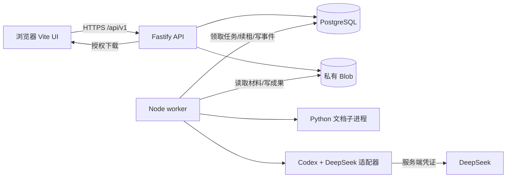

# M1 统一技术栈与四人协作基线

状态：供 M1 团队评审的技术方案。产品范围和验收以 `product-prototype/product-specs/`、GitHub M1 issue 为准；本文件固定实现方向和跨模块接口。若需改变选型或公共契约，先在同一个 PR 更新本文件及受影响的接口契约，再合并实现。

## 1. 技术栈

| 层 | M1 选型 | 采用方式 |
| --- | --- | --- |
| 用户界面 | Node.js 22、Vite、原生 ES modules、现有 CSS | 以 `product-prototype/public/` 的交互为起点，逐页接真实 API。新模块用 TypeScript；旧 JS 用 JSDoc 和 `// @ts-check` 渐进检查。M1 不做 React 重写。 |
| Web API | Node.js 22、TypeScript、Fastify、JSON Schema/OpenAPI | 单个 API 服务处理身份、项目、材料、对话、任务查询和后台管理。所有公开接口统一 `/api/v1`。 |
| 持久化 | PostgreSQL 16、SQL migration、`pg` | 用户、项目、版本、任务、租约、参考库、审计和 outbox 存关系库。正式运行数据不再写到原型的 JSON 文件。 |
| 大文件 | Azure Blob Storage；本地开发使用 Azurite | 原件、OCR 派生文件、Word 成果和受控 prompt 正文使用私有容器。数据库只保存引用、hash、版本和授权范围。 |
| 后台执行 | 独立 Node.js worker 进程 + PostgreSQL 任务表/租约 | API 在事务中创建任务及事件；worker 用 `FOR UPDATE SKIP LOCKED` 领取，定期续租，崩溃后按检查点恢复。M1 不另引入 Redis/BullMQ。 |
| 文档处理 | Python 3.11+；`python-docx`、`pdfplumber`/`pypdf`、`openpyxl`、`pypdfium2`、Tesseract | 复用 `product-prototype/python/` 与 `backend/` 中可验证的解析、OCR 和 Word 逻辑，通过受控子进程传入文件引用/结构化清单，输出版本化 JSON；不让 Python 直接改业务数据库。 |
| AI 接入 | 隔离的 Codex 执行进程、DeepSeek 适配器 | 以 #16 的真实协议联调结果确定 Codex CLI / app-server 接口和准确模型 ID。适配器统一记录请求、重试、usage 与结构化输出；凭证只在服务端。联调未通过不启用真实更新。 |
| 部署 | Docker Compose、Nginx + TLS、Azure VM | 基于现有 `deploy/vm/` 演进为 web/api/worker/PostgreSQL/Azurite(仅开发) 的独立进程。生产 Blob 使用 Azure 服务；密钥由部署环境注入。先保持单区域部署，后续再按负载拆分。 |

版本号为兼容基线；具体补丁版本由 lockfile、容器镜像 digest 和部署清单锁定。短信供应商、DeepSeek 实际模型 ID、存储地域与保留期限必须在真实接入时记录，不在代码中猜测。

## 2. 一张图看边界



浏览器只负责输入、展示和显式操作。API 是身份、权限、版本和任务提交的权威入口。worker 不接受浏览器直接调用。Python 只处理文件和结构化文档数据。规则包和参考库在服务端选用；个人上传材料不会自动进入公共参考库。

现有 `product-prototype/server.mjs` 的内存队列、JSON 账号/项目、演示短信和模拟积分只能作为交互与算法参考；`backend/server.py` 是旧 Cowork 路线，不作为 M1 第二套线上 API。M1 是平台承担成本的受控试用，记录真实 token 和用量，但不创建模拟余额或扣费。

## 3. 首批必须固定的契约

四个人从同一份 OpenAPI 及数据库迁移工作。公共 DTO 的字段、枚举、错误码在 API 仓库目录定义并生成前端类型；不得在页面和 worker 各自复制枚举。实现目录建议如下：

```text
apps/web/            # 现有产品 UI 逐页迁移；唯一 API client
apps/api/            # Fastify 路由、鉴权、权限、OpenAPI
apps/worker/         # 领取任务、编排、检查点、模型调用
packages/contracts/  # JSON Schema/OpenAPI、枚举、错误码、事件格式
packages/domain/     # 与 HTTP/数据库无关的事实、适用性、规则判断
python/              # 文档解析、OCR、Word 生成与结构化输入输出
db/migrations/       # 单一顺序的 SQL migration
deploy/              # Compose、Nginx、部署与回滚
```

这是一条迁移目标路径，不要求先移动所有原型文件。新代码进入目标目录；移植原型逻辑时在 PR 中写明来源、覆盖边界和旧入口处理方式。

### 最小数据和 API 契约

| 契约 | 固定规则 |
| --- | --- |
| 身份 | `user_id` 为所有个人项目资源的 owner；Cookie 为 HttpOnly、Secure、SameSite，写操作校验 CSRF/Origin；服务端逐对象校验 owner。 |
| 项目输入 | `project_id`、`input_revision`、`input_hash`；每次提交执行锁定不可变输入清单。更新草稿用 revision 乐观锁，冲突返回 409。 |
| 材料 | `material_id` + `material_version` + SHA-256 + Blob 引用 + role；上传完成时服务端校验大小和 hash，才进入解析队列。 |
| 事实/证据 | 值与 `entity`、期间、口径、单位、材料版本、原文锚点、置信/确认状态绑定；OCR 不确定数字不能变成已核实事实。 |
| 任务 | `run_id`、`execution_request_id`、`input_revision/hash`、`state`、`stage`、租约和检查点。用户重复提交同一键只得到同一 run；不同输入返回 409。 |
| 事件 | 每条含 `event_id`、`schema_version`、`trace_id`、`run_id`、序号、时间、阶段、状态；数据库事务同时写业务变更与 outbox。UI 按事件游标恢复。 |
| 模型调用 | `logical_call_id`、`attempt_no`、供应商请求 ID、模型/规则/模板版本、prompt 引用、真实 usage 与来源。usage 缺失为 `unknown`，不得写 0 或按估值冒充实耗。 |
| 成果 | `artifact_id`、`run_id`、文件版本/hash、质量检查结果、授权下载引用；仅成果验证可获取后标记 `succeeded`。 |
| 规则/参考库 | `rule_pack_version`、`reference_version`、`index_release` 在 run 开始时锁定。只有审核发布且授权有效的参考稿可被选用，内部候选不下发普通用户。 |

第一批 OpenAPI 至少覆盖注册/会话、项目草稿、上传完成、预检、执行/取消/恢复、任务事件、成果下载和右侧对话。请求与响应按 `16-数据模型接口与状态机.md` 细化；分页、错误码、时间格式、空值含义在 schema 中写明。新接口不直接暴露现有原型的文件路径、运行目录或内部参考稿 ID。

### #6 首批契约与可运行骨架（2026-09-24）

仓库根目录用 npm workspaces 管理 `packages/contracts/` 与 `apps/api/`，不接管现有 `product-prototype/` 的独立包。`packages/contracts/src/index.ts` 以 TypeBox 定义可导入的值、TypeScript DTO、JSON Schema 和 OpenAPI 操作目录；`examples/synthetic.json` 与 `npm run check:contracts` 验证合成样例。`apps/api/` 的 Fastify 服务只实现 `/health` 和 `/openapi.json`，其余 `/api/v1` 路由在 OpenAPI 标为 `contract-only`，不能当作已实现或上线。Node 22 环境从干净检出运行 `npm ci && npm run build && npm run check:contracts && npm run test:api && npm run start:api`。

公开路径统一 `/api/v1`。产品规格 16 的 `/platform/v1` 是较早的前缀，按本架构与仓库协作约定采用 `/api/v1`；#8 依赖 CTO 对 #6 公共契约的技术验证与集成。Web 材料的账号隔离服务端副本、云端/模型处理、加密、保存/删除和备份清理文案草案及尚待发布决策见 `packages/contracts/WEB-DATA-LIFECYCLE.md`。生产期限、地区和供应商条款仍需发布前确定并实测，骨架不宣称已经做到。

此切片没有持久路由，因此本地 PostgreSQL/Azurite 尚不启动。#8 接入身份、owner、材料、事务/outbox 时再加入数据库迁移、本地对象存储与真实隔离/恢复集成测试；#79 完成日志持久化与检索，#16 确认真实模型标识和协议。关闭浏览器后同一 run 可查询的行为在契约样例中演示，并非已部署验收。Chris、Felix、Xuefeng、Maxy 的字段消费与待实现边界见 `packages/contracts/README.md`。

#6 契约修订采用规格 04 的七类普通材料格式及现有 `project-fields.js` 的 M1 更新材料分区；声明 MIME 不可信，服务端核对真实内容。历史稿识别响应逐字段保留来源、不确定性和报告期集合；公开的项目材料 `ProjectEvent`、运行 `RunEvent` 与仅供受信服务使用的 `InternalObservabilityEvent` 分开。草稿 PATCH 在服务端合并旧值后校验市场/发行方式组合，不能只校验局部 JSON。具体值、错误码与交接说明仍以 `packages/contracts/` 为唯一公共定义；#79 的日志持久化不因本次 DTO 定义而视为完成。

### #79 logging foundation slice (2026-09-24)

`0005_m1_observability.sql` adds append-only operation, snapshot reference, model usage observation, structured error and internal event records on top of #17 queue state/outbox. The internal event writer validates the shared `InternalObservabilityEvent` contract; each event is committed with an outbox reference. Trusted owner-scoped service queries record an access audit. Usage aggregation counts failed attempts but returns null token totals when measured observations conflict, until explicit reconciliation; unknown, pending and conflict remain unresolved. Cached and reasoning subsets are not added to totals. The database binds snapshot references to runs in the same owner's project. Snapshot metadata points to a verified private Blob object but the privileged prompt retrieval workflow, log forwarder, alarm sink, retention purge and real supplier adapter remain release gates. Production execute/cancel/resume stay 501; owned production execute rejections retain requested revision/hash without creating a run. Details and restore guidance are in `apps/api/README.md`.

## 4. 关键流程

### #17 queue implementation slice (2026-09-24)

`0004_m1_durable_jobs.sql` and `apps/api/src/queue.ts` implement PostgreSQL job leases, checkpoints, owner-bound run events and transactional outbox transitions. `apps/worker/` is a separate Node process with an injectable synthetic processor; its shipped CLI refuses production execution. The existing run and event DTOs remain the public contract. The API's real entry point still returns 501 for execute/cancel/resume until #16 provider verification, #79 operation/prompt/attempt/usage/error logs and checked Word delivery are connected. A pending provider attempt pauses on recovery and requires supplier reconciliation before resume. This slice establishes queue mechanics and does not assert real update acceptance. The explicit test-only queue option is for local integration tests, and the existing prototype and Cowork applications are untouched.

`0007_m1_provider_result_reconciliation.sql` appends immutable owner/project/job/run/call/attempt bindings for provider result candidates and observations; it is independent of the concurrent #8 `0006` storage migration. A result is stored as JSON in the private Blob container by content hash; a single candidate with measured, non-conflicting #79 usage is added to the job checkpoint in the same transaction as its observation and outbox event. The worker must read and revalidate that checkpoint result before calling a provider, so a completed attempt is reused after restart. Missing/unknown/conflicting evidence remains paused; a second result hash is retained as a conflict rather than selected. A measured supplier failure ends the run as failed with no automatic retry. A verified `confirmed_not_sent` observation requires an explicit resume and a new attempt number before sending. These seams remain synthetic/internal only and do not enable the production routes or replace Word delivery checks.

1. 用户完成真实短信登录，API 建立会话；前端创建项目草稿并按 revision 保存。
2. 上传经 API 创建受限会话，Blob 接收字节；API 核对 hash 后登记不可变材料版本，worker 解析/OCR 并登记证据锚点。
3. 用户预检和执行时，API 校验 owner、材料、目标市场/品种、规则能力与输入版本；事务内写 run、首次 job event 和 outbox。M1 标记 `billing_mode=platform_trial`。
4. worker 领取任务，保存每阶段检查点；读取锁定的材料、规则、参考库版本；执行 Codex/DeepSeek；每次模型尝试写可追溯 usage 或 `unknown`。
5. Python 生成 Word 修订/清洁版，worker 检查文件完整性、来源和交付清单，再写成果版本与终态。浏览器关闭不改变 run；重开后用 `GET /runs/{id}` 和事件游标恢复。
6. 外部模型、存储或日志故障时，按同一 run 和检查点恢复。已经发出的模型请求先对账，不能直接重发；无法持久化关键事件时停止新的外部调用并告警。

## 5. 四人工作面与交接

| 负责人 | 主改动面 | 必须与谁对齐 |
| --- | --- | --- |
| Chris | `apps/web/`，上传/项目/对话/成果 UI；现有 `product-prototype/public/` 迁移 | Felix 提供 API/OpenAPI，Xuefeng 提供 OCR/解析状态，Maxy 确认业务表单枚举与文案 |
| Felix | `apps/api/`、`apps/worker/` 基础设施、`db/migrations/`、`deploy/`，认证/存储/队列/日志与生产接入 | 三人共同评审第一版契约；负责合入公共 DTO/迁移、部署和回滚 |
| Maxy | `packages/domain/` 的债券业务规则、品种能力、参考库准入与审核数据，历史稿/跨品种更新业务 | Xuefeng 对齐规则包输入输出和参考匹配；Felix 对齐持久化与后台接口 |
| Xuefeng | 解析/OCR/事实抽取、规则适用与匹配算法、无历史稿编制；复用 `python/` 与 worker 的算法模块 | Maxy 审核专业规则与样本；Felix 对齐 worker 协议；Chris 对齐待确认状态 |

共同约定：每项 issue 从 `develop` 建独立分支和工作区，日常 PR 的 base 为 `develop`；`master` 只接收经审核的 `develop` 发布 PR，生产修复从 `master` 分支并回灌 `develop`。具体操作规则见仓库根目录的 `AGENTS.md`。PR 只改自己负责的模块和必要契约。改 `packages/contracts/`、`db/migrations/`、运行状态机或公共规则枚举时，PR 写清迁移影响，并由受影响的负责人 review。迁移文件只追加，不修改已部署版本。以 OpenAPI/schema 样例和固定材料样本联调，避免口头约定字段。规则与模板数据带版本、来源、适用范围和审核状态；任何专业结论由 Maxy 或指定行业审核人确认。

## 6. 开工顺序与首个可集成切片

**第 0 批（并行启动）：** Felix 起 API/数据库/Blob/worker 骨架并提交公共契约；Chris 保留现有 UI 外观，接登录和项目草稿；Xuefeng 固定解析/OCR 的结构化输出与材料样本；Maxy 固定市场/发行方式矩阵、规则包格式和已核实来源。#79 的事件字典与 #16 的模型调用接口须同时定稿。

**首个集成切片：** 真实登录 → 新建项目 → 上传 DOCX/PDF → 保存材料版本 → 提交一个后台 run → 关闭并重开浏览器 → 看到同一状态和成果。先打通这一条链，再让规则/品种和无历史稿分支并行接入。这个切片的模型调用、prompt、attempt、token 和终态进入 #79 日志；其验收先于任何受控用户开放更新。

**PR 交付格式：** 写明关联 issue、改动的契约/迁移、对旧数据的处理、依赖的真实服务、可复现样本及剩余阻碍。前端不能以模拟成功代替服务端确认；模型返回文本不能代替 Word 成果可获取；业务规则不能以未审核资料宣称覆盖。M1 上线门槛仍以 #35 和各子任务的真实验收为准。

## 7. 仍需在真实接入时落定

- 短信供应商与生产回执/限流策略；DeepSeek 准确模型 ID、Codex 接口能力和 usage 口径。
- Azure Blob 容器、部署地域、加密密钥、材料与 prompt 保存期限、备份和删除流程。
- 首批授权的募集书来源与行业审核人，以及大公募、PPN/MTN/CP/SCP、DFI 的真实规则版本和样本。

这些是对应 issue 的交付条件。具体值由接入证据填写到配置和运行手册，不能用演示值作为上线配置。

### #8 数据与 API 切片（2026-09-24）

`db/migrations/0001_m1_owner_data.sql` 和 `0002_artifact_download_grants.sql` 建立个人项目、上传会话、材料版本、不可变输入版本、run、事件、outbox、成果元数据及限时下载授权。`apps/api/` 在可信会话 seam 下实现 owner 限定的项目、材料、输入快照、run 查询与成果读取；Blob 存材料字节。`deploy/local/compose.yaml` 用 PostgreSQL 16 与 Azurite 做合成数据集成验证。实际身份由 #7 注入可信 principal 前，公开个人路由拒绝请求；真实 run 执行由 #17 队列和 #79 日志能力接入前返回 `CAPABILITY_NOT_READY`。测试专用 run staging 只保存 `paused` run/事件/outbox，不发起模型调用。尚未连接的识别、预检、对话、项目事件等能力明确返回 501。生产保存期限、物理清理、备份删除重放和供应商处理证据仍待发布决策，详见 `apps/api/README.md`。

### #7 服务端身份与会话切片（2026-09-24）

在 #8 owner API 基线上，`0003_m1_auth_sessions.sql` 保存 +86 规范化号码、挑战 HMAC、协议版本接受记录、注册幂等事件和可撤销会话；对 `0001`/`0002` 仅追加迁移。生产入口使用数据库中的已验证会话解析 `user_id`，不信任浏览器提交的 owner 标识。15 分钟访问令牌与最多 30 天的轮换刷新令牌仅以哈希入库，分别放在 `Secure/HttpOnly/SameSite=Strict` Cookie；另用可读 CSRF Cookie、请求头回传及严格 Origin 校验保护变更请求。登出撤销后，#8 材料/成果读取也不能沿用旧会话。

短信传输是明确的服务端接口；目前仅本地进程内合成测试实现。生产入口没有供应商适配器，发送与验证保持关闭。供应商身份、审核、地域、凭据注入和真实发送/回执证据具备后，才能配置上线；合成测试不表示 #7 实际短信验收。原型仅复用交互语义和 5 分钟/60 秒默认值，不沿用 JSON 账号、演示码或模拟积分。具体配置与升级说明见 `apps/api/README.md`。#17/#79/#16 与完整 Word 交付仍是 #6/#8 的独立验收依赖。
