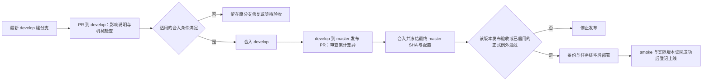

# BondBuddy：从 PR 到发布部署

适用对象：所有开发者、代码审查者、发布负责人、业务复核人员和部署操作员。适用系统：M1（`apps/`、`packages/`、`deploy/m1/`）。根 README 中旧 Cowork 的 `backend/`、`web/`、`deploy/vm/` 部署命令不适用于 M1。

本文整理已有分支约定、2026-11-01 质量要求及 2026-11-03 修改清单，不批准新的质量豁免。**提交 PR、合并代码、取得发布资格、部署成功是四个不同结果。** CI 绿灯或 Issue 关闭不能替代后三者。

## 1. 先看当前启用状态

核对日期：2026-11-04（Asia/Shanghai）。下表是检查时的事实，发布人每次发版须重新核对。

| 项目 | 核对结果 | 对开发者的影响 |
| --- | --- | --- |
| `develop` | `7f3c4ac77ef2128a5c9793bc31a20f2b8c84c9e5` | 从最新远端创建分支；此 SHA 不是生产版本证明 |
| `master` | `9b2049914c2f70da21324663beb5ae55335ef757` | 正常部署只用经发布 PR 合入的 master 完整 SHA |
| 质量修复 [#871](https://github.com/ITSophiaXu/BondBuddy/pull/871) | Draft；候选 `dca895ff66b71efb9f960ab10f70e253356e6074`，未合入 | 新机械门禁、交付检查和发布凭据拦截在修复分支，不代表线上已启用 |
| GitHub 保护 | develop/master 均 `protected: false`；两分支均无 `prospectus-quality.yml` | 当前不能靠 GitHub 自动阻止违规合并；脚本存在也不等于必需检查已配置 |
| 三档分类、R2 分层、跨 SHA 证据复用 | v2 设计，未接入执行器 | 不能填写虚构的 `prospectus-regression-gate=passed`，不能借另一 SHA 的凭据部署 |
| 生产基线 | 仅 Web 来源已核；API/worker/egress 版本未完整绑定 | 不得以 master 或 Web SHA 代替全部服务的生产版本；首次自动放行基线尚不成立 |

今天可以继续提交 PR、审查和执行现有 CI。涉及生成敏感路径的 PR 按下文保留在分支。**新的例外发布尚无完整执行路径；普通 CI 全绿不构成例外放行记录。** 本文合入也不会自动开启保护、修改部署脚本或授权上线。

## 2. 全流程与交接人



| 环节 | 谁负责 | 必须交给下一环节的内容 |
| --- | --- | --- |
| 开发 PR | PR 作者 | 改动目的、影响路径、测试证据、迁移/契约、待验收项 |
| 影响与例外判定 | 工程负责人（待 Lei 指定） | 当前 head/base、逐文件分类、理由、确认人；作者不能自签门禁豁免 |
| 发版 PR 与版本冻结 | 每次发布明确一名发布负责人（人员待指定） | 上一已放行版本到候选的累计差异、最终 SHA、配置、验收及回退方案 |
| 独立业务复核 | Sophie；代班人待指定 | 与实际成果 hash 绑定的财务、章节及逐页复核记录 |
| 保护配置 | Sophie 交接仓库管理员/所有者 | 实际开启的规则、可信状态来源、拒绝违规合并的验证；取决于权限和仓库归属/套餐 |
| 构建、切换、读回 | 受控发布/部署操作员（每次记录姓名） | 镜像引用、原凭据、备份、迁移、smoke、实际运行版本及部署结果 |

Sophie 的业务复核与管理员交接是两个职责。人员未指定时记录缺项，不能由生成模型代签。

## 3. 开发者提交和合入 PR

1. 从最新 `origin/develop` 建独立分支。普通功能、修复、文档和基础设施 PR 都以 `develop` 为 base，不直接推 develop/master。紧急生产修复才从 master 建分支，评审后回合 master，并把同一修复带回 develop；紧急身份不自动免除质量要求。
2. 在 [PR 模板](../.github/pull_request_template.md) 填清改动及影响：输入/原稿采用/锁定、报告期、prompt/知识/模型、解析/Word、检查器/发布脚本、依赖、契约/迁移。运行时读取的 `.md` 是生成输入，不能当普通文档免测；普通测试/文档/图片不计入业务路径分类，但检查规则的修改仍须独立审查。
3. 运行 `npm run build`、`npm run check:contracts` 和相关测试；Linux worker/沙箱/数据库等测试在对应 Linux 环境执行。以 PR 实际触发的完整 CI 结果交接，不挑选成功项。门禁接入后的固定清单见下一节；缺少环境、样本、渲染、必需结果或出现失败/跳过时不能写成通过。
4. 合入前 fetch 并按 [AGENTS.md](../AGENTS.md) rebase 最新 develop。head/base 改变后重新核对影响和当前结果；记录 CI 实际检查的 SHA，不能只看绿色图标。GitHub strict up-to-date 的目标配置尚待管理员落实，merge queue 为可选。
5. 满足适用的合入规则才合并。普通代码审查沿用 AGENTS 的既有约定；下文敏感路径、独立业务验收和门禁规则审查优先于旧的“自测后直接发布”口径。合并以后在 PR 中记录 merge SHA，发布另行交接。

有些 checkout 的 fetch 配置只跟踪 develop。需要核对 master 时可显式获取两个引用，不能把未刷新的 `origin/master` 当最新版本：

```bash
git fetch origin refs/heads/develop:refs/remotes/origin/develop refs/heads/master:refs/remotes/origin/master
```

### 限时过渡期间的 PR 去向

Lei 已选择方案甲及三档过渡：不可放行的改动留在自身分支，不进入 develop，避免整树发版时被带上。**仓库所有者同意、工程负责人、完整生产基线、固定分类脚本及到期拦截仍待落实；以下是判定依据，不是已经可用的自动豁免。** 需确认事项不得由作者勾选代替确认。

| 档位 | 覆盖范围 | 合入/放行要求 |
| --- | --- | --- |
| 不可放行 | `apps/worker/src/` 中 `file-authoring-*`、`codex-adapter`、`authoring-material-tools`、`material-parser`、`model-generation-router`、`unified-input`、`historical-generation-input` | 留分支等金样，不因机械全绿合入 develop |
| 不可放行 | `python/bondbuddy_file_authoring/`、`python/bondbuddy_document_parser/`、`knowledge/material-drafting/`、实际加载的 model catalog、`python/requirements*` | 同上 |
| 不可放行 | `apps/web/src/` 中 `source-prospectus`、`source-format-template`、`prospectus-panel`、`form-model`；`apps/api/src/` 中 `unified-authoring`、`prospectus-import`、`prospectus-versions`、`original-material-upload`、`update-workspace` | 同上 |
| 需确认 | `apps/web/src/main.ts`、`apps/api/src/server.ts`、`packages/contracts/`、`packages/domain/`、`db/`；`scripts/` 下门禁/验收脚本、`deploy/m1/scripts/`、`.github/workflows/prospectus-quality.yml`、`deploy/m1/Dockerfile` | 工程负责人逐文件确认未触输入链、未放宽检查、未改 CODEX_VERSION/worker 阶段依赖；迁移/契约纯新增。涉及输入锁定表/字段则转不可放行 |
| 可放行 | 其他已确认没有上述直接或传递影响的改动 | 机械通过；这只是单项改动的资格，整个发布版本仍须核累计差异 |

未知影响先查清再分类；根 lockfile/混合依赖改动不能直接归为“其他”。只收紧检查、不改生成行为的门禁自身变更可以逐文件申请已定例外，由独立工程负责人确认；不能整包豁免包含 prompt、新 UI 或契约行为的 #871。

[#870](https://github.com/ITSophiaXu/BondBuddy/pull/870) 只有一次性例外：必须同时带上修复 `25ffe82bec896232f88e304042b0dda8804825da`，其余文件由工程负责人逐项确认并留记录。检查时 develop/master 尚未满足此修复条件，不能因为 #870 已合并就直接随发版放行。

过渡在第一次完整金样通过或 **2026-11-27** 失效，以先到者为准；失败后挑一次成功结果不算验收。截止日期已定，精确时刻仍须在启用记录中明确，不能自行延长。首次拆分合入、目录/逐章影子模式、正式产品例外记录，以及紧急通道均未批准实施；本文不替代这些批准或到期执行器。

## 4. 哪些检查自动跑，哪些需要交接

| 层次 | 当前实现/执行方式 | 能证明什么 |
| --- | --- | --- |
| 机械 | #871 的 `npm run quality:prospectus:validate`；GitHub workflow 在 develop/master PR、push 和 merge_group 触发，无 paths 过滤 | 固定构建、契约、迁移、API、真实 Chromium→隔离 API/PostgreSQL/Azurite、worker、Word/渲染及部署反例；不调用模型，不产发布凭据 |
| 交付 | #871 的服务端输入不变量及模型完成后的宿主 Word 检查 | 遗漏原稿、灾难性删减、结构/格式/双稿或明确报告期冲突会拒绝交付；不替代全文财务和视觉审核 |
| 真实发布验收 | 隔离流程先跑实际金样，独立人审后，由受控 Linux publisher 验证私有证据 | 准确 commit/tree 的完整验收；不是每次 push 自动触发模型 |

普通 develop/master 目前没有新机械命令和 workflow；开发者不能在缺脚本时勾选“已通过”。接入后的环境参照 [#871 固定 workflow](https://github.com/ITSophiaXu/BondBuddy/blob/dca895ff66b71efb9f960ab10f70e253356e6074/.github/workflows/prospectus-quality.yml)：Linux、Node 22、Python 3.11、PostgreSQL 16 一次性本机库、Docker/Azurite、Chromium、LibreOffice 和字体等。测试库必须隔离，不能使用生产数据库。

本次已获授权的是 `rq-202509` 三份材料发送到**当前配置的 GitHub Copilot Enterprise，仅用于本次隔离质量复验**；不构成所有开发者未来任意复验的持续授权，也不能扩展到其他客户材料/供应商。后续运行须确认其落在已有授权范围。完整财务、章节及逐页人审由 Sophie 负责，差异人审尚未获准。复验私有成果和复核记录留在受控位置，不写入仓库或公共 CI artifact；原始失败证据保留，不重跑挑最好结果。

v2 计划把 R2 分为输入核对、保存的 operations 重放、真实模型三层：一般 PR 按影响运行前两层；真实层在发版前执行，prompt/模型 PR 合并前也执行。**此分类执行器尚未实现，不能据此签发免测或复用证据。**

管理员接入时须解决作用域差异：v2 设计中，普通 develop PR 与 master 发版 PR 应有 `prospectus-quality-mechanical` 加待实现的 `prospectus-regression-gate`；`prospectus-release-acceptance` 留给准确发布候选。#871 的旧 v1 publisher 文档仍建议两个分支都必需 release-acceptance。不能直接照旧文档把每个普通 PR 都变成真实生成任务，也不能提前把尚不存在的检查设为已生效；管理员须在启用记录中明确最终规则并做拒绝演练。

## 5. 发布负责人：形成一个可以部署的版本

1. 记录上一已放行版本及生产逐服务镜像/版本，比较它到候选版本的**整树累计差异**，包含已经进入 develop 的改动。首次生产基线无法核实时不能用最近一条 PR 或 master 猜测基线。
2. 开 `develop → master` 发布 PR，附范围、迁移/配置、三档判定及所需确认、检查结果、真实验收或正式例外依据、回退方案和负责人。先解决所有阻碍合入的条件。上线频率尚未确定，不默认每周两次。
3. 经适用审查合入后，固定最终 master 的完整 40 位 SHA、tree 和实际运行配置。**合入 master 不是自动部署。** PR head、GitHub test-merge、queue SHA 与最终 master SHA 可能不同；变更后重验当前版本。
4. 走实际已经启用的发布路径。#871 v1 正常路径要求该最终 commit/tree 的真实金样和独立人审；`validate` 不能代替。v2 跨 SHA 复用和限时例外的凭据/执行器未启用时，不得用人工 JSON、旧 SHA 的绿灯或一条审批评论冒充可部署凭据。
5. 受控 Linux 发布者核验证据、运行完整固定清单、复查源码未变，再签发当前凭据和 GitHub 状态。之后改代码、重建不同来源镜像或改变受验配置，停止并重验。

**仅在相应脚本已合入发布版本、受控身份与独立验收已就绪后，使用以下命令。** 当前 master 缺少这些门禁脚本，不应复制执行或从旁边分支借脚本/凭据冒充该 master 已验收。

```bash
# 干净 Linux checkout，已定位到发布记录中的最终 master 完整 SHA。
release_sha="$(git rev-parse HEAD)"
export BONDBUDDY_TEST_PYTHON="$(command -v python3)"
export BB_TEST_DATABASE_URL='<一次性本机 bb_prospectus_quality 数据库连接>'
export BB_PROSPECTUS_ACCEPTANCE_FILE='<独立复核人员控制的本版本证据 JSON 绝对路径>'
node scripts/publish-prospectus-quality.mjs "$release_sha"
```

publisher 会先写 pending，再运行完整 gate、验证凭据和源码，成功后写 `prospectus-release-acceptance=success`；失败不放行，不能手动补绿色状态。该命令**验证已完成的真实生成/复核证据，不负责启动真实模型或替人签认**。GitHub 发布凭证不能交给模型进程。

现行 v1 的普通发布凭据最长 **24 小时**；验收验证器要求**人审记录**距今不超过 7 天，且人审在模型完成后。v2 的“从真实生成完成开始计算根证据 7 天，复核不刷新”尚未实现，不能宣称代码已经强制这一起点。v1 任意新 commit/tree（含文档提交、合并提交）都需新的准确版本验收；跨 SHA 复用仍是待落地方案。

## 6. 部署操作员：构建、切换和确认成功

以下是 #871 门禁接入后的受控 M1 路径。接入前，旧脚本没有质量凭据/四镜像 revision 拦截；它们能运行不等于当前版本获准发布。首次切换还必须准备生产旧版实际可用的回退方案，不能伪造其从未获得的通过凭据。

1. 构建机和目标机均使用最终 SHA 的干净 checkout。脚本与 Compose 来自执行 checkout，仅传 `deploy.sh <sha>` 不足以证明脚本本身也是该版本。固定实际配置并记录 API、worker、web、egress 四镜像的 ID/digest/revision；多种 worker 服务共享 worker 镜像。
2. 构建机验凭据后导出镜像，通过既有受控路径传输镜像、源码和原凭据；目标机加载。也可在目标机构建，但同样必须通过门禁。导出包不是发布授权本身。

```bash
export BB_RELEASE_QUALITY_RECEIPT="$PWD/.local/prospectus-quality.json"
bash deploy/m1/scripts/export-images.sh "$release_sha" '<镜像包绝对路径>'
# 目标机：先核对受控传输来源与文件 hash。
docker load -i '<镜像包绝对路径>'
```

3. 操作员持发布锁，核对环境与已有 state 目录；阻止新任务接入/领取，等待原任务安全结束，完成数据库/Blob 备份并确认回读和恢复路径、迁移兼容性及回退版本。`backup.sh` 是独立命令，`deploy.sh` 不自动备份、持锁或阻止新任务。不能为了部署中断真实模型调用；异地备份须验证回读，不以命令退出成功代替。
4. 在目标机显式指定正确 stack 并打开在途检查。实际路径由操作员填写，不新建空 state 冒充原部署历史。

```bash
release_sha='<发布记录中已验收的最终 master 完整 SHA>'
test "$(git rev-parse HEAD)" = "$release_sha" || exit 1
export BB_ENV_FILE='<该生产 stack 已有的 .env 绝对路径>'
export BB_STATE_DIR='<该生产 stack 已有的 state 绝对路径>'
export BB_RELEASE_QUALITY_RECEIPT='<受控传来的原通过凭据绝对路径>'
export BB_DEPLOY_INFLIGHT_GATE=1
bash deploy/m1/scripts/deploy.sh "$release_sha"
```

在途检查只核非 parse 的活动租约，且默认关闭；设置为 1 也不等于已排空全部任务。检测到任务退出 76、计数不可读退出 77；此时不要关闭检查重试。构建后的再次核验用于减小期间新任务进入的风险，人工阻新与排空仍必需。

5. 脚本验凭据与四镜像 revision，执行追加迁移、切换服务并 smoke。正常凭据过期、镜像不匹配或必需检查失败都停止。磁盘检查按四镜像齐全/需要构建分别要求至少 2.5/4 GiB；不能删正在使用的镜像或用户数据凑空间。
6. smoke 成功后，再读回所有实际服务镜像/配置、公开访问、worker 状态和受影响业务，记录结果并恢复接入。#871 的 deploy 脚本在 smoke 成功后保存原凭据到 `state/quality/<full-sha>.json`，登记完整 SHA 和凭据 hash。`state/current` 在 smoke 前已被改写，不能单独作为部署成功证明；当前生产旧脚本的日志也不能充当新格式通过记录。

## 7. 失败和回滚

质量失败保留失败记录，修复后作为新候选重新验收；不能反复调用模型选择最好结果，也不能修改旧证据。v2 的基线对照裁定、紧急通道、Sophie 代班人尚待明确，不能自行执行质量豁免。

部署/smoke 失败不自动回滚。操作员停止后续发布并记录实际状态，按已核兼容方案回退或恢复；不得把 `state/current` 或单条 release/rollback 日志当成功证明。

新门禁的标准回滚只接受**已成功部署提交的原通过凭据**，并核对已有 `releases.log` 的完整 SHA 与同一凭据 hash。其有效期可超过 24 小时，但不能用新造凭据、未发布提交或不同镜像冒充历史版本。

回滚操作员须重新取得同一生产 stack 的发布锁，显式设置并核对环境与已有 state 目录；阻止新任务接入/领取，等待原任务结束或按已验证兼容方案安全处理。`rollback.sh` 不自动持锁、不检查在途任务，不能沿用上次部署的检查结果。

```bash
export BB_ENV_FILE='<该生产 stack 已有的 .env 绝对路径>'
export BB_STATE_DIR='<该生产 stack 已有的 state 绝对路径>'
rollback_sha='<已成功部署且具备兼容回退方案的完整 SHA>'
export BB_RELEASE_QUALITY_RECEIPT="$BB_STATE_DIR/quality/$rollback_sha.json"
bash deploy/m1/scripts/rollback.sh "$rollback_sha"
```

四镜像必须仍存在且 revision 匹配。回滚不还原数据库、不撤销迁移或用户新数据；跨 worker 拓扑的旧版不能直接套此命令，须落实相应 checkout/Compose 及兼容计划。执行后仍须 smoke 和实际版本读回。首次门禁上线前的历史版本没有凭据时，按预先确认的首次切换回退方案处置，不能补造验收。

## 8. 每次发布的最小记录

以下字段可写在发布 PR 的描述或关联记录中；私有证据只记受控引用/hash。未知写“未核实”，不填默认通过。

```text
负责人 / 部署操作员 / 独立业务复核人：
上一已放行版本 / 生产逐服务版本证据：
候选最终 master SHA / tree / 配置版本：
累计差异 / 三档结论 / 逐文件确认 / 例外依据与期限（若适用）：
CI 实际检查 SHA / 必需结果 / 失败与缺失项：
真实运行及独立验收引用（或已正式启用的例外记录）：
发布凭据 hash / 签发与到期时间：
四镜像 ID 或 digest / revision：
备份回读与恢复路径 / 迁移兼容性 / 阻新与任务排空：
回退版本及可用性：
smoke / 实际服务版本读回 / 受影响业务检查 / 恢复接入时间：
最终结论：未发布 / 部署失败 / 已回退 / 部署成功（附证据）
```

## 9. 维护和依据

- [分支与协作约定](../AGENTS.md)、[M1 架构](M1-TECH-ARCHITECTURE.md)。
- [#871 当前候选的质量决定](https://github.com/ITSophiaXu/BondBuddy/blob/dca895ff66b71efb9f960ab10f70e253356e6074/docs/product-decisions/2026-11-01-prospectus-quality-gate.md)、[验收格式](https://github.com/ITSophiaXu/BondBuddy/blob/dca895ff66b71efb9f960ab10f70e253356e6074/scripts/prospectus-acceptance.md)、[受控 publisher](https://github.com/ITSophiaXu/BondBuddy/blob/dca895ff66b71efb9f960ab10f70e253356e6074/scripts/prospectus-quality-publisher.md)。这些是固定版本证据，第 4 节已指出与 v2 的保护作用域差异，不能无条件照搬。
- 2026-11-03 Regression Gate Spec v2 修改清单：本文摘录已选三档与方案甲，保留 owner/人员/启用接线等依赖；未把候选放宽写成正式产品决定。
- 门禁分批合入、分支保护实际开启、生产基线核实或规则获准变更后，同步更新本文、PR 模板及对应执行脚本；每次发布仍需当场核对远端与生产事实。
