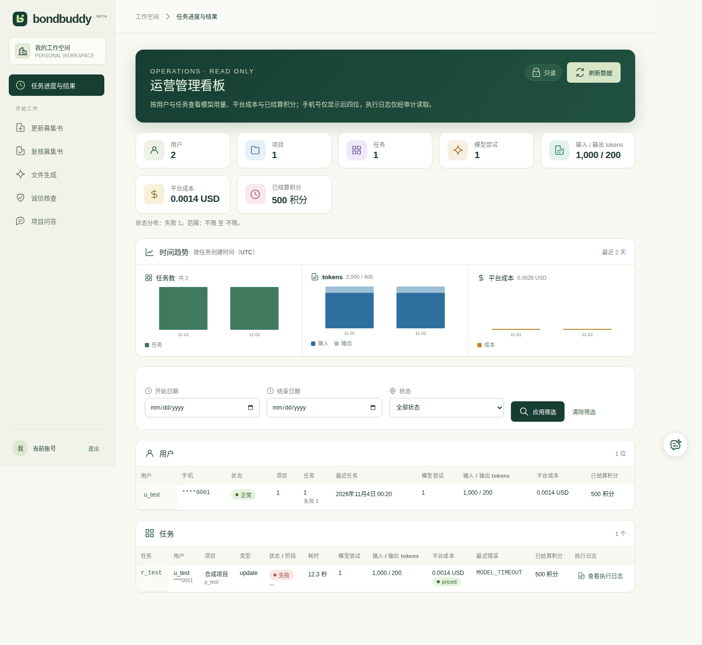
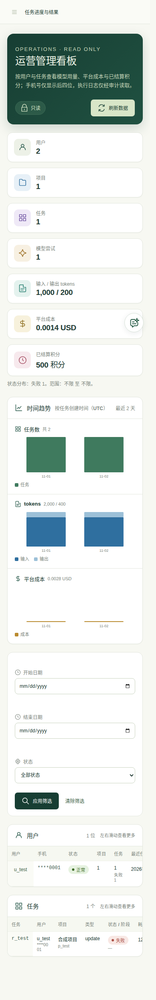

# 运营管理看板（per user × per task）测试与验收记录

日期：2026-11-04（UTC+8）
关联：PR #869（看板本体）、#870（per-attempt Codex 执行日志入口）、#448（用户实测/运营跟踪）
页面：`#/admin/dashboard`
E2E：`apps/web/tests/admin-dashboard.spec.ts`

> 本文所有账号、任务、tokens、成本、积分均为 **synthetic** 测试夹具，不代表真实客户或真实供应商用量。

## 1. 范围

只读运营视图，按 **用户** 与 **任务（run）** 两个维度展示明细：

- 汇总：用户数、项目数、任务数、任务状态分布、模型尝试数、输入/输出 tokens、平台成本（单币种合计）、已结算积分。
- 用户表：`user_id`、**脱敏手机号（仅后 4 位）**、状态、项目数、任务数/状态分布、最近任务时间、模型尝试、tokens、成本、已结算积分。
- 任务表：`run_id`、用户、项目、`task_kind`、state/stage、耗时、模型尝试、tokens、成本与定价状态、最近错误码、已结算积分、**执行日志入口**。
- 交互：按用户点选过滤、日期范围/状态筛选、keyset 分页、刷新、执行日志查看与下载。
- 无 `log_reader` 权限时只显示"无运营权限"提示，不暴露数据。

## 2. 接口

| 方法 | 路径 | 说明 |
|---|---|---|
| GET | `/api/v1/admin/dashboard/overview` | 汇总 |
| GET | `/api/v1/admin/dashboard/users` | 用户明细（keyset 分页） |
| GET | `/api/v1/admin/dashboard/tasks` | 任务明细（keyset 分页） |
| GET | `/api/v1/admin/dashboard/access` | 轻量权限探测（账号页据此显示入口） |
| GET | `/api/v1/admin/exec-logs/{attempt_id}` | 单次 Codex attempt 的私有执行日志（审计读取） |

- 参数：`from`/`to`、`user_id`、`state`、`cursor`、`limit`（默认 20，上限 100）；非法参数 422。
- 鉴权：全部 `log_reader` operator；非授权统一 **404**（不泄露资源存在性）；读取走 `audit`，`cache-control: no-store`。
- 手机号：API 仅返回 `****dddd`，契约用正则 `^\*{4}[0-9]{4}$` 强约束，完整号码不出后端。

## 3. 数据来源

- 用户/项目/任务：`bb_users`、`bb_projects`、`bb_runs`。
- 用量与成本：`bb_call_usage_effective` → `bb_platform_cost_ledger`（tokens、`pricing_status`、`cost_amount`、`currency`）。
- 计费：`bb_credit_events`（`kind='settle'` 的已结算积分）。
- 执行日志引用：`bb_codex_exec_logs`（#870，私有 Blob + 不可变引用）。

## 4. 测试证据

### 4.1 E2E（Playwright，mock API）
`apps/web/tests/admin-dashboard.spec.ts` —— **4/4 通过**：

1. 汇总卡与两张表正确渲染（tokens `1,000 / 200`、成本 `0.0014 USD`、积分 `500 积分`；手机 `****0001`；任务行含 `失败`、`12.3 秒`、`priced`、`MODEL_TIMEOUT`）。
2. 执行日志面板：显示 `2,048 字节`、`超出上限，已截断`、sha256、`[stdout]` 内容；点击下载得到 `exec-a_test.log`。
3. 点选用户 → 后续请求带 `user_id=u_test`；日期/状态筛选带 `from=2026-11-01&state=failed`；点"加载更多任务"带 `cursor=t2` 并追加行。
4. 无 `log_reader`（接口 404）→ 显示"无运营权限"提示，且不渲染任何指标。

### 4.2 单元/集成
- Web 单测：971/0（含该页 7 条用例）。
- API 单测：10/10（dashboard + exec-log 鉴权/脱敏/分页/审计）。
- 契约：`check:contracts` 通过。
- **真实 PostgreSQL 16 聚合验证**：插入 synthetic 的 user/project/input/run/job/attempt/usage/runtime/rate/credit 后，三个查询返回
  `tasks=1`、`failed=1`、`model_attempts=1`、`input_tokens=1000`、`output_tokens=200`、
  `cost_amount=0.0014000000 USD`、`credit_settled_points=500`，与手算一致。
- PG 集成（#870）：4/4（`BB_TEST_EXEC_LOG_DATABASE_URL=... node --test apps/api/dist/exec-logs.pg.integration.test.js`）。

### 4.3 CI
合并 PR 时 GitHub Actions 五项检查（core-linux / linux-integration / cli-review-linux / desktop-ux / fixed-credits-linux）**全部通过**。

## 5. 截图

### 桌面 1440×960


### 手机 390×844


## 6. 复现命令

```bash
# 1) 构建 workspace 包（Vite dev 需要 dist）
npm run build -w @bondbuddy/contracts
npm run build -w @bondbuddy/domain

# 2) 跑 E2E 并输出截图
cd apps/web
BB_UX_EVIDENCE_DIR="$PWD/ux-evidence/admin-dashboard-20261104" \
  npx playwright test tests/admin-dashboard.spec.ts --reporter=list

# 3) 真实 PG 聚合验证（可选）
#    先对 bondbuddy_test 跑迁移，再调用 adminDashboardOverview/Users/Tasks
```

## 7. 已知限制与待办

- E2E 使用 **mock API**；真实登录/真实 operator 授权/真实数据的浏览器闭环尚未自动化（本地可用真实预发布环境手动走查）。
- 看板目前**没有导航入口**（仅 `#/admin/dashboard` 直达 + 账号页"运营看板"链接），是否加入运营菜单待产品确认。
- 多币种混合时 `cost_amount` 求和、`currency` 为 null，需人工按来源核对。
- 执行日志为私有 Blob、`log_reader` 审计读取；**尚无自动保留/清理策略**（20 MiB/attempt 上限），建议并入现有日志保留任务。
- 手机号仅后 4 位；如需支持按完整手机号检索，应另立受审计的运营接口，不在本页暴露。


## 8. UI 升级（2026-11-04）

- **Hero + 只读徽章**：深绿渐变标题区，带「只读」与「刷新数据」。
- **7 个带图标的 KPI 卡**：用户 / 项目 / 任务 / 模型尝试 / 输入·输出 tokens / 平台成本 / 已结算积分。
- **新增「时间趋势」按天图表**（内联 SVG，无新依赖）：任务数、tokens（输入/输出堆叠）、平台成本；数据来自 `AdminDashboardOverviewResponse.daily`（**additive 可选字段**，默认最近 14 天，按任务创建时间 UTC）。
- **表格专业化**：状态/定价徽章、等宽 ID/错误码、数字右对齐、失败/完成分布副文本、移动端「左右滑动查看更多」提示。
- **筛选卡**：日期/状态字段带图标；**执行日志面板**：深色代码区 + 字节/截断/sha 信息 chips + 下载/关闭。
- **移动端**：卡片与图表单列、表格横向滚动。
- 上述截图为升级后的 **synthetic 数据**真实渲染；E2E 4/4、web 单测 971/0 均通过。
