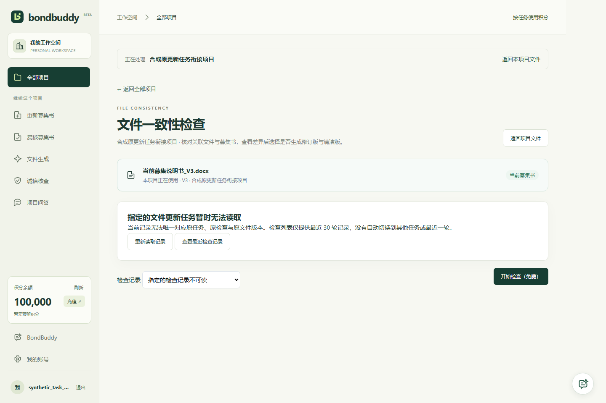
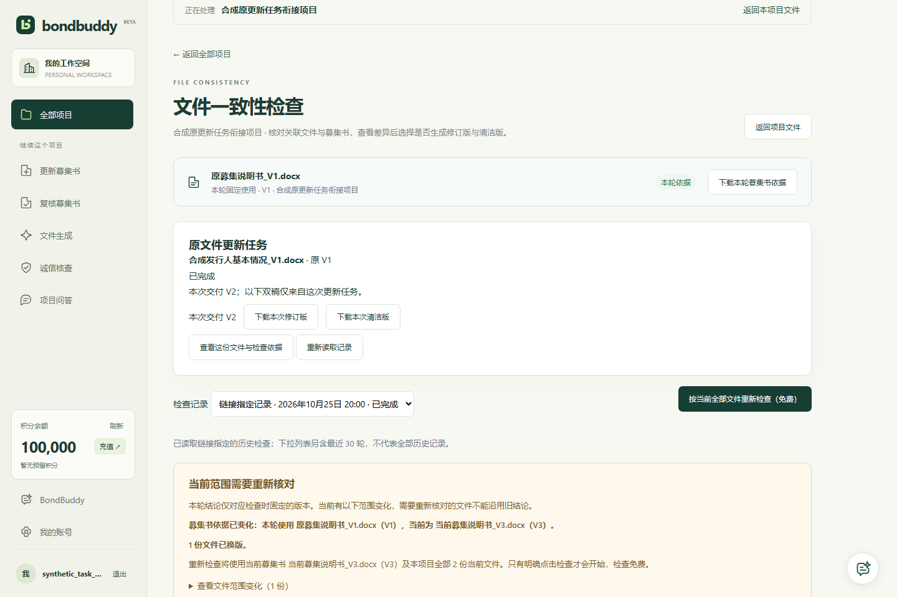

# 桌面 UX milestone：历史更新任务续看与原双稿下载

2026-10-26。基于最新 `develop@4d163e67`（已含 PR #745、#746），承接上一轮 `7160c519`，在本工作区无冲突移植为 `ce3f2a8d`。本轮只交付下述增量，不重做已发布内容。

## 交付范围

更新任务入口只携带 `update_run`。此前原检查移出最近 30 轮后，从全部项目或项目文件的任务历史打开旧更新任务，页面无法找回其原检查。上一轮只解决了明确检查 `run` 的链接。

本轮闭环：**任务历史 → 原更新任务与原检查 → 原文件 V1、本次交付 V2 → 下载本次修订版/清洁版 → 刷新后仍为原任务**。当前 V3 或其他重试成果不能替代原交付。

| 验收项 | 交付要求 |
| --- | --- |
| 历史发现 | 两个既有任务入口均可读取最近 30 轮以外的原检查 |
| 关联准确 | 仅最近集合完全缺少该更新记录时反查；原任务、检查、文件、来源及 hash 精确核对 |
| 下载准确 | 沿用既有授权及版本/hash/字节校验，原任务修订版和清洁版分开下载 |
| 失败边界 | 缺失、越权、歧义、无效响应或冲突参数明确失败，不切最近、不借别的任务成果 |
| 读取恢复 | 可明确重读；活动旧任务短暂失败保留准确快照并提示，恢复后继续轮询；403/404 不保留旧动作 |
| 只读操作 | 打开、刷新、下载只 GET；工作区 404 也不自动创建，不创建检查、更新或费用 |
| 收口 | 桌面主流程、错误恢复、定向回归、API/契约及构建通过，保存增量提交后结束 |

手机优化、全历史分页、长期监控、收费和任务执行语义变更不纳入本轮。

## 实现及界面依据

新增 `GET /api/v1/projects/:project_id/project-files/updates/:run_id/check`，返回既有 `{check: ProjectFileCheck}`。API 核对账号、项目、原 patch run、acceptance、原检查及固定来源；无匹配或歧义统一 404。无迁移、费用变更或新 DTO，OpenAPI 同步登记。

两个前端入口复用原任务面板、文件行和下载按钮，沿用 `docs/product-decisions/2026-10-02-generated-word-download.md` 与当前全站 BondBuddy 决定。新 helper 只补读取，仍由原 `updateTarget` 核验准确文件、检查结果及联合参数；原未知提交请求不变。界面依据为 PR #745 已交付布局及上一轮 `7160c519`，没有新增页面、步骤或导航。

## 同尺寸桌面对照

以下均使用完整应用、同一合成旧任务及 1440×960 视口；没有向旧版注入新组件。旧版为独立工作区的 `ce3f2a8d`，本轮实现的源码 SHA-256 及验证记录见 [verification.json](verification.json)。

| 状态 | 旧版 | 本轮实现 |
| --- | --- | --- |
| 旧任务超出最近 30 轮 | 无法读取指定任务 | 准确显示原文件 V1、本次交付 V2 和该任务的两个下载按钮 |
| 原任务缺失或不可读 | 说明把原因归于最近 30 轮 | 显示准确读取失败原因，可重新读取，保留既有返回最近记录入口 |
| 页面结构与操作位置 | 已交付任务面板及文件行 | 沿用相同布局，无新增页面、导航或步骤 |

旧版缺失状态：



本轮读取原 V2 成果：



本轮任务缺失状态：


## 验证

最终结果见 [verification.json](verification.json)。浏览器使用真实前端与合成 HTTP 数据；API 使用 Fastify 注入及严格合成 SQL pool。截图按桌面 1440×960 对照。

- 桌面定向回归：107 通过、0 失败、1 个既有可选截图 collector 跳过；含本轮新增 18 项全部通过。
- API 定向回归：38 通过（27 项新增、11 项原历史检查回归），0 失败。
- 全工作区构建及契约检查通过；构建仅保留既有 Vite bundle 体积警告。
- 独立旧版基线 collector：1 项通过，确认旧链接问题；不是修复版的通过数。
- 首轮浏览器测试的唯一失败来自旧夹具缺少动态缺失 acceptance 的反查 GET 404。修正夹具并保留、加强原断言后，完整重跑全部 108 项选定用例通过上述验收；原始失败日志保留。
- 最终回归期间源码和测试文件均未修改，10 个文件的 SHA-256 复核一致；构建、API、契约检查对应的产品源码未再变化。

不以合成下载字节证明 Word 内容、可编辑性、真实 Blob/账务/模型/worker 或业务用户验收。

复验命令：

```powershell
npm run build
npm run check:contracts
node --test apps/api/dist/project-file-update-history.test.js apps/api/dist/project-file-check-history.test.js
```

在本工作区启动 Vite，设置 `BB_E2E_BASE_URL` 及本机浏览器 channel 后，在 `apps/web` 运行：

```powershell
npx playwright test tests/consistency-update-history.spec.ts tests/consistency-task.spec.ts tests/consistency-history.spec.ts tests/consistency-reading.spec.ts tests/consistency-confirmation.spec.ts tests/file-consistency-workbench.spec.ts --grep-invert "at 390"
```

本轮交付后停止自动扩展。新改动仅本地提交，未推送或部署。
