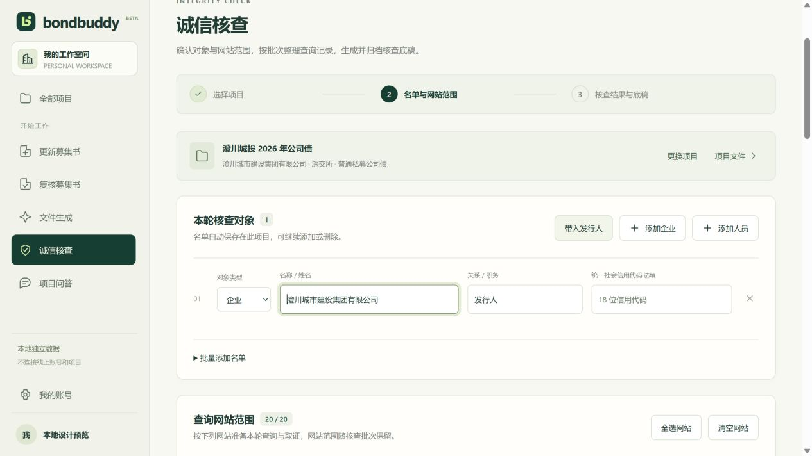
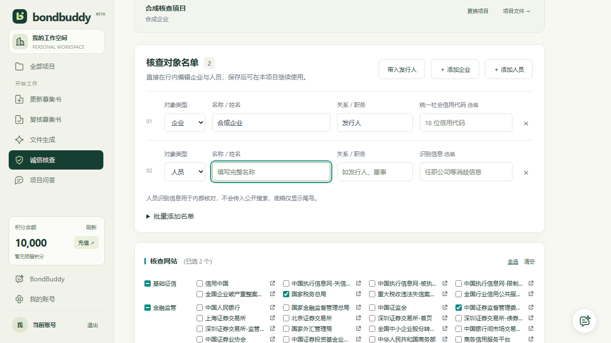
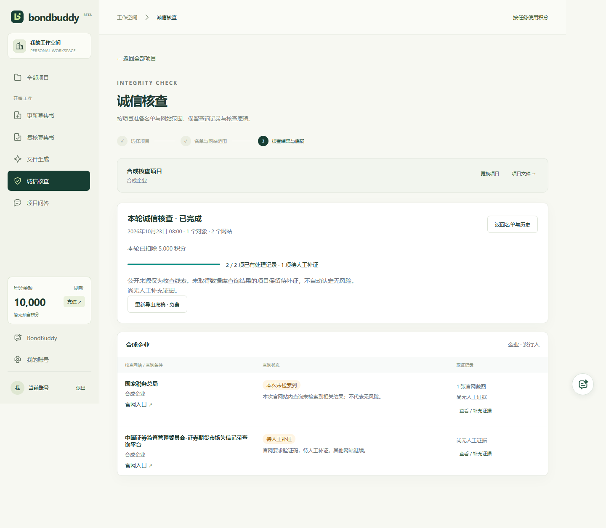
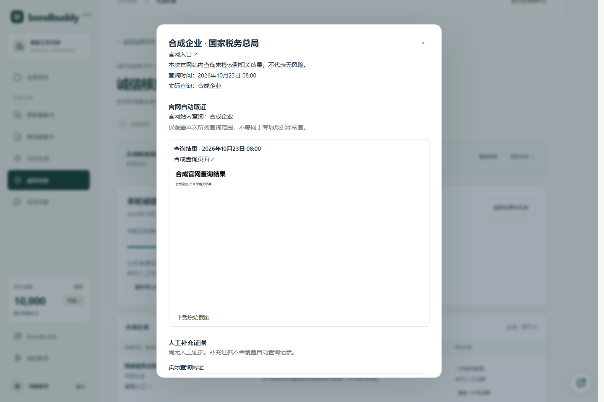

# 诚信核查官网取证交付

Issue #727。开发基线 `develop` `1ab2875865b77ba1000b1cd2a1ff40416b263811`。

## 已实现

- 新轮次按对象、网站打开独立 Chromium，输入公开全名并查询，保存结果页面和可打开正文的截图及可见文字。验证码、登录、访问受限和无法识别的查询页标记待人工补证，其他站点继续。
- 查询请求须包含完整查询词，结果页须回显该查询且可见结果已变化并稳定。空查询、过期零结果、站点维护、备案号中的错误码数字不能当成本次查询结果。
- 自动证据先持久化再执行 AI 辅助解读；逐字引用校验，保留同名主体及影响待核实口径。中断恢复复用原截图，不重复查询。
- 截图私有存储，下载校验项目/轮次归属、大小及 SHA-256。截图损坏会拒绝下载。无权限账号及同账号其他项目不能读取。
- 企业和人员 Word 均增加核查汇总表、官网截图、查询词、网址、UTC 时间、证据指纹及待补充范围；长截图分段以保持可读，签字栏留空且不拆散。同轮补证和重新导出继续免费，旧文件保留。
- 54 项紧凑网站清单、统一项目入口和行内添加企业/人员保留。结果表显示截图数量，现有证据弹层增加查看/下载官网截图。

## 验证

- Node 22 完整构建及公共契约检查通过；保留前端既有 bundle size 提示。锁文件沿用公共 npm 源和原 SHA-512 校验值。
- API/数据库/账务/worker/私有存储/Python Word 的真实本地链路加 Chromium 合成官网，21 项测试通过，0 失败、0 跳过；补充浏览器进程环境和 Linux 策略最小差异后，专项回归 13 项通过、0 失败、0 跳过（与前述测试有重叠，不累加）。真实模型供应商由 synthetic 适配器替代，不能据此认定真实模型质量已验收。
- 界面测试 3 项通过：1440×960、390×960、1265×712，核对官网截图显示/下载、损坏拒绝、免费导出及添加人员无弹框。这里的 HTTP 数据为 synthetic；不冒充产品后端链路。
- Linux Chromium sandbox 开启验证通过：Node 22 Debian Bookworm，非 root、read-only、network none、cap_drop ALL、no-new-privileges、1536 MiB；仅本地合成官网。原 Codex seccomp 缺少 renderer PID namespace，专用策略仅追加该项许可后输入、结果识别和截图通过；没有使用无沙箱降级。Docker Desktop 环境未验证生产 AppArmor 宿主配置。
- Compose 5.0.2 只读配置验证通过：`compose.yaml` 与本次 overlay 合并后，worker 只有一个专用 seccomp，保留原依赖并新增代理健康依赖，配置专用代理地址与 1536 MiB 内存。仅执行 `config --no-interpolate --no-env-resolution`，未启动服务。
- 自动生成的企业/人员 Word 已渲染为 4/3 页并逐页检查，截图、汇总表、身份尾号与留空签字区正常。使用独立文档 QA 镜像 LibreOffice + bundled Poppler；本机 bundled renderer 缺少 LibreOffice，未调用用户桌面 Word/LibreOffice。参考客户原件和生成文件均未提交仓库。

复现后台回归：先 `npm run build`，设置独立本地 `BB_TEST_DATABASE_URL`（已迁移 template）、`BB_TEST_AZURITE_CONNECTION_STRING`、`BONDBUDDY_TEST_PYTHON` 和 `PLAYWRIGHT_BROWSERS_PATH`，运行 `node scripts/local-integration/test-integrity-browser.mjs`。测试会克隆 template，并在结束后删除测试数据库；不连接生产。UI 用 `apps/web/tests/integrity-browser.spec.ts`。

## 真实官网抽查

2026-10-23 使用用户参考中的公开企业名称，通过产品 collector 实测：

| 官网 | 实际结果 |
| --- | --- |
| 国家发改委 | 成功提交全名，页面回显正确，返回本次未检索到，已截图。仅为站内全文检索结论。 |
| 证券期货市场失信记录查询平台 | 打开并提交搜索后出现滑动验证码，标记待人工补证，未绕过验证。 |
| 国家税务总局 | 后台浏览器搜索请求被官网拦截，保留拦截页面；不认定无记录。先前人工浏览器可搜索不能代替产品运行结果。 |

本地原始证据位于父工作区 `work/integrity-browser-product-probe-20261023`，不提交客户查询数据。未声称全部网站已真实验收；其他网站、专项栏目、完整分页和真实模型效果列入最终统一验收。每站最多 3 页结果和 3 篇正文，附件及未覆盖页明确待补证，不自动作无风险判断。

## UI 对照

批准的原型基线为 `35da7b8c9bc649abea4aadd66ab59a624be7e7b4` 的 `apps/web/src/project-design/app.ts`、`design.css`；本次沿用 `1ab28758` 已迁移的入口、名单、网站和结果页结构。按用户 2026-10-23 要求仅扩展结果状态和现有证据弹层，无新增导航或添加对象弹框。

| 原型 1265×712 | 本次实现 1265×712 |
| --- | --- |
|  |  |

状态及证据扩展由本次官网核查、自动截图和待人工补证要求确定：

[窄屏证据显示](evidence-390.png)。显示内容为合成数据。保留原费用确认和人工补证表单，没有要求用户接管浏览器。

## 集成与发布说明

迁移：`0116_integrity_browser_evidence.sql`。依赖：Playwright 1.63.0、对应 Chromium 和系统包。需要本次 API、web、worker；私有数据库加两张取证表，原记录兼容。生产 backend 无公网出口，新增 credential-free `integrity-egress` target 和可选 Compose overlay，worker 通过 `BB_INTEGRITY_EGRESS_PROXY_URL` 连接；不扩大原模型代理。overlay 需要 Compose 2.24.4+，采用浏览器专用 seccomp，建议 worker 至少 1536 MiB。

详细安全边界与版本语义见 [架构说明](../../architecture/integrity-browser-evidence.md)。未启动或替换用户正在使用的测试实例；5198 仅用于本轮 mock UI 自动化，测试后已停止，不作为可验收入口提供。用户统一验收应由指定集成测试 chat 固定版本并启动完整环境。

开发和自测完成；最终统一验收待办：全部官网覆盖、真实模型效果、完整部署组合与用户实际验收。代码完成，尚未部署，待统一发布。
