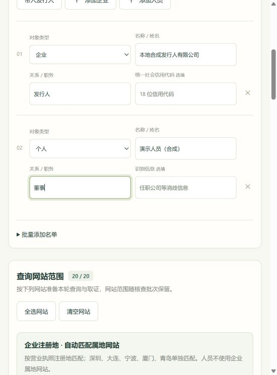
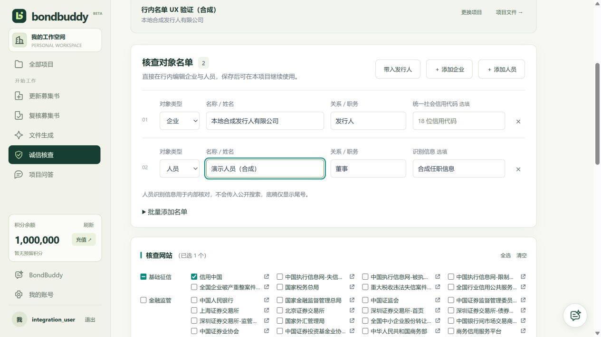

# 诚信核查：行内名单与执行检查点修复

用户 2026-10-22 要求添加发行人、企业和人员时直接增加一行；同轮报告本地诚信核查立即失败。

基线：`develop` `29a02a9deeb0c93724258385c2eff2d06ba0987d`。原型：`35da7b8c9bc649abea4aadd66ab59a624be7e7b4`，`apps/web/src/project-design/app.ts` 的 `subjectRows` / `addSubject` 与 `design.css`。本次用户要求确认行内交互，取代原 E2E 交付中记录的对象弹窗差异。

## 修改

- 带入发行人、添加企业、添加人员直接增加可编辑行；新增后聚焦名称。重复带入发行人定位到已有行。
- 行内显示序号、类型、名称、关系 / 职务、识别信息及移除按钮。类型切换同步企业注册地区域，名称修改即时同步注册地中的企业名称。
- 输入时不重绘页面；增删行只更新名单与注册地区域，保留尚未导入的批量文本、核查说明和网站范围。
- 保存和开始前就地提示空名称、重复对象及非法信用代码；不静默丢弃空白行。保留 100 个对象上限、后端版本校验和离开页面前保存机制。
- 修复真实执行路径：原模型阶段名称为 `integrity-<hash>`，保存 `<name>_prompt` 检查点时被 `checkpointStage` 的小写字母、数字、下划线约束拒绝。只将内部阶段名称改为下划线，模型逻辑调用 ID 不变。

## 验证

- web TypeScript / Vite 构建通过（保留已有 bundle size 提示）；worker TypeScript 构建通过。
- `npm run check:contracts`：171 synthetic + 12 internal 样例、4 个生命周期样例、29 个 OCR + 11 个 issuer-binding 测试通过。
- `BB_LOCAL_INSTANCE=integrity-20261021 node scripts/local-integration/test-integrity.mjs`：16 passed / 0 failed / 0 skipped。覆盖真实 API、检查点、队列、PostgreSQL、Azurite、Python Word 交付、收费与释放、归属和项目归档。
- 合成供应商前新增实际 `codexModelStage` 的快照/检查点回归，必须到达供应商配置边界；旧实现会在此前抛出 Invalid stage。该测试不发起真实模型/搜索调用。
- 实际浏览器：带入发行人、添加企业/人员后无添加弹框且聚焦名称；空行/重复对象/非法信用代码提示；类型切换；批量添加；移除；重复发行人去重；保存后刷新恢复两行、识别信息、广东深圳注册地、说明和网站选择。
- 展开 BondBuddy 侧栏后，名单容器宽 565.5 px，字段自动分为两列，页面 scrollWidth/clientWidth 均为 1265 px。390 px viewport 请求未在当前标签页实际生效，已恢复默认；未声称手机尺寸已经实测。

本地用户失败轮次 `02234a8a-e800-4004-81b3-00cdbf983c87` 的只读诊断：3 次快照、0 次模型尝试；worker 在 model_generation 阶段重复报告 VALIDATION_FAILED，最终失败。旧失败记录保留，修复后需由用户从名单重新开始一轮。未伪造成功结果或自动重启收费任务。

## UI 对照

截图使用同一浏览器默认尺寸。名单原型在 5186 运行；实现连接 5195 的实际本地 API，测试项目名称明确标为合成。

| 原型 | 实现 |
| --- | --- |
|  |  |

[修改前的只读名单](before.png)。字段顺序和新增/移除交互按原型；保留用户此前确认的紧凑 54 项网站清单、统一导航及项目选择器。姓名/关系/人员标识上限沿用现有契约 200 字，保存使用实际 API，不显示原型“自动保存”的演示承诺。新建项目、费用确认、补证等其他弹窗继续承担原用途。

## 交付边界

没有 API 契约、数据库迁移、依赖或计费规则变更。浏览器和 worker 需要使用本次代码；仅更新网页不会修复执行错误。基础 worker 沿用本地已固定镜像，仅覆盖编译后的 integrity-stage.js。

本地入口：`http://localhost:5195/#integrity`。本功能独立开发实例 `integrity-20261021`，数据保留在父目录 `work/local-integration-runtime-integrity-20261021`，未连接生产数据库。

Node 22 下使用 `BB_LOCAL_INSTANCE=integrity-20261021` 运行 `scripts/local-integration/start.mjs` / `status.mjs` / `stop.mjs`。停止脚本核对实例身份并拒绝中断活动任务；数据保留。

开发和自测完成；真实官网搜索、模型效果与用户验收仍待完成。代码尚未部署，待统一发布。
