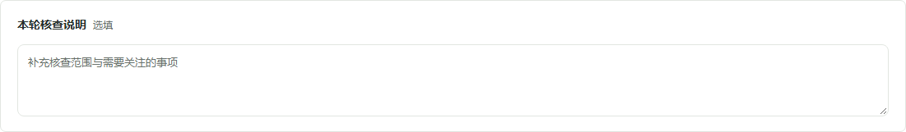
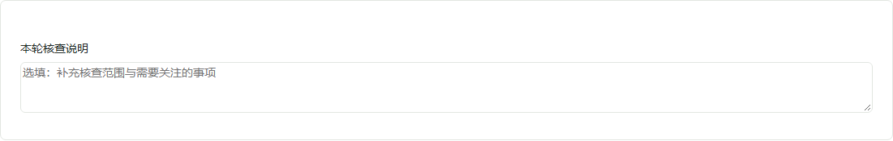
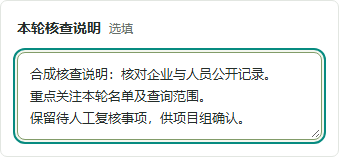

# 诚信核查说明框 UX 验证（2026-11-09）

关联 #923 / UX-5。用户要求细化截图红框中的“本轮核查说明”，与其他组件统一。

## 版本与范围

- 基线：`d24dcdf5`（本次开始时的 `origin/develop`）。
- 实现和局部原型：`d93b5e14813bbf82cb5375991c0f984c773b4bda`。
- 既有参考：`product-prototype/public/authoring-materials-entry.html`、`project-workspace.css`，最近共同参考 commit `c67a7fd5dfbe02032246f8e27b531cab0161200e`。
- 新的局部原型：`product-prototype/public/integrity-notes.html`，已在 #361 登记。它只展示说明卡片，不模拟整个诚信核查流程。
- 实现仅修改说明卡片的 HTML/CSS：去掉全局 label 继承的 25px 顶部外边距；14px 标题配“选填”；标题下间距 12px；输入字号 13px、行高 1.7、内边距 10px/12px、圆角 8px、初始高度 88px；仅允许垂直拉高，保留键盘焦点。
- 保留输入 ID、三行、12,000 字符上限及原输入/保存逻辑。无新增依赖、接口、数据库迁移、任务或计费变动。

## 原型与实际组件对照

Windows / Microsoft Edge（Playwright），视口分别为 1440×960、390×960、320×960。每组截图截取相同 CSS 宽度的说明卡片；各图为合成数据，均已人工查看。截图裁切时的亚像素边界会带来约 1px 的位图取整差异，实际 CSS 尺寸与下表一致。

| 视口 | 局部原型 | 实际组件 |
| --- | --- | --- |
| 1440 |  |  |
| 390 |  |  |
| 320 |  |  |

| 浏览器实测属性 | 1440 | 390 / 320 |
| --- | --- | --- |
| 卡片内边距 | 18px 20px | 16px |
| 标签文字与行高 | 14px / 22.4px | 相同 |
| 标签下间距 | 12px | 相同 |
| 输入文字与行高 | 13px / 22.1px | 相同 |
| 输入内边距 / 高度 | 10px 12px / 88px | 相同 |
| 输入框横向溢出 | 无 | 无 |

原有区域对照（从 `d24dcdf5` 的原始 HTML 还原说明卡片，其他运行代码保持当前版本，不冒充旧站整体截图）：



多行内容及键盘焦点：



与旧页的差异均限定于用户明确要求细化的说明区；尚未取得用户对实现的人工验收。320px 下页面原有步骤条“核查结果与底稿”仍超出视口（右边界 337px），本次说明卡片及输入框均在视口内，因此不宣称整页 320px 已无溢出。

## 验证

- 定向浏览器检查 4/4：三种宽度下的原型/组件截图；空值与多行内容；标签点击及 Tab / Shift+Tab 焦点；保存、多行刷新恢复、清空再保存和刷新；另含原始卡片对照。三种宽度均只调用合成草稿保存接口，每种两次，无查询或导出提交。
- 补充定位检查 1/1：320px 横向溢出来自原有步骤条，说明卡片无溢出。
- Web 类型检查及 Vite production build 通过。先编译 contracts/domain/rule-pack-registry/rule-applicability-context/API，解决干净工作区测试引用所需的 dist 依赖，再运行 `tsc --noEmit -p apps/web/tsconfig.json`；Vite 构建沿用既有 bundle 大小提示。
- 公共契约检查通过：72 个测试，179 个合成公开样例、12 个内部资料库样例、4 个数据生命周期样例。

命令（在仓库中已安装依赖的前提下）：

```powershell
node node_modules/typescript/bin/tsc --noEmit -p apps/web/tsconfig.json
# apps/web 目录
node ../../node_modules/vite/bin/vite.js build
$env:BB_E2E_BASE_URL='http://127.0.0.1:5317'
$env:BB_E2E_BROWSER_CHANNEL='msedge'
node ../../node_modules/@playwright/test/cli.js test tests/integrity-continuation.spec.ts tests/integrity-retired-sites.spec.ts --config playwright.config.ts
```

定向检查脚本位于本次独立工作区的忽略目录 `apps/web/tests/.local/integrity-notes-ux.spec.ts`，作为一次性视觉核验使用，不扩展永久测试套件。验证界限：合成 HTTP、真实前端浏览器；没有执行官网核查、真实模型调用、生产保存或扣费。


## 扩展回归及基线复测

`integrity-continuation.spec.ts` 和 `integrity-retired-sites.spec.ts` 共 49 项：32 通过、17 失败。将两个实现文件临时恢复为未修改的 `d24dcdf5` 后，对全部 17 个失败用例再次运行，17/17 同样失败，失败标题集合一致；随后恢复修复版并确认与代码提交无差异。主要为原有证据表单/查询时间入口预期及付费确认前保存行为预期；本次不修改这些测试或业务流程。

失败用例（均已在未修改基线复现）：

- a deduplicated upload with the original upload ID attaches the exact existing material without adding another file
- a paid new check confirms 5,000 and freezes the whole adopted roster without inheriting old findings
- a reused material still requires a user supplied actual query time
- a same-id evidence readback with changed note or material pin cannot settle an unknown attachment
- a schema-valid upload receipt with wrong byte_size is rejected before attaching evidence
- a schema-valid upload receipt with wrong media_type is rejected before attaching evidence
- a schema-valid upload receipt with wrong role is rejected before attaching evidence
- a schema-valid upload receipt with wrong sha256 is rejected before attaching evidence
- an accepted unknown evidence request is recognized only by complete exact authoritative readback
- an unknown uploaded evidence request retains the verified pin and never uploads the same bytes twice
- cancelling the paid confirmation performs no save, query, export or upload
- local storage persistence failure blocks execution before any draft or paid POST
- next pending follows original subject/site order and preserves the saved subject position
- raw evidence fields survive close, reopen and refresh while blank actual time stays blank
- reusing an existing historical version sends its exact pin to the original check from export history
- selecting the newer material version is explicit and never substitutes it for the old exact pin
- unknown evidence before acceptance retries the original material pin and body without uploading

另在较早的 `integrity-browser.spec.ts` 扩展试跑中遇到重复的“诚信核查暂时无法打开”，六项失败后停止，未称该套件已完整运行。其 HTTP 夹具直接返回数字金额，没有使用当前 `billing-fixture-wire` 的传输格式转换。代表用例 `company region is inferred from a clear province prefix and existing values are retained` 在未修改的 `d24dcdf5` 上同样无法找到注册地字段。该存量测试限制与本次说明卡片定向验证分别记录。

开发和定向自测完成；用户尚未验收；代码完成，尚未部署，待统一发布。
