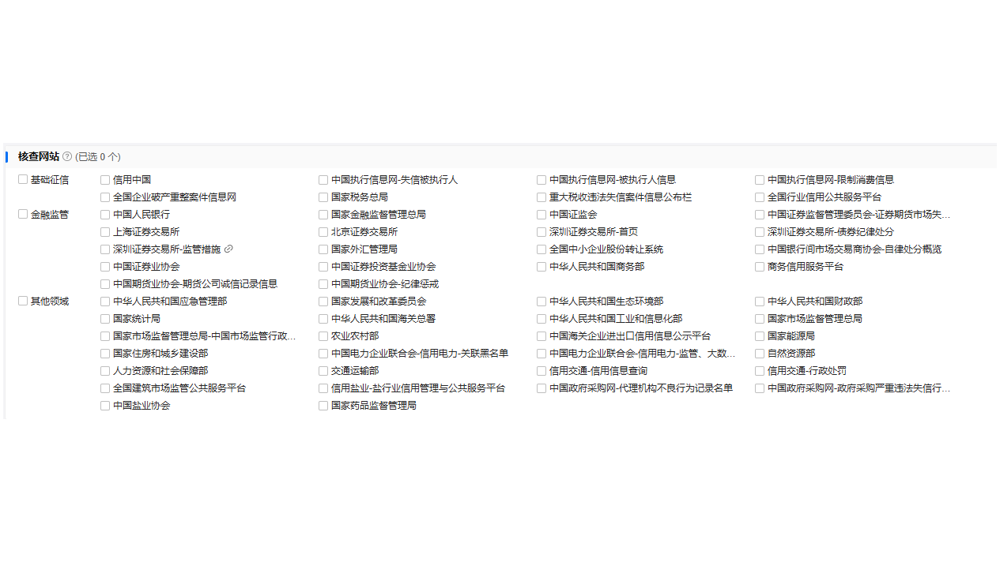
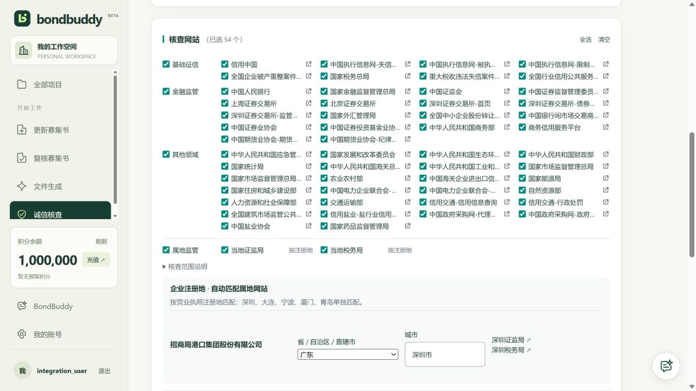

# 诚信核查网站与紧凑布局（2026-10-22）

对应 Issue #720 / PR #721 的增量。产品基准为用户本次提供的截图 `codex-clipboard-dc84a6e4-fad7-44d1-bfd5-6efcaf13c445.png`，替代旧网站卡片布局；未修改旧原型代码。原实现基线 `9b274d0a`。

## 清单与交互

- 截图中的 52 个入口按行保留顺序：基础征信 8、金融监管 18、其他领域 26。唯一清单为 `packages/contracts/src/integrity-sites.ts`。
- 保留此前确认的属地监管 2 项（当地证监局、当地税务局）及注册地自动匹配、联系我们加网站。
- 分类在左、四列单行复选框在右；窄容器两列，手机单列；长名称省略、悬停显示全称和事项，独立图标打开网站。分类支持全选/取消及半选状态，顶部显示已选数量，支持全选和清空。
- 新项目默认未选网站；旧草稿保持原范围。截图外的旧 `gsxt`、`execution`、`judgments`、`food-drug` ID 保留，在仍选中的草稿中收在“历史网站范围”，不把旧记录静默映射成新栏目。
- 截图没有提供 URL，一些栏目使用对应机构门户入口和明确的查询主题；入口为门户时说明可在名称提示及“核查范围说明”中查看。未宣称所有栏目直达 URL 或网站自动查询已验证。截断名称按可见栏目补全；电力“监管、大数…”暂按监管、大数据预警展示，待用户核对完整名称。

## 后端与兼容

网站范围和模型返回由原 20 项上限扩展至共享清单容量；记录上限覆盖 100 个对象 × 全清单。仍拒绝未知 ID、重复 ID。新增目录、保留 ID 和查询主题仅在 contracts 定义，API、worker、web 共用。

同域不同栏目必须有对应主题或栏目路径的实际搜索事件，避免一次泛域名搜索被多个栏目当作已查询；可靠引文仍需来自真实工具记录且匹配主体。原 5,000 积分/轮、免费补证导出、暂停恢复、历史版本及 4.3 归档不变。无数据库迁移、无新增依赖。

## 自测

- contracts、API、worker TypeScript 构建通过；web TypeScript + Vite 构建通过（已有 bundle size 提示）。
- contracts：171 synthetic + 12 internal 样例、4 lifecycle、29 OCR + 11 issuer-binding 通过。
- `BB_LOCAL_INSTANCE=integrity-20261021 node scripts/local-integration/test-integrity.mjs`：15 + 1 = **16 passed / 0 failed / 0 skipped**。包含 54 项范围经真实 API 保存/读取、新项目空范围、未知网站拒绝、原计费/底稿/历史/归属 E2E、同域栏目区分和项目聚合回归。
- 模型搜索为 synthetic；真实本地 API、PostgreSQL、Azurite、Word 输出。未调用真实模型或对任何企业执行线上核查。本次门户地址查询也不代表企业核查已完成。

## 本地与交付状态

使用独立实例 `integrity-20261021`，入口 `http://localhost:5195/#integrity`。启动、停止按上一级 [原验收记录](../integrity-e2e-scope-20261021.md) 的 lifecycle 命令操作。浏览器截图与最终验证记录随本增量补充。

开发自测与用户验收分开；尚未部署，待专用集成测试 chat 汇总、用户验收与统一发布。PR 保持开发草稿，不自行合并。

## 最终浏览器验证与同尺寸对照

实现源码提交 `e73fa941`。2026-10-22 在真实本地 API 上保存 54 项，刷新后仍为 54 项；单独取消中国人民银行后为 53 项且金融监管呈半选；已恢复并保存 54 项。原项目深圳证监局/税务局链接保持正确，联系加网站弹窗可打开。仅保存范围，没有创建核查任务或消耗积分。

桌面四列，行高 22 px。手机测试 viewport 390 px，内容宽与 scrollWidth 均为 375 px（另有 15 px 浏览器滚动条），单列且无横向溢出；已复原默认视口。当前保存成功后的截图见下表。

| 用户截图 | 实现 |
| --- | --- |
|  |  |

两张对照图均为 1265 × 712：用户提供的原图为 1257 × 350，仅居中补白，没有缩放或改动原图内容；实现为实际桌面截图。手机完整页面见 [mobile.png](mobile.png)。对照差异：沿用 BondBuddy 的绿色主题、补充独立官网图标、保留属地监管及历史兼容区；实现应用内正文宽度小于用户截图，因此更多长名称省略显示。截断栏目全称与这些呈现差异仍待用户验收。

本地 API readiness / 页面可访问 / worker 已重启为新源码。worker 镜像 `sha256:83d04fb1b7eccab21436dda0700569c99e2df8475088c316b4380c518a78deb2`，复用原固定依赖镜像，仅增量复制已编译的 contracts/API/worker；断网启动校验确认 54 项目录、58 项含兼容容量和栏目查询判定已载入。完整依赖打包因 OneDrive 读取缓慢中止；构建上下文和旧镜像收据保留在隔离 runtime，未修改生产。真实模型 preflight 状态继续为 not_run，不等同于查询成功。

最终状态：开发和自测完成、本功能独立本地版可检查；用户未验收，未合并 develop，未部署。指定集成测试 chat 仍需汇总本批固定版本。
