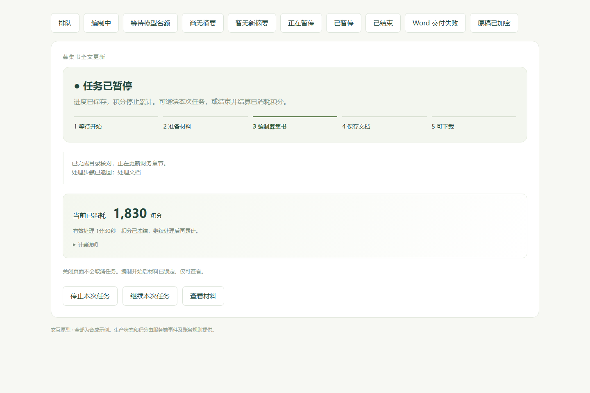
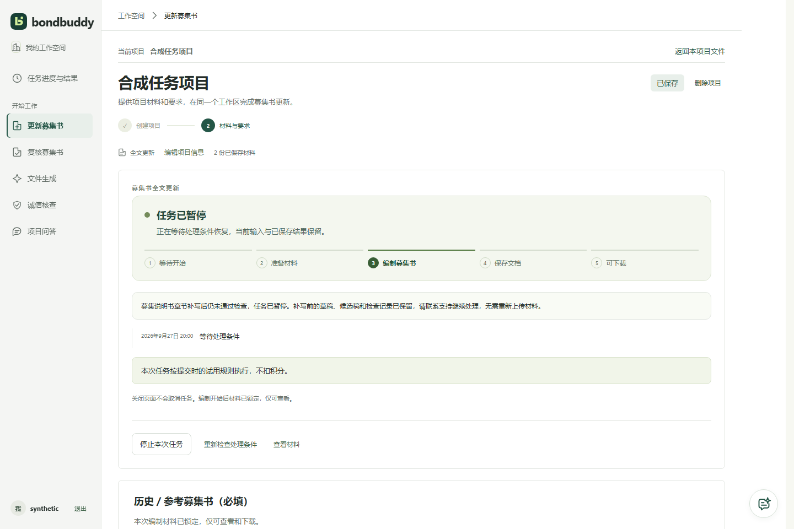
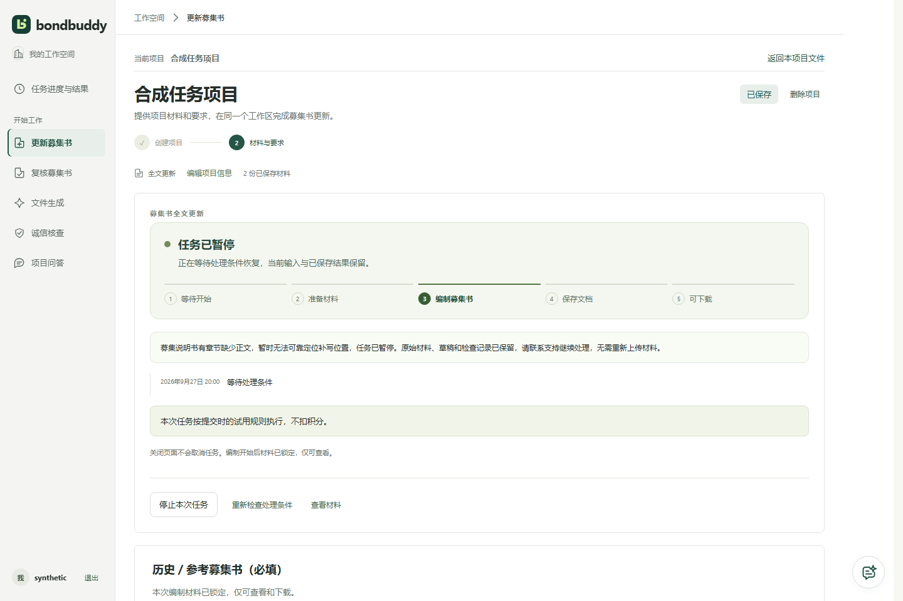

# #1529 空章节纠错开发验收

日期：2026-11-17。代码完成，尚未部署，待统一发布。原失败 run `d8c63eec-b599-4140-b125-c2f3886a75c1` 尚未因此修复被恢复或验证交付。

## 问题与结果

原故障将包含表格的 XML 段落序号用作 `Document.paragraphs` 顶层下标，再将错误段落转换成合法 node_id 和匹配 before。原编辑器已有稳定 ID 和 before 校验；缺陷是诊断修复没有限定业务目标。七处错误定位导致空章仍未填补，后续修改又破坏结构/格式，最终达到既有 90 分钟时限。

本改动用宿主锁定原稿、输入和上一轮日志重新计算目标；答案仅有问题 ID 与正文。模型另写通用日志/Word 不会被用于本轮修复。空章节有多个原非空正文位置时全部列入，标题、表格、文本框及原空白排版段落不作为目标。候选稿必须再次通过完整宿主质量门禁；拒绝时保留前后快照并暂停。恢复不重置预算，旧篇幅修复与交付专用恢复保持原边界。

初次预检只剩空章时给出交接指令，但没有新加进程强制切断机制；不能保证任意模型都不会在初次调用继续循环。任意超时工作区恢复仍属于独立能力。没有扩大超时或修改模型/费用策略。

## 验证

环境：Windows，Node 24.22.1，现有 Python 运行时及 python-docx/lxml，Microsoft Edge。全部模型回答为 synthetic，无付费模型调用，无生产任务/账务/配置/服务修改。

| 检查 | 结果与范围 |
| --- | --- |
| `npm run build` | 全仓通过；Vite 仅有已有大 chunk 提示 |
| `npm run check:contracts` | 72 项测试、179 个合成示例、12 个内部库示例、4 个生命周期示例及恢复/冲突/用量检查通过 |
| `python -B -m unittest python.tests.test_fixed_edit python.tests.test_repair_scope python.tests.test_period_definition_guard -v` | 原编辑/预检/报告期定义 62 项通过；范围修复初版 6 项通过，补充多正文场景后最终 7 项重跑全通过，共 69 个不同用例 |
| 受影响 worker / 弹性脚本测试 | 61 个不同用例完成通过。组合运行先得到 59 pass、2 timeout/cancel；两个旧 format-plan 恢复测试随后隔离执行，分别约 30.5 / 42 秒通过；没有放宽 60 秒上限或改断言 |
| Playwright `--grep 'scoped chapter pause'` | 2/2 通过；真实网页、mock API，刷新不新增任务、不自动执行恢复动作，提示保留草稿且无需重传 |
| 原始 DOCX 确定性夹具 | 原稿 SHA-256 `a07fa8cea9f004349b3bda012868199fa3039d3c4ff13ea6e1fbffe9752f99b3`；由七个故障位置定位七章，将其中 18 处原非空普通正文合成清空；7/7 错位目标被拒绝，18/18 正确位置补回，7/7 原故障位置覆盖，无关段落零改动，原件未改 |
| 实际线上旧覆盖包的离线叠加 | 只读下载并验证旧 archive `c9449fc3294e0a1590ddc5081d99cb9387ea439acf4d096db4ea41e790391770`（461736 bytes / 78 条目）；新包 511022 bytes / 118 条目，保留 70 条旧路径原字节，未提高 512KiB 上限 |
| 两角色冷启动脚本 | 用已读到的实际公开池参数生成，修复前包 pin 的长度为 16307 / 16315 bytes；新包固定 pin 的最终长度随本地包回执另记。合成回归检查解码后先写身份清单、嵌入 helper 原字节/hash，旧 warm 创建证明保持原样 |

worker / 弹性测试命令：

```sh
node --test apps/worker/dist/file-authoring-scoped-repair.test.js \
  apps/worker/dist/file-authoring-repair.test.js apps/worker/dist/file-authoring-completion.test.js \
  apps/worker/dist/file-authoring-delivery.test.js apps/worker/dist/file-authoring-format.test.js \
  apps/worker/dist/file-authoring-bad-input.test.js \
  deploy/tencent-elasticity/chapter-repair-overlay.test.mjs deploy/tencent-elasticity/business-overlay.test.mjs \
  deploy/tencent-elasticity/bootstrap-warm-entry.test.mjs deploy/tencent-elasticity/warm-bootstrap.test.mjs
node --test --test-concurrency=1 --test-name-pattern 'format plan remains indexed' apps/worker/dist/file-authoring-format.test.js
```

原稿回归是明确构造的缺失正文夹具，未重建原任务全部操作，也未做真实模型全文生成或 Word 全页视觉验收。较早只清空七个种子段落的夹具只能形成四个完整空章，其结果另存，没有用作七章通过证据。客户原件、完整日志、私有 scope 和固定包保留在本地调查目录，未提交到仓库。

## 页面比较

对应页面：现有募集书执行进度/暂停面板。原型 `product-prototype/public/authoring-live-progress.html`，commit `4448ac710d52ebec44b55d06f1ad1dedee3511bf`。实现为本 PR 的 `apps/web/src/project-execution.ts`，仅新增两项原因文案，没有改变页面结构、步骤、按钮或费用行为。

1440×960 截图已检查，无裁切或横向溢出。实现截图使用试用合成项目，原型使用付费展示数据；这些既有差异不是本 PR 新增行为。限定修复失败沿用现有 capability 暂停的“重新检查处理条件”，不伪造可继续的修复次数。

| 原型 | 补写拒绝 | 无法定位 |
| --- | --- | --- |
|  |  |  |

## 最终统一验收待办

独立集成环境的用户验收、真实固定 yyx 输入的模型完整编制和内容/全页检查、正式双 Word 下载，及现有/热启动/新建腾讯节点的真实生效核验均未完成。开发自动化证据不等于这些状态已通过。发布步骤和回滚范围见 [发布交接](../runbooks/yyx-scoped-word-repair-release.md)。
