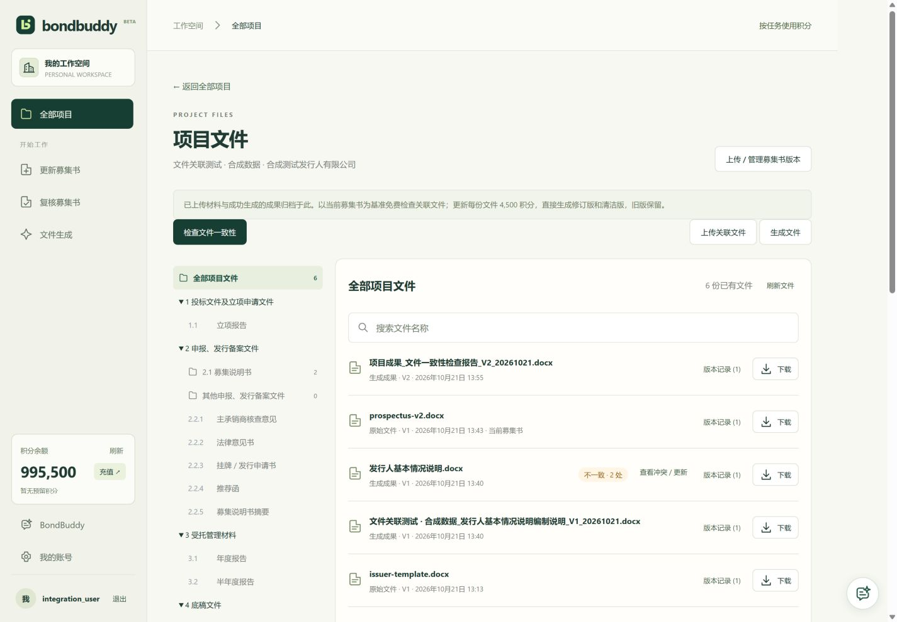
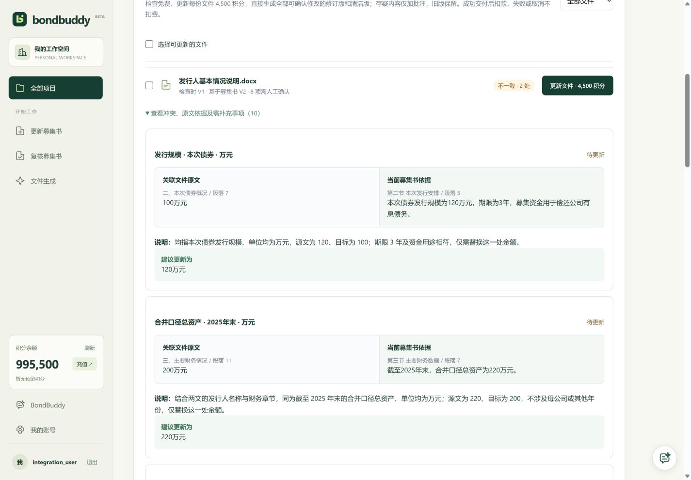
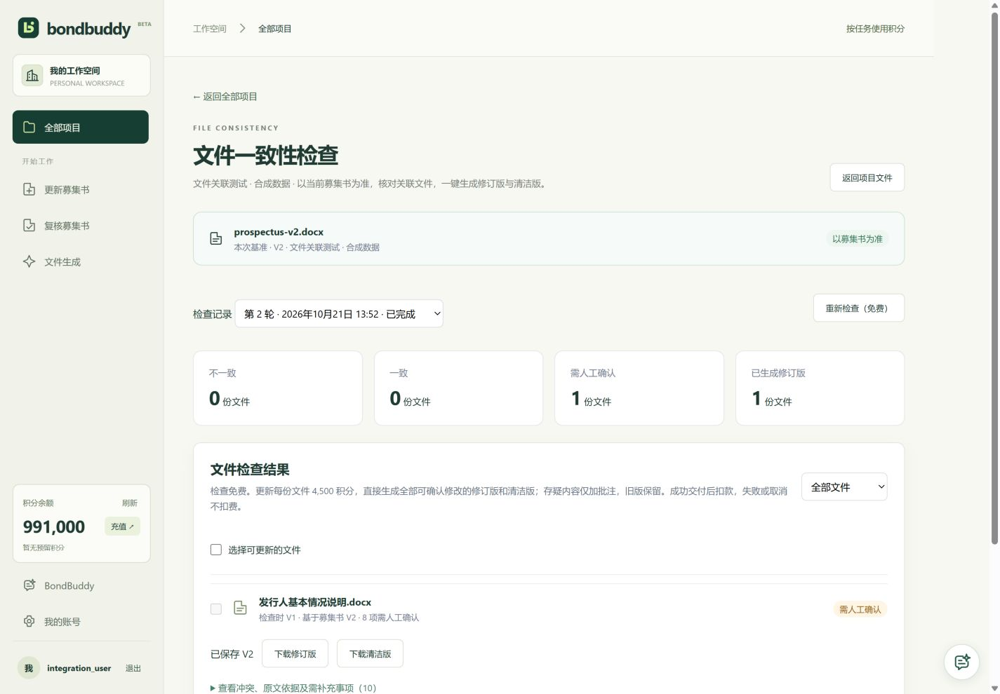
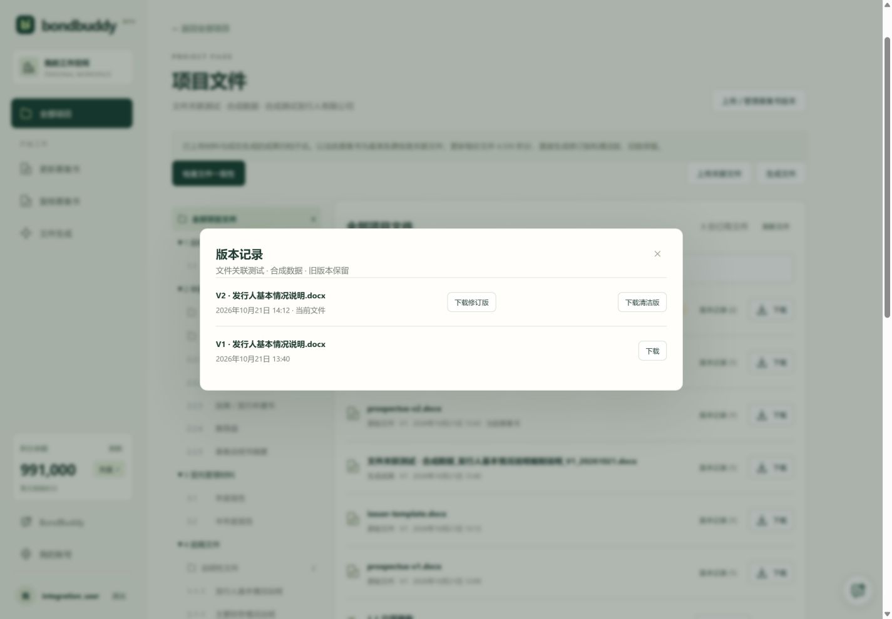
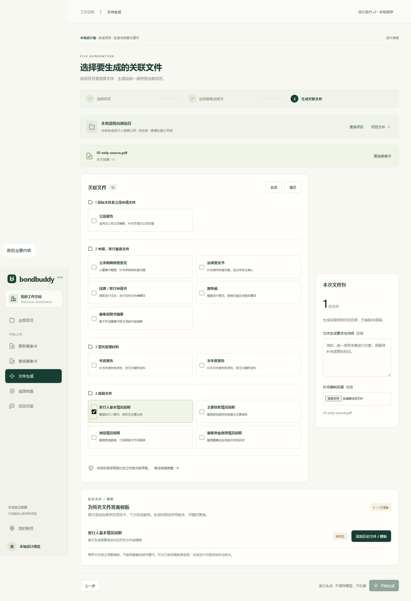
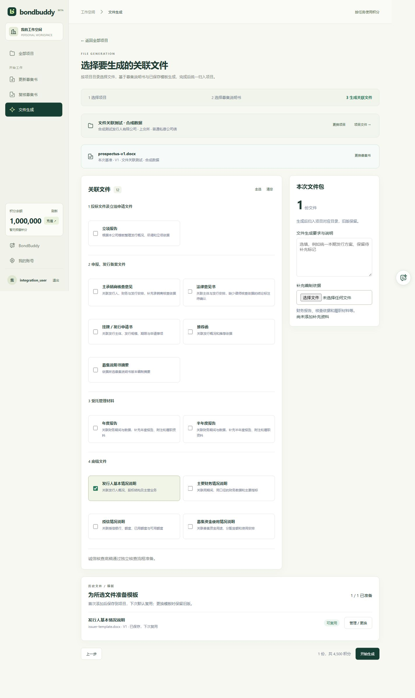

# #718 开发验证与交付

范围：十二类模板文件生成、可核验募集书引用、真实一致性检查、按文件直接生成修订版（无需逐项接受）、保留历史与双 Word 下载。未部署；用户验收未发生。本记录不是统一集成测试 chat 的验收交接。

## 版本与依赖

- 分支：`feat/project-files-e2e-20261021`，基线 `d401be3c`。
- 依赖 #713 → #715 → #717；本批 PR base 为 develop。
- 迁移：`0111_project_file_workspace.sql`、`0112_project_file_update_credits.sql`。仅应用于下述独立本地库及回归克隆库。
- 无新增 npm/Python 外部依赖。使用现有 PostgreSQL、Blob、Codex CLI、python-docx/lxml/PDF 组件。
- 对外 DTO、枚举、文件目录在 contracts；详见 [架构](../../PROJECT-FILES-ARCHITECTURE.md)。

## 自动化验证

- contracts、API、worker、web TypeScript 编译通过，Vite 生产构建通过；有既有的大 bundle 提示。
- contracts：171 个公共合成样例、12 个内部参考库样例、4 个数据生命周期样例通过；issuer binding/OCR 40 测试通过。
- 项目文件 E2E 使用真实 PostgreSQL、Azurite、上传/下载、队列和 Word 修改，**模型提议由测试替身提供**。覆盖模板必填/复用、两文件生成、准确引用、整份文件修订、按文件计费、余额不足、取消释放及重试、原字节保留、目录归档、账号隔离、请求幂等。
- 更新期间并发上传文件和切换募集书，最终用户选择不被覆盖；旧来源不能冒用当前选择修订号；原募集书版本不被关联文件修改。
- Word 成果持久化后、阶段检查点写入前模拟进程中断，恢复复用同一字节引用。
- 最近定向回归：项目文件 E2E、引用证据（含虚构、缺项、跨表格期间、重叠修改）、原 M4 document/QA pipeline 共 6 项通过，0 跳过。
- 先前项目列表/M4 skills/M4 stages/证据/E2E 定向组合 26 通过，1 个 Windows 符号链接用例跳过。该平台差异不冒充 Linux 通过。
- Python `unittest discover -s python/tests -p test_project_files.py -v`：5 项通过，验证存疑事项仅加批注、准确段落、相同金额不同期间不误改、表格定位、修订/批注/清洁版、哈希及重叠保护。
- 前端项目集合模型 6 项通过；包括准确任务链接和直接子文件目录。

本批定向测试入口：`apps/worker/dist/project-files-e2e.pg.test.js`、`apps/worker/dist/project-file-evidence.test.js`、`apps/worker/dist/m4-pipeline.pg.test.js`。通过 `node --test --test-concurrency=1` 执行；设置 `BB_TEST_DATABASE_URL` 为本实例模板库、`BB_TEST_AZURITE_CONNECTION_STRING` 为本实例存储、`BONDBUDDY_TEST_PYTHON` 为现有 Python；测试自行克隆数据库，不能指向生产库。构建使用各包的 `tsconfig.json`，前端使用 `node node_modules/vite/bin/vite.js build apps/web`。

## 本批独立本地环境

入口：`http://localhost:5194/#generate`。账号 `integration_user`，密码 `Local-Test-2026!`；这是隔离库中的开发测试账号，余额为合成测试积分。

实例 `files-20261021`；API 3024、PostgreSQL 15444、Azurite 10024。数据目录位于父工作区 `work/local-integration-runtime-files-20261021`；不连接生产数据库，不修改 5193 或其他 chat 的服务。

在本工作区 PowerShell 中：

```powershell
$env:BB_LOCAL_INSTANCE='files-20261021'
node scripts/local-integration/start.mjs
# 无活动任务时停止；数据保留
node scripts/local-integration/stop.mjs
```

真实模型 worker 使用固定 Linux 镜像、现有本机认证和文件沙箱。`configure-generation.mjs` 的真实 Word/沙箱预检已通过；模型为现有授权配置 `gpt-6-sol / copilot_enterprise`。认证留在仓库外，未写入源码或截图。实际业务生成结果在下方单独记录，不用预检代替业务 E2E。

API/worker 固定代码为 `f2540111`；worker 镜像为 `sha256:be9445b569aab85d9a0d282c8277343506d8cd55560dae6e3816901048bd31b7`。前端最终调整与本记录同批提交，仅涉及复选框布局、结果排序/文案及已修订文件计数，不改变后端。已有大 bundle 提示仍存在。

## 真实模型与浏览器 E2E 证据（2026-10-21）

输入均为合成测试数据；真实登录、上传、模型生成/检查、队列、PostgreSQL、Azurite、积分和 Word 下载均实际执行。此处不是模拟 API，也不代表真实客户材料或十二类文件的专业内容已验收。

项目 `137e198e-024d-4410-8964-75acf65bc42a`（文件关联测试 · 合成数据）。

| 环节 | run | 核验结果 |
| --- | --- | --- |
| 初次生成发行人基本情况说明 | `7ea57563-c1ed-4fbb-917f-0ef0554922a2` | 真实模型生成 V1，保存 9 条经原文核实的引用；扣 4,500 合成积分 |
| 首轮检查 | `76856797-2678-441e-9475-89640d1351d8` | 模型启动前因缺 scratch 目录失败；已修复目录初始化并增加回归，不削弱沙箱；失败记录保留，无扣费 |
| 当前募集书 V2 检查 | `21f30ac0-e553-4c51-9da4-9340aacee25d` | 真实模型识别 2 处冲突和 8 项缺材料事项；检查无积分预留/扣费 |
| 整份文件更新 | `e9e53db7-db89-4907-9a4c-156a3b59c818` | 一次点击生成 V2 修订/清洁版；4,500 积分已结算，未要求逐项接受 |

V2 募集书将发行规模 100 万元改为 120 万元、2025 年合并总资产 200 万元改为 220 万元。浏览器下载修订版含 2 个插入、2 个删除、10 条批注（2 条修改理由、8 条缺项提示）；清洁版正文包含 120/220 万元，不含旧金额、修订标记或批注。原有业务及缺材料描述保留。

| 下载文件 | SHA-256 |
| --- | --- |
| V1 历史原件 | `62d1aabd51cd34343810fc4a54757e800d981942e0df370db55523d4c776fc18` |
| V2 修订版 | `fdb1f1497766b2653cbb9bd78cd8c1ed731cc14da347785ea3505996ddec4383` |
| V2 清洁版 | `22992a4a1e51c2c575b5bd451c567ef376aa345045dea81a03fc45114512c30c` |

从版本记录重新下载 V1，哈希与原生成成果一致。文件当前版本为 V2（`166b9f10-0491-4697-b193-64b61237f748`）；募集书仍保留原来的两个版本，当前仍为用户上传的 V2，未因关联文件更新而改写。余额从 1,000,000 → 995,500（初次生成）→ 995,500（检查）→ 991,000（更新）；冻结积分为 0。

### 页面证据









截图为同一真实本地项目，1440 × 1000 对照尺寸；浏览器临时尺寸已恢复。Word 内部修订/批注和哈希已检查，未将此视为 Word/WPS 桌面排版专业验收。

## 页面与设计对照

原型 commit `35da7b8c9bc649abea4aadd66ab59a624be7e7b4`，地址 `http://127.0.0.1:5186/`。对照使用 1440 × 1000 viewport，全页截图因内容高度不同而长度不同。

| 设计稿 | 实现 |
| --- | --- |
|  |  |

沿用三步流程、四组十二文件、多选文件包、模板准备区、项目目录与版本记录。实现显示真实账号/余额/任务及错误，替换原型演示数据；2026-10-21 用户最新决定将逐项接受改为整份文件生成修订版，按每份 4,500 积分提示费用；源选择复用真实募集书版本面板，模板窗展示持久化 Word；结果显示后台任务并直接下载。此前用户明确要求的 side-by-side 冲突比较保留为展开的证据面板；专业结论缺项保留人工确认。诚信核查和项目问答是其他开发批次，未在本批接入模拟实现。

## 验收路径

1. 文件生成 → 选择/新建项目 → 添加募集书，设为当前版本。
2. 选择文件，未提供对应模板时不能生成；保存 DOCX 模板后生成，返回页面确认模板复用。
3. 成功后下载文件与编制说明，到项目文件查看目录和 V1。
4. 上传含已知差异的募集书 V2，设为当前，点击检查一致性；查看真实状态、原文对照和建议。
5. 点击更新文件（4,500 积分/份），直接生成全部可确认修改；完成后下载修订/清洁版，检查修订、缺项批注和 V1 历史。
6. 重新检查、切换募集书/上传目标新稿，确认过期检查不能覆盖新版本。

用户已确认检查免费、更新每份 4,500 积分；生成沿用既有费率。更新成功交付才扣费，失败/取消释放预留。合成样本的真实模型测试不代表十二文件/所有市场的专业内容已验收。统一集成、真实业务材料验收及生产发布仍由指定 chat 按用户授权执行。
