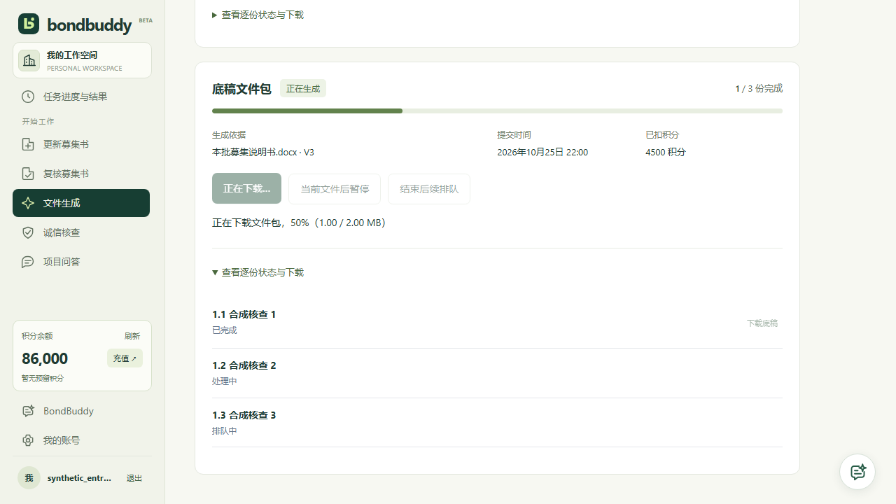
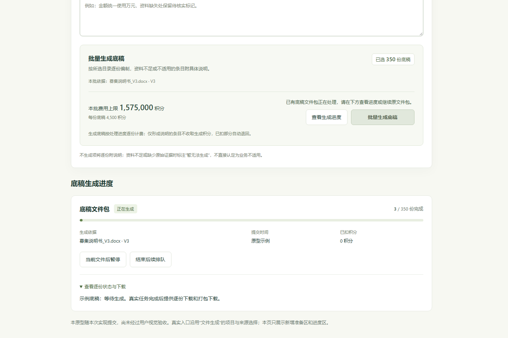
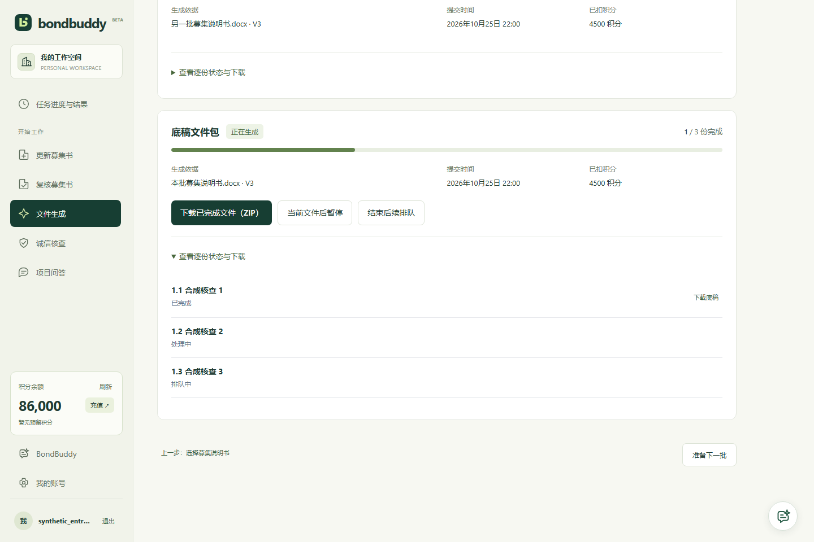

# Issue #841：底稿整包下载

代码完成后交付开发集成测试；尚未部署，待统一发布。无数据库迁移、新依赖或公共 DTO 变更。

## 实现

- 每次下载重新校验账号、项目及可交付文件引用，用两条批量查询解析文件位置。
- 最多 4 路读取对象存储，写入私有临时文件并核验每份文件的长度及 SHA-256。DOCX 使用 ZIP STORE，避免重复压缩。
- 相同账号、项目、批次和文件清单共用已核验的 ZIP；文件路径、对象地址或哈希变化会失效。并发请求共享构建，单个请求取消不会影响其他下载。
- 缓存有效期 10 分钟，闲置缓存预算 256 MB；单包原始内容上限 256 MB，最多 2 个构建、4 个保留/正在构建的包。慢读者不会导致无限保留临时文件。最后一个等待者断连时取消存储读取，超时和服务关闭会清理文件。
- 返回 Content-Length。收到首批字节后按钮和提示同步进入“正在下载”；可靠总长度显示百分比，否则只显示实际字节。截断文件不会作为成功下载交付。

## 本地真实后端测量

Windows、Node 22、PostgreSQL 16、Azurite 3.35.0；独立测试数据库与容器，未访问生产数据。248 份 synthetic DOCX（124 份说明、124 份成果），ZIP 10,340,658 字节。

| 测量 | 用时 |
| --- | ---: |
| 旧串行逐文件查询/读取/压缩策略 | 35,726 ms |
| 新策略首次 HTTP 响应头（包含准备） | 3,745 ms |
| 新策略首次 HTTP 完整下载 | 3,930 ms |
| 相同批次重复请求响应头 | 215 ms |
| 相同批次重复完整下载 | 354 ms |

旧策略基准在同一数据库、存储和进程内执行，计时包括生成完整 ZIP，不包括旧 HTTP 传输；新策略通过本机真实 HTTP 测量。以上是一次受控本地结果，不是线上 SLA，也不能替代历史山东蒜都批次的上线后复测。

## 自动化证据

API：`node --test --test-concurrency=1 apps/api/dist/workpaper-zip.test.js apps/api/dist/workpaper-download.test.js apps/api/dist/workpaper-download.pg.test.js`，共 10 个用例（9 个缓存/HTTP 夹具测试及 1 个真实 PostgreSQL/Azurite 测试），均通过。

覆盖 248 份 ZIP 全部解压、CRC、SHA-256、路径和数量；缓存复用/失效、账号隔离、项目删除、交付状态撤回、损坏/截断/过大文件、超时、取消、迟到流关闭、慢读者上限。ZIP 库的临时文件读取错误接入请求失败处理，故障注入验证可重试，避免未监听的 error 事件终止服务。未生成任务或产生费用。

网页 API 单元测试：`node --test apps/web/dist-test/api.test.js`，22 pass / 0 fail。覆盖未知/压缩长度、截断和接收进度。

浏览器回归：`workpaper-progress-routing.spec.ts`、`workpaper-library.spec.ts`，16 pass / 0 fail。浏览器使用真实页面组件与 synthetic API；分块用例控制 Response 流，分别验证已知和未知长度。真实存储与 HTTP 完整性由上述后端测试验证。

TypeScript、API/worker 和 Vite 生产构建通过。公共契约 72 项测试、171 个接口样例、12 个内部库样例、4 个生命周期样例通过。

页面仍使用现有任务/成果布局；本次仅修改下载阶段和进度。原型为 `product-prototype/public/workpaper-batch.html`（最近提交 `bbc91ea5`），开发基线 `8e5b9384`。截图见下方；原有页面对照测试保持覆盖。

原型/实现视口均为 1440×960（另覆盖 390×960）：

## 最终统一验收待办

GitHub Actions 检查未能启动：运行 41058809765 的 GitHub 注释指出账户近期付款失败或支出上限需要提高，job 无执行步骤。以上通过结果为本地自测，不宣称远端 CI 通过；PR 保持开放，待账户问题解决后重新运行。

在统一集成版复验两个下载入口，再用获授权的实际 248 份批次复测冷/热下载和真实网络传输。用户尚未验收；生产配置、部署及线上核验由统一发布 chat 按授权处理。
