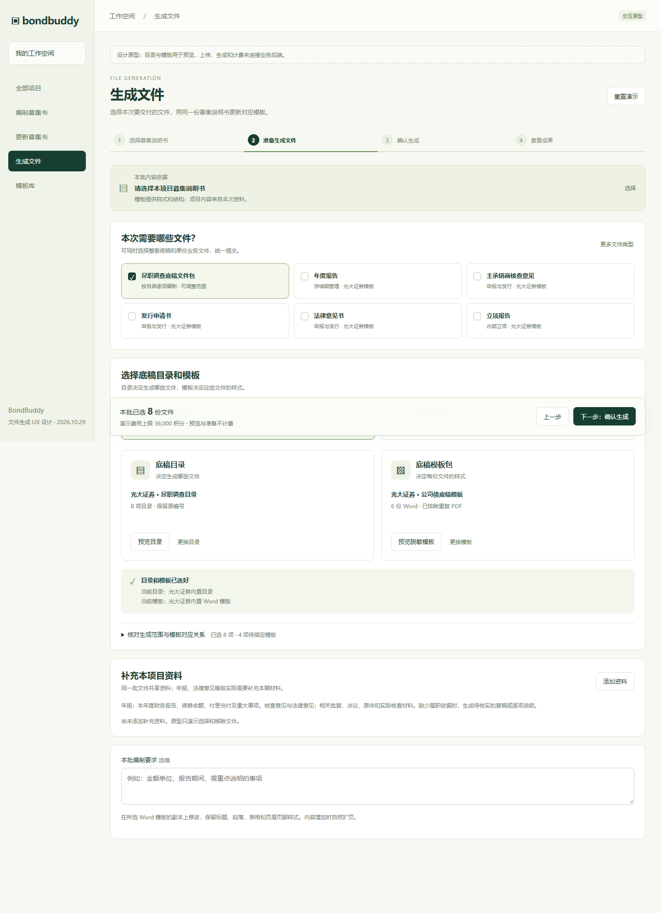
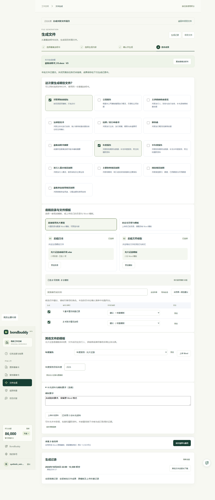
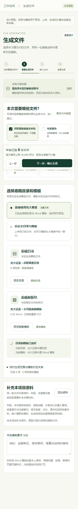
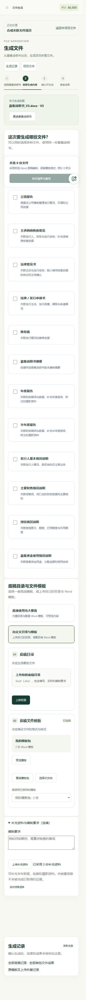

# Issue #842：模板预览与模式切换

代码完成后交付开发集成测试；尚未部署，待统一发布。无迁移、新依赖或公共 DTO 变更。运行时仍需已有的 `BB_FILE_TEMPLATE_BUNDLE` 内置资产配置。

## 实现

- 光大模式首次载入整套目录和模板，加载、失败、取消及重试状态明确；目录与模板实际返回后开放预览。
- 光大、自定义分别保存选择，切换会取消旧请求，迟到结果不会覆盖当前选择；加载有 60 秒上限。自定义区域只显示自己的上传和已保存模板入口。
- 逐项匹配表折叠时不生成行和选项；展开时仅生成当前/推荐选项，用户通过键盘或鼠标操作某个下拉框时才补齐该框的完整模板列表。
- 对象存储写入/读回校验最多 4 路并发，重复字节仅存一次但保留各角色记录及原顺序；所有在途操作结束后才允许外层事务失败回滚。
- 已整合 `8e5b9384` 上的文件类型平铺、上传进度及空项目入口修复。

## 真实后端验证

Windows、Node 22、PostgreSQL 16、Azurite 3.35.0，专用测试数据库与容器，全部数据为 synthetic。

`node --test --test-concurrency=1 apps/api/dist/file-template-loading.pg.test.js apps/api/dist/file-generation.pg.test.js`：3 pass / 0 fail / 0 skip。

- 147 份独立 Word、148 条角色记录、248 项目录；一次加载 7,509 ms，最大同时写入数 4。逐条顺序与哈希保持一致，重复采用不重复写入。
- 真实内置加载、私有导入、保存、脱敏结构预览和字节完整性；损坏读回会回滚，无半成品目录/模板集，随后可以重试。
- 账号隔离、不可变模板采用、混合提交及失败回滚；覆盖既有和自动计费模式，不调用真实模型。

## 页面证据与原型对照

源码：`apps/web/src/file-generation-panel.ts`、同名 CSS。原型：`product-prototype/public/file-templates-v2.html`，原型最近提交 `a7f8a9c4`，本次开发基线 `8e5b9384`；沿用双模式、目录/模板双卡和匹配展开的结构。

同尺寸视口截图位于 `apps/web/test-evidence/file-template-preparation/`：桌面 1440×960、手机 390×844，保存整页截图供滚动区域核对。自定义去除光大快捷入口、分别保留两种模式选择，是本 Issue 中用户明确要求；上传进度、全部文件类型、真实计费/历史记录等来自已合入产品能力，原型不包含完整后端状态。

`file-template-preparation.spec.ts` 使用真实生产组件、浏览器文件传输和 synthetic API。16 个用例通过（12 个完整回归用例，加冷启动后 4 个超时/上传进度用例）。覆盖预览正文及表格、PDF 失败后的结构预览、模式切换/迟到响应/取消重试、上传恢复、刷新后选择保持、生成采用的选择、付款恢复不重复创建，以及完整目录的按需展开和键盘选择。248 项、147 份模板的展开耗时本地测得 653 ms；只为正在操作的下拉框补齐全部选项。浏览器模拟边界与上述真实后端链路分开记录。

两个分支的 TypeScript、API/worker 和 Vite 生产构建通过；公共契约 72 项测试、171 个接口样例、12 个内部库样例及 4 个生命周期样例通过。整合时冷启动 Vite，消除热更新后测试注入模块与页面模块不一致造成的上传进度夹具失败。

## 最终统一验收待办

在统一集成版用实际安装的光大资产核对所有模板内容、目录和各上传格式；完成桌面/手机实际操作验收。PDF 版式转换仍依赖既有转换服务，失败时保留结构预览。用户尚未验收；本次未执行生产部署。
