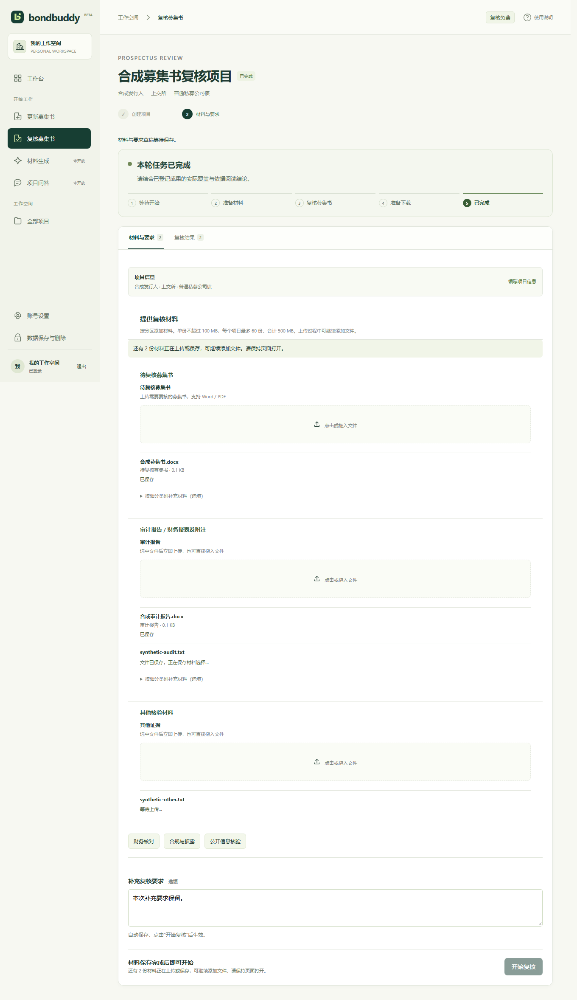
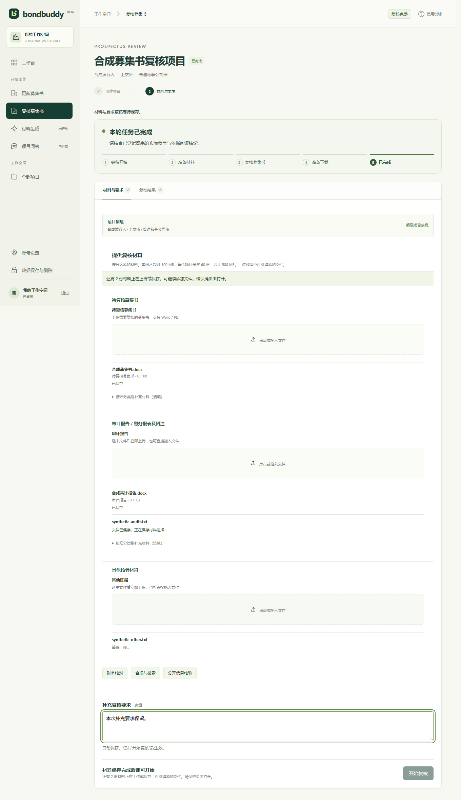
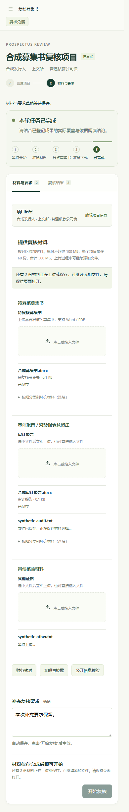
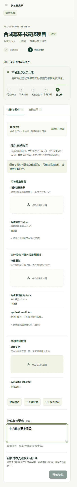
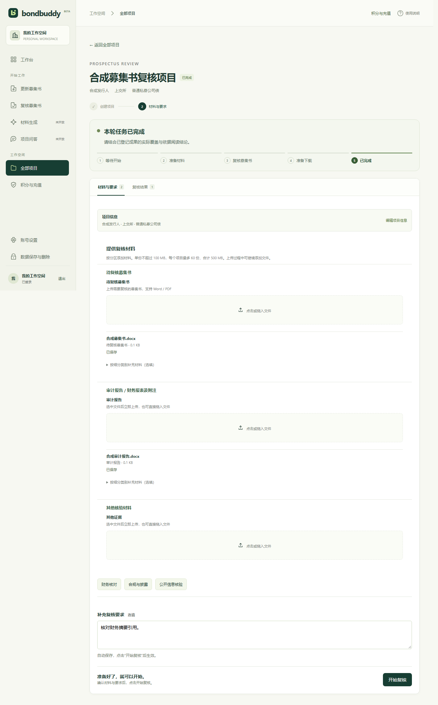

# 上传期间继续添加材料

对应用户 2026-10-06 反馈及 #361 / #448 B07。基线 develop 615f395。
原型为 product-prototype/public/workspace-ux.html 的 uploading 场景；实现为 apps/web/src/review-workspace.ts。
本目录与同次提交的原型/实现对应，准确 commit 另在 #361 和 PR 登记。

## 行为与边界

- 原因：复核页全局 uploading 禁用隐藏 file input，label 仍可点击；进度刷新还会替换 input。
- 上传期间选择其他分区立即进入队列。选择框保持连接，避免原生文件选择窗口打开期间丢失 change。
- 依次完成字节上传、服务器确认、材料选择保存。100% 传输不冒充已保存。
- 单文件失败不阻止其他文件。重试复用原 session 和已上传字节；保留补证对象、输入版本冲突和所有权检查。
- 尚有排队/上传/保存或失败文件时，开始操作给出等待原因；失败文件可重试或明确移除未保存行。全部保存后开始按钮恢复，上传不自动执行。
- 无 API / worker / schema / 收费变化。更新页既有队列未改，更新页原稿必填信息不变。

## 本轮验证

Windows / Edge，1360×900、390×844；全部数据及响应为 synthetic。

- 首次定向 6 项中 4 项因测试定位同时命中隐藏结果页按钮而失败，缩小到材料页后 6/6 通过。
- 最终复核工作区 33/33 通过，包含上述 6 项、创建/编辑/结果/冲突/跨账号、原型输出及四视口外壳测试。
- 更新上传回归首次 9/13 通过；4 项仍使用旧“本企业历史募集书”标签，按当前统一入口修正，并通过信息页检查原有目标字段。定向复跑 4/4 通过。没有删除或跳过断言。
- Web TypeScript / Vite build 通过；Vite 保留既有大包提示。
- 契约 166 个合成示例 + 12 个内部示例、4 个生命周期示例及 40 项契约测试通过。
- 慢上传、服务器确认等待、草稿保存等待下其他分区可继续选择；所有文件准确进入草稿，选填说明保留；刷新后恢复。单文件失败继续队列、丢失确认重试不重传、草稿保存失败继续保存、无效文件移除均验证。

命令（在 apps/web，设置 BB_E2E_BASE_URL=http://127.0.0.1:5199、BB_E2E_BROWSER_CHANNEL=msedge）：

```
node ../../node_modules/@playwright/test/cli.js test tests/review-workspace.spec.ts tests/upload.spec.ts
node ../../node_modules/@playwright/test/cli.js test tests/upload.spec.ts --grep 'renamed equal-content|upload processing stays|duplicate uploads join|material recovery keeps'
```

原型生成时额外设置 BB_WORKSPACE_DESIGN=1、BB_WORKSPACE_EVIDENCE 和 BB_UPLOAD_EVIDENCE 指向本目录、BB_PROTOTYPE_URL=http://127.0.0.1:4331。

## 同尺寸原型 / 实现

| 场景 | 原型 | 实现 |
|---|---|---|
| 桌面上传与保存队列 |  |  |
| 手机上传与保存队列 |  |  |
| 桌面材料页 |  |  |
| 手机材料页 |  |  |

布局、分区、按钮、提示与已确认产品调整一致。实现截图中输入框有真实键盘焦点，静态原型无焦点；不构成布局偏离。保留复核自己的标题、材料/结果标签与三维结果。
原型是本次用户要求对应的设计镜像，不作为独立后端证据。

本地测试不等同真实客户材料、真实模型、Word 或专业验收。部署和线上页面核对另在 #361 记录；用户原项目的新上传体验待验，不关闭父单。
