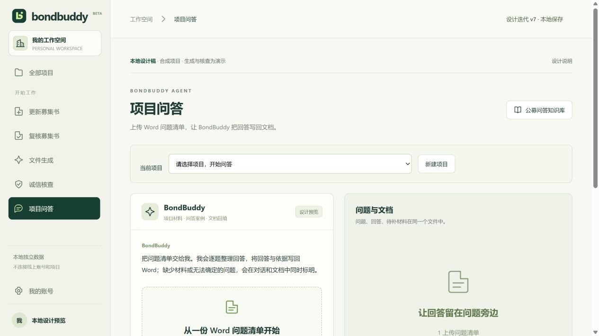
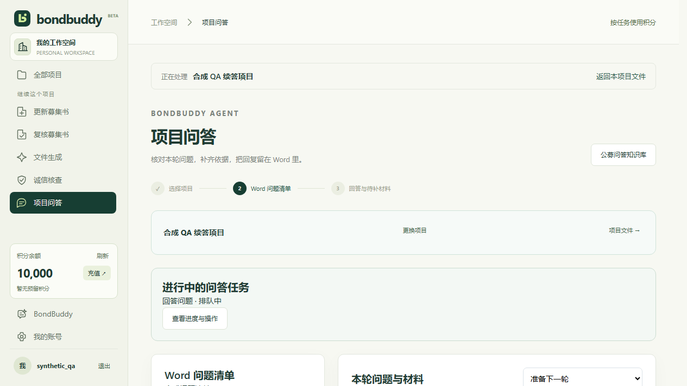

# 线上核心流程问题修复与验证

状态：开发和自测完成；代码尚未部署，待统一发布。没有准备或交付统一本地集成验收版，用户尚未验收。

基线：`develop@1d8615c3`。修复源码：`1bc999ed693647d27d3fea24611e267905794938`，最终验收脚本与证据见本 PR。需求来自 2026-10-27 线上验收后的用户指令“修复你发现的问题”。本记录和截图均随修复 PR 交付，不代表生产已经恢复。

## 修复范围

| 编号 | 线上观察 | 本次实现与验证 |
| --- | --- | --- |
| BB-UX-01 | 历史复核 Word 仅有内部进度，仍显示完成并已结算 | 复核收集和旧检查点交付都拒绝空正文/纯进度 Word，保留异常原文件；失败按已有规则释放预留。历史读取在 owner、project、run、artifact version 和 SHA-256 绑定下检查实际 Word；证实无正文才返回 `invalid_content`，页面显示“历史复核成果异常”，保留原下载和账务。 |
| BB-UX-02 | 普通问答约 29 分钟无结果，免费识别/检查也排队；缺少停止入口 | 助手显示排队、长等待、暂停/调用核对等状态，提供刷新和停止原回答；仅允许停止该消息关联的 QA task。authoring worker 增加交互专用名额，只领取 `m4_qa_v1`、`project_qa_v1`、`project_file_v1`，保留 task kind、租约及归属限制。真实 PG 测试证明长文书占用通用名额时三类交互任务仍执行且不重复领取。 |
| BB-UX-03 | 默认问答入口隐藏进行中的识别任务 | 默认入口显示进行中的识别/回答及准确 run 链接；历史同时显示识别、回答、序号和状态。导航/刷新不新建请求，也不改写当前草稿。 |
| BB-UX-04 | 内嵌助手使主区变窄、中文竖排、收起未恢复 | 内嵌助手不再触发全局侧栏留白；消息样式隔离；按实际容器宽度切换布局；收起 detach，忽略已移除 details 的 toggle。手机内嵌助手不锁住整页滚动。覆盖 1108、1440、390px，以及活动任务轮询重绘后保持嵌入。 |

`readDocxBodyText` 只供复核输出检查，不改变 M1 双 Word 生成后直接下载的产品决定。它区分“读取失败/不支持”与“证实空正文”，有 ZIP/XML 大小和 CRC 边界；不宣称检查了报告专业质量或完整性。实际历史下载文件在本机只读验证为正文长度 42、无有效正文，客户文件及生产截图未提交到仓库。

## 验证

全部模型响应为合成数据或 fake adapter，没有新增真实模型调用。真实执行的部分包括 PostgreSQL 16 队列/租约/账务、Fastify API、Azurite 私有文件读写、Python Word 导出及交付流程。浏览器测试使用隔离 Edge 上下文和模拟 API，不能代替真实后端端到端验收。

| 范围 | 结果 | 关键证据 |
| --- | --- | --- |
| Web 定向回归 | 9 passed | 默认入口恢复、3 种宽度、轮询保持、停止 queued/paused 原回答、2 种尺寸历史 Word 下载、历史异常提示 |
| API / worker / Compose 定向集成 | 25 passed / 1 skipped（Windows 符号链接项） | 历史 owner/hash 读取、空成果拦截、真实取消释放预留、复核失败 charged_points=0、交互队列不被长任务占满、Compose 名额隔离 |
| Linux worker 定向回归 | 19 passed / 0 skipped | 包含前述符号链接项、worker 真进程启动/SIGTERM、解析名额、review 隔离、交互名额、报告交付 |
| Contracts | 44 passed；171 synthetic + 12 internal examples，4 lifecycle examples 校验通过 | 新增状态来自唯一共享契约，原恢复/冲突/用量约束通过 |
| 构建 | API/worker TypeScript、web 类型检查和生产构建通过 | web 保留现有大 bundle 警告；没有新增依赖或迁移 |

初次扩展 worker 验证暴露两个旧 heartbeat 容量断言未计入新增交互名额，已更新为实际总容量并在 Linux 复验；Windows 的生产入口测试触发 POSIX 暂存目录权限保护 `PARSE_STAGING_UNSAFE_ROOT`，对应 Linux 测试已通过，未放宽该保护。

可复用的命令（先构建；数据库、Azurite 必须使用独立本地测试环境）：

```sh
npm run build
npm run check:contracts
node --test apps/api/dist/review-readable.test.js apps/api/dist/review-report-content.test.js apps/api/dist/m4-workspace.pg.test.js apps/worker/dist/review-file-stage.test.js apps/worker/dist/runtime-interactive-slots.pg.test.js apps/worker/dist/review-project-e2e.pg.test.js deploy/m1/scripts/worker-isolation.test.mjs
# Linux；同样设置 BB_TEST_DATABASE_URL / BB_TEST_AZURITE_CONNECTION_STRING
node --test apps/worker/dist/runtime-entry.test.js apps/worker/dist/runtime-parse-slots.test.js apps/worker/dist/runtime-isolation.test.js apps/worker/dist/runtime-interactive-slots.pg.test.js apps/worker/dist/review-file-stage.test.js
```

Web 在 `apps/web` 中设置 `BB_E2E_BASE_URL=http://127.0.0.1:5187`、`BB_E2E_BROWSER_CHANNEL=msedge`，运行：

```sh
node ../../node_modules/@playwright/test/cli.js test tests/online-ux-regressions.spec.ts tests/project-assistant.spec.ts tests/review-workspace.spec.ts --grep "default QA|embedded QA|ordinary QA|file-only report|historical progress-only"
```

本次 Vite 地址仅用于上述模拟 API 回归，不是统一本地集成版。重跑可在 `apps/web` 执行 `npm run dev -- --host 127.0.0.1 --port 5187`，完成后 Ctrl+C 停止。本次专用本地测试容器名称为 `bb-ux-fix-db-20261027`、`bb-ux-fix-blob-20261027`，不使用生产数据库、存储或账号。

## 原型与界面对照

问答原型来源为 `35da7b8c9bc649abea4aadd66ab59a624be7e7b4` 的 `apps/web/src/project-design/qa-view.ts` / `qa-model.ts`；历史截图和来源见 [原问答对照记录](../../../apps/web/test-evidence/project-qa-20261021/README.md)。这些原型源码已不在当前 develop 中，复用已登记的截图，不把当前实现冒充原型。全站助手依据 `product-prototype/public/project-assistant-refined.html` 和 [全站助手决定](../../product-decisions/2026-10-08-global-project-assistant.md)。

下表两图实际像素均为 **1265 × 712**；均为合成项目。原型图中有“设计预览”，实现图中有实际任务状态。

| 已登记原型 | 本次实现 |
| --- | --- |
|  |  |

保留原项目问答导航、上传、BondBuddy 对话、问题/文档和知识库入口。本次偏离是新增原任务恢复与历史状态、停止回答和异常成果提示，以及不足 900px 容器中的单列排布；依据为用户本次修复要求，未声称用户已逐屏确认或验收。统一集成时需用户实际核对这些状态与布局。

- [1108px 展开完整页面](qa-embedded-1108.png)
- [1440px 展开完整页面](qa-embedded-1440.png)
- [390px 手机完整页面](qa-embedded-390.png)

全页截图中的固定侧栏停在截图时的滚动位置，不表示页面结构中途插入了侧栏。

## 集成和发布边界

- 无数据库迁移、无新增 npm/Python 依赖。API 新增只读 `invalid_content` 状态；contracts、API、worker、web 应作为同批固定版本集成验证，避免旧前端将新状态当作未知响应。
- 新增 `BB_WORKER_INTERACTIVE_SLOTS=1`，范围 0–4，设置 0 可关闭附加名额。仅支持 QA/generation 的 run worker 启用；Compose review/parse 显式设 0。heartbeat 与连接池已计入附加名额。authoring 的 2 GiB 资源限制不变，发布后观察并发内存和延迟。
- 与待合并 #711 同时涉及 `project-assistant.ts` / `.css`，统一集成时保留双方功能并复验，不能简单用旧文件覆盖。本分支未合并该 PR。
- 线上诊断三次均返回 Azure `Run command extension execution is in progress`；没有停止其他命令、重启服务或改生产网络。只读 readiness 显示心跳健康，不证明任务实际执行。单一通用名额造成的调度饥饿风险已在本地复现并修复，**线上那次约 29 分钟排队的唯一根因仍未确认**。
- 历史 13,900 积分结算未修改或退款；线上唯一已授权的 60 积分普通消息未重复发送，其最终结果/结算仍需单独核对。历史坏成果不是对当前新 worker 的再次实测。
- 发布前在统一集成版验证上传→识别→回答→Word 下载、异常成果零扣费和停止释放预留。统一发布后，在已有授权范围内再核对实际队列和成果；新的付费模型调用须遵守用户费用授权。

**代码完成，尚未部署，待统一发布。**
