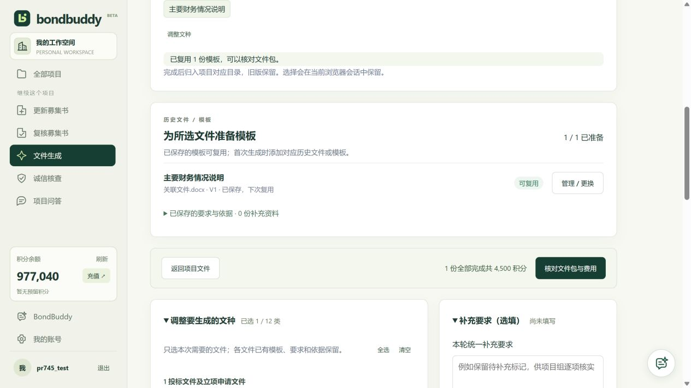
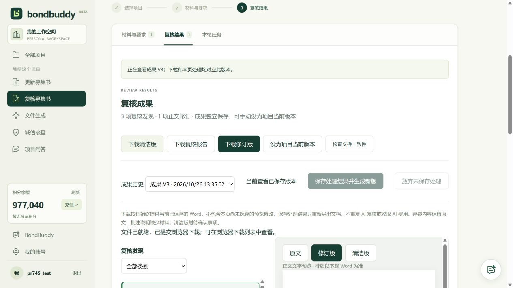
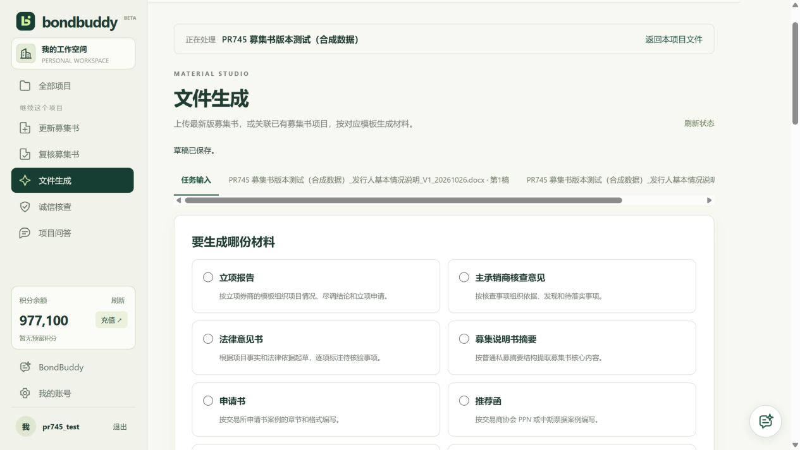

# PR #745 本地验收问题修复

来源：leizhai2025 的 PR #745，固定候选 `8c81e8f1032ba5e23657eb32a43d9dfd0c9612fe`，develop 基线 `030b0c5657bba34c921587d372e586c212de3d6a`。用户要求修复受托验收发现的六项问题。本补丁按该候选接续，保留其桌面 UX 与原请求恢复设计。

| 问题 | 修复后行为 |
| --- | --- |
| D01 原上传确认误报换版 | 使用材料 ID、版本、上传 ID、hash、大小、类型及角色核对文件；解析快照补全不再阻断原请求，真实换版仍拒绝。 |
| D02 导出完成后查看旧稿 | 进度页“查看结果”携带该任务 ID，读取准确成果后同时切换编辑器和 URL；不会跳到另一个更晚的任务。历史 tab 仍保留用户选定版本。 |
| D03 首次模板保存后未刷新 | 保存草稿后同步模板目录，首次保存、原请求重试及模板换版立即更新准备状态；旧模板版本保留。 |
| D04 项目忙后导航被静默拦截 | 保留已上传 Word 的原免费识别请求，允许导航，回来可恢复同一请求。未保存的本机文件选择提供明确的离开选项。 |
| D05 项目文件 V2 下载名 V3 | 项目文件的清洁版/修订版按文件版本序号命名，仍按准确 artifact/run/hash 校验下载；普通成果保留原命名。 |
| D06 NAFMII 续改市场为空 | 表单使用已有公共市场/品种及文种适用范围，项目文件续改保留 NAFMII/MTN。此为新入口暴露的既有兼容问题。 |

无 API、worker、契约或数据库迁移。此补丁只修改网页，与上述候选的真实 API/worker 配套验收。UI 调整依据用户本次修复要求和本地实测报告；不重排原页面。旧失败证据保留在集成测试工作区。

自动化和真实本地复验结果将在同目录验证记录中记录。自动化/受托代测不代表用户实际验收；代码完成后交付统一发布，未执行生产部署。

## 本轮验证

145 项定向 unit、71 个不同浏览器用例通过；TypeScript/Vite 通过。首轮 70 通过、1 个旧测试按钮名失败；该 fixture 为 0 项正文修订，修正为准确的批注版按钮后，复核组 19 项通过。记录保留，不作为远程 CI 通过。

固定修复源码 `21a7d846` 已在独立本地 5196 实测：原 QA 材料恢复、单题真实模型回答、回填 Word 下载；首次模板保存立即 1/1；V2 免费导出 V3 后直接打开 V3；关联文件两种下载名均为 V2；NAFMII/MTN 原值保留。D04 的 PROJECT_RUN_ACTIVE 路径使用浏览器 HTTP 夹具验证导航和同一请求重试，未另造真实忙碌任务。

模型证据为一次 gpt-6-sol / copilot_enterprise completed/measured；问答一次预留/结算 60 合成积分，免费导出无模型调用或扣费，四份 Word hash 和目标正文核验通过。原问题带测试前缀，自动分题返回 0，实测通过页面手选单一段落完成；不宣称所有 Word 自动分题已验收。

截图为真实本地网页；前后对照来自原固定候选验收记录，用户本次修复要求为交互调整依据。无腾讯北京官网链路、低积分暂停、大文档专业质量或 Word/WPS 渲染验证。详见 [验证回执](validation.json)。

**开发和自测完成；本地集成版可验收。用户未验收，代码尚未部署，待统一发布。**
