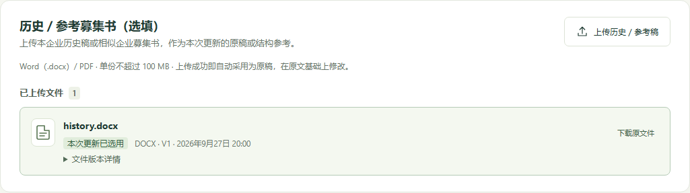
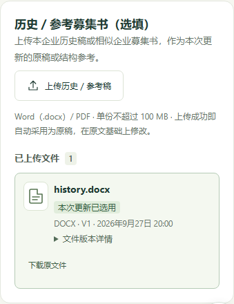
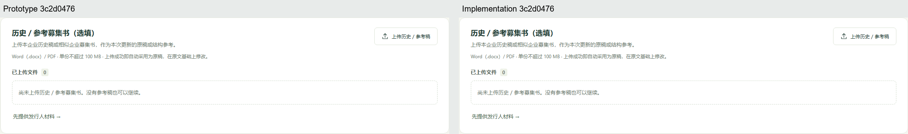
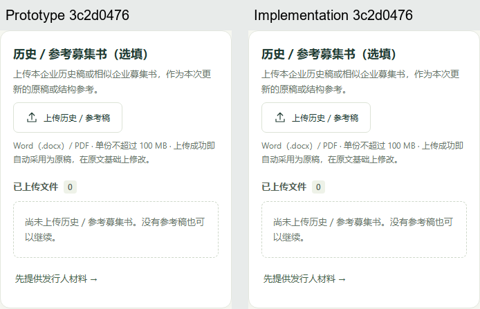
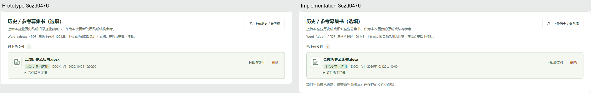
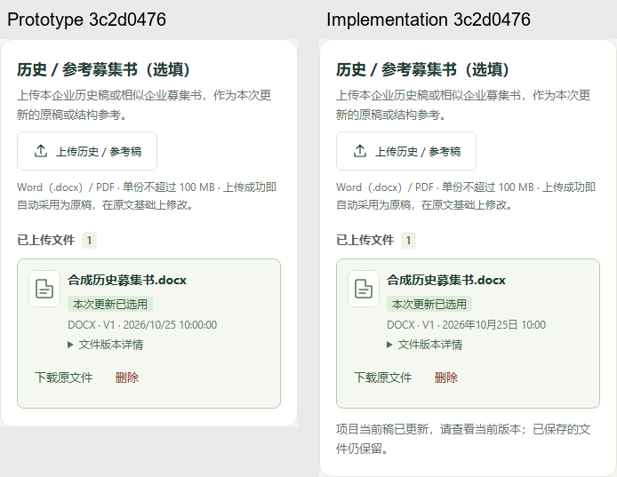

# 募集书上传即采用与原稿修订

状态：开发和自测完成，尚未部署，待统一发布。用户本地集成验收和真实模型复验未执行。基于 `develop de745a7c`，代码及原型提交 `3c2d0476`；本记录补充 #860/#862，取代手动采用流程。

## 结果与复现原因

生产只读诊断确认：原稿已上传保存，但未被设为当前稿，版本列表将其排除在输入之外，最终锁定 `source_prospectuses=[]`、`format_policy.mode=new_document`。#804 已在生产版本中，但只保护已绑定的原稿，此次未进入该路径。原稿与结果存在章节换序，结果没有针对上传稿的修订记录。账号、客户原文及日志仅留在授权本地诊断目录，没有加入仓库。

用户明确要求“上传就直接采用，在原稿上修改”。统一更新项目现在在上传成功事务内自动采用，页面不再要求第二次点击。历史／相似企业原稿都沿用此流程，DOCX/PDF 继续锁定对应原稿处理策略。#860 的原目录保留提示、PPN 内容映射和 `SOURCE_OUTLINE_CHANGED` 非阻断诊断继续保留。

## 实现边界

- 上传、复制 reference 为 historical、从其他项目复用历史稿均登记准确版本并自动采用。多次上传以最新成功上传为主原稿，已存版本保留。
- 上传回执重试不重选旧稿；新建上传即使去重复用旧材料，也按新的上传意图采用。重新采用时清除旧格式模板覆盖，避免当前稿已变而格式仍跟另一文件。
- 自动采用的未使用误传稿可以删除。删除当前稿后恢复可用版本；无剩余版本则清空选择但保持 revision 单调递增。任务、文件、复核、底稿已引用的材料仍保留。
- 新任务检查当前采用 revision；先准备无稿输入／助手卡、后上传原稿，不能绕过新原稿启动。已存在任务请求仍优先幂等返回，旧输入和费用不变；运行中上传新稿后，旧任务结果只归档、不覆盖新的原稿选择。
- 上传保存成功但版本回读失败时保持未确认状态，可重读原回执；不能让旧本地状态静默启动无稿任务。复核、文件生成、问答不套用更新项目的自动采用规则。
- 仍保留服务端漏稿防护和错误白名单，异常情况下提示刷新自动采用状态，不要求手动采用。原稿信息仍按既有要求填写，上传不执行、不计费。

## 迁移与发布依赖

新增 `0162_automatic_prospectus_upload_adoption.sql`，无新增依赖。由统一发布执行，先迁移，再协调 API/web 版本；worker/Python/PPN 继续包含 #860 已交付修复。迁移仅在本次独立测试库执行过。

迁移先按业务锁顺序锁项目表，允许 selection.version_id 为 null 并补 owner/project 外键；登记遗漏历史材料，修复未采用或有原稿却生成无稿首稿的项目，保留有效原稿选择和正常成果续改。新增版本按材料原保存时间判断先后，避免回填把旧原稿误认成新上传。写入选择 revision、草稿 revision 和 outbox，不修改 inputs、runs、Blob 或账务。合成用例已验证再次执行无额外变更。

发布需预留迁移锁的等待时间；不在本开发聊天执行生产迁移。回滚应用无需撤销可空列或删除版本、审计记录；旧代码回滚后不再自动采用新上传，用户行为会退回旧版本，须由发布负责人评估。历史已交付错误成果不会被此迁移替换或自动重跑。

## 验证

本机独立工作区，PostgreSQL 16 + Azurite，均为新建独立容器和合成数据；无生产数据库连接、真实模型调用或收费任务重跑。

| 范围 | 结果 |
| --- | --- |
| contracts/API/web TypeScript、Vite 构建 | 通过，保留既有 bundle 体积提示 |
| API：上传、复制、迁移、原稿格式、输入锁定、续改 | 18 通过，0 跳过；本地真实 DB/Blob，合成文件与队列成果 |
| 浏览器原稿区域 | 21 通过；自动采用、上传重试、误传删除、关联入口隔离、版本读取失败恢复、桌面与手机布局 |
| 浏览器上传到开始及错误恢复 | 2 通过；未发 select 请求、无采用确认框，输入准确包含上传稿；异常提示不启动任务 |
| web API 单元回归 | 24 通过；错误白名单、下载与隔离 |
| 原目录／PPN 回归 | 沿用 #860 的 Python 25、PPN 3、worker 7 通过记录，本轮未改变这些文件 |

关键回归包括：漏稿输入被拒绝；相似企业上传原稿正确传入原稿策略；新上传打断旧输入启动；已有 run 重试不创建新任务；生成完成不覆盖后来上传稿；误传稿全部删除后仍可新编；跨页面工作区删除后补稿可恢复；存量回填不改旧输入及正常续改版本。

测试中发现并修正了两类问题：迁移测试夹具缺少当前 schema 要求的合成 Word 交付证据；跨工作区自动采用时不应清除与同一原稿匹配的格式引用。对应定向回归已补齐。浏览器版本读取失败夹具的上传回执也已校正。最终结果按修正后复验计数，不把首轮失败记为通过。

## 同尺寸原型对照

原型 `product-prototype/public/prospectus-reference.html` 与实现 `apps/web/src/prospectus-panel.ts` 均为 `3c2d0476`；已迁移页面为材料与要求页的历史／参考募集书区域，关联 #361。用户本轮明确要求是交互变更依据：上传成功自动采用，旧版本可选“改用此版”，不新增页面和必经对话框。

空状态原型与实现一致。已保存状态的既有差异是日期格式及刷新后的状态文本；手机自然换行，无裁切和横向溢出。截图为合成文件。浏览器采用合成 HTTP 响应，不据此声称真实模型效果或用户集成验收通过。

## 统一集成验收待办

上传历史／相似 DOCX 后直接开始，验证原稿目录、正文及表格组织保留，双 Word 对应原稿产生真实修订；补测 PDF 原稿策略。再次上传、删除误传稿、复用已存原稿、继续修改已生成清洁版均应锁定准确来源。发布后才能按授权重新处理原问题任务；旧错误成果目前仍保留。
