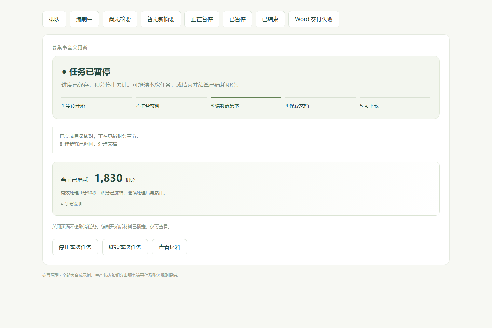
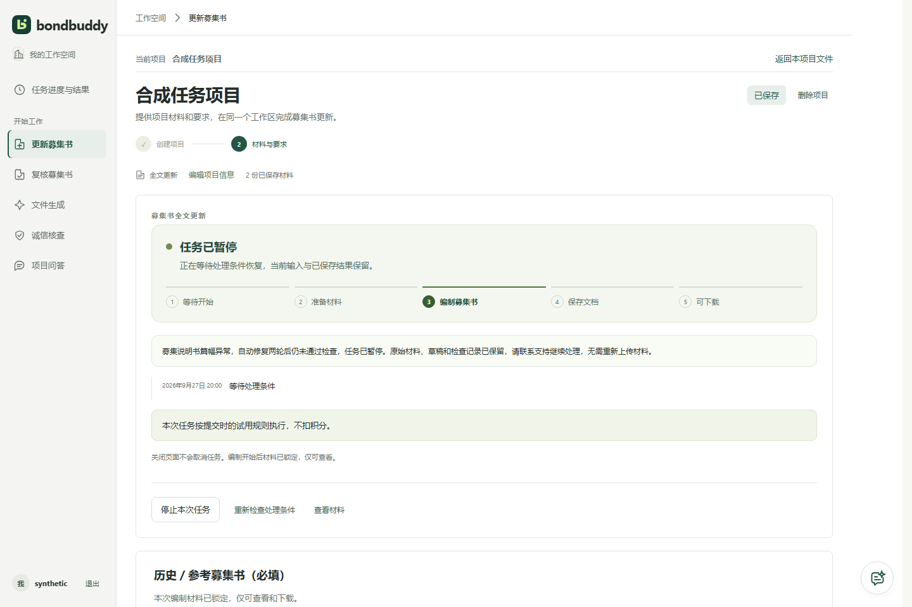

# 篇幅门禁拒绝后的自动修复验证（#995）

用户要求篇幅被门禁挡住后由worker重做，不直接将任务判为失败。本次在同一任务内最多自动修复两轮：每轮携带可信质量报告和上一轮草稿／日志，原始输入、模板和修订时间不变；修复后的稿件仍走完整服务端检查。连续两轮篇幅不合格后保存证据并暂停，普通恢复不重置预算。

## 自动化证据

环境：Windows，Node22，bundled Python。使用合成材料和模型替身，未调用真实供应商、生产任务或生产数据库。

| 命令 | 结果与边界 |
| --- | --- |
| `node --test apps/worker/dist/file-authoring-repair.test.js apps/worker/dist/file-authoring-quality.test.js apps/worker/dist/file-authoring-delivery.test.js apps/worker/dist/file-authoring-format.test.js`（设置 `BONDBUDDY_TEST_PYTHON`） | 36通过，0失败、0跳过。含实际Python重放Word、修复工作区交接、原始输入与基线保留、独立格式计划和最终完整质量复验 |
| `node --test scripts/prospectus-quality-gate.test.mjs` | 31通过，0失败、0跳过 |
| `npm run build`、`npm run check:contracts` | 全部通过；契约72项测试、179+12+4个示例。既有Vite包体提示保留 |
| `playwright test tests/project-execution.spec.ts --grep "exhausted size repairs" --workers 1` | 1通过，0失败、0跳过。真实Chromium，合成HTTP边界；暂停原因正确、刷新后只有一次提交、无自动任务操作、无横向溢出 |

编排回归覆盖：首次拒绝→修复→重新检查通过→交付；两轮仍不过暂停；保存失败报告后崩溃及模型完成后崩溃的恢复；相同轮次复用已完成调用；取消、用户暂停、未知供应商结果停止追加调用；跨用户／篡改报告和候选不授权重做；delivery-only恢复不启动模型；渲染异常重试检查；修复不绕过其他Word门禁。

完整工作区测试使用合成页数拒绝报告触发修复，之后由真实Python工具生成并检查Word，不能冒充300页真实模型生成测试。真实分页310→104拒绝、正常166→164通过属于前一批 #992 的独立门禁证据；本次没有重复调用模型。持久化重启测试使用调用日志替身验证固定逻辑ID及预算，真实PG租约／进程崩溃链路仍待Linux集成验收。

本机沙箱首次阻止Chromium进程启动（EPERM），经工具审批后在相同本机合成测试环境运行通过；这不是业务断言失败。构建亦经工具审批使用现有npm运行。没有改动生产网络、服务或账务。

## 原型与实现对照

沿用 `product-prototype/public/authoring-live-progress.html` 的暂停状态和现有 `ProjectExecution` 进度、原因、操作区域。原型commit为 `67661ef6f4dcff79b8b197b6f5fb2e184971c483`，实现commit见本PR测试提交。两张截图均1440×960，全部合成数据，已查看确认无裁切或横向溢出。

| 原型暂停状态 | 本次实现暂停状态 |
| --- | --- |
|  |  |

本次变化仅为用户明确要求的质量修复耗尽原因说明：保留材料及草稿、联系支持、无需重新上传。没有新增布局或控件。原型中的手动暂停继续按钮和积分示例，与现有实现的处理条件暂停／合成试用账号不同，属于既有状态与计费分支，本次没有修改。浏览器测试只验证页面和交互，不代表真实后端或用户验收。

## 统一发布交接

无数据库迁移、公共状态枚举、新依赖或计费政策修改。新增worker编排与固定回归已纳入发布测试和工具指纹。原任务中每轮调用仍按既有持久化模型日志记录真实用量，不新建重复run；未知结果继续对账，不盲目重发。

代码完成，尚未部署，待统一发布。最终统一验收待办：固定版本完整Linux/PG恢复及计费集成回归、真实模型修复效果、模板和页面检查、用户验收与授权发布。没有重跑yyx线上任务。
