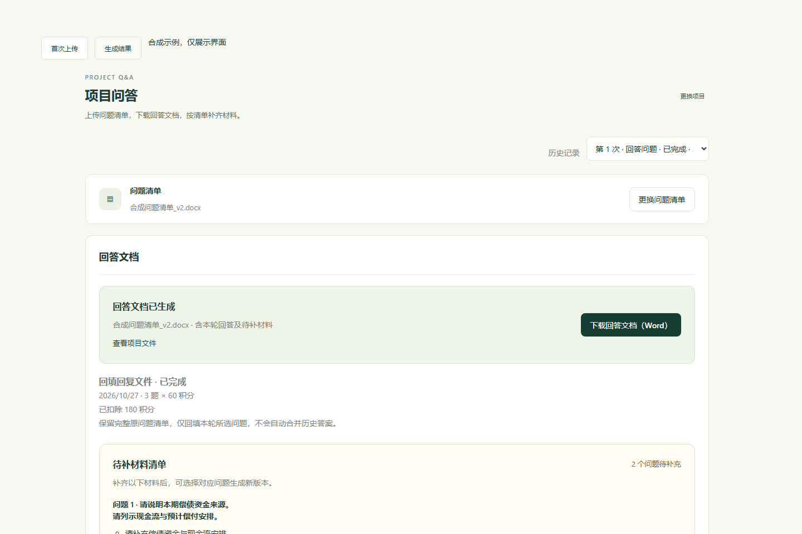
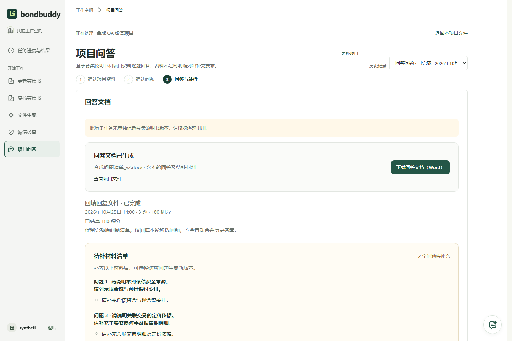
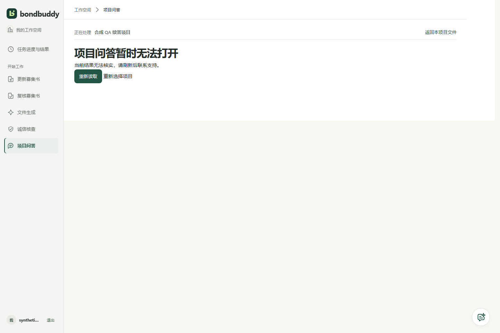

# 项目问答读取恢复

## 问题与改动

问答轮询读取失败会把错误写入通用状态文案；之后合法响应已经恢复并渲染回答，旧错误仍不消失。首次读取失败则只有重新选项目入口，不能在当前任务直接重试。

本次把轮询错误与保存、提交等操作提示分别保存，仅在成功采用合法响应后清除轮询错误。首次打开失败增加“重新读取”，保留原项目和任务 URL，重新读取项目与问答。响应 schema、计费整数、成果归属及下载 hash 校验不变，无自动重提、无新增收费或数据库迁移。

## 验证

- 旧代码已复现：两次不合法响应后恢复合法响应，结果已显示，状态仍为“当前结果无法核实，请刷新后联系支持。”。
- Edge 合成 HTTP 浏览器测试：`qa-read-recovery.spec.ts` 与 `contextual-errors.spec.ts` 共 12 项通过。覆盖首次网络/schema/计费响应失败的重试、持续非法响应不得清除警告、恢复后清除旧错误、未确认保存的请求与提示保留、下载失败、错误任务成果及提交幂等保护。
- TypeScript workspace 构建和 web 类型检查、Vite 生产构建通过。首次 web 检查缺少依赖包 dist，按仓库构建顺序生成后通过；未修改类型检查规则。
- contracts 测试 72 项通过；179 个公开合成示例、12 个内部库示例、4 个数据生命周期示例校验通过。
- 上述浏览器数据均为 synthetic，不运行真实模型、数据库、Word 生成或积分结算。

## 界面对照

对照原型为 `product-prototype/public/qa-document.html`（最近修改提交 `4256759279557ee376dab952739d4ef51a6dde25`），实现基于 `17895204`。截图尺寸均为 1440 × 960。

| 原型 | 修复实现 |
| --- | --- |
|  |  |

结果卡片、Word 下载、历史选择和待补材料区域沿用既有实现；现有工作区外壳、结果优先排列和募集书提示是本次改动前已有的原型差异。本次新增的界面只有首次读取失败的重试按钮，位置在已有错误说明之后，使用既有按钮样式。用户于本会话明确要求修复并于 2026-11-08 明确要求合并 develop、部署和重新提交验证；不把自动测试记为用户实际操作验收。

## 生产证据边界

原线上任务的生成状态为成功，已有下载文件与服务端 SHA-256 一致，内部 XML 可读；原结果页刷新后可显示全部回答。已证实界面错误残留，但没有保留最初失败响应，不能认定网络、鉴权或某个字段是最初触发原因。生产部署及后续真实任务验证记录另行保存，不把本次合成回归当作真实生成结果。
