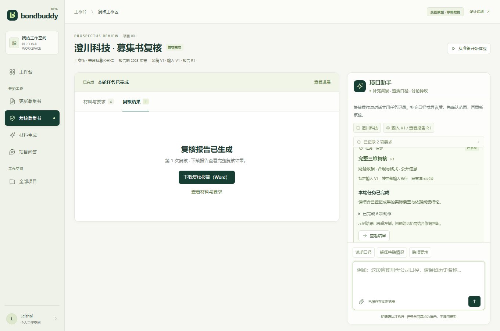
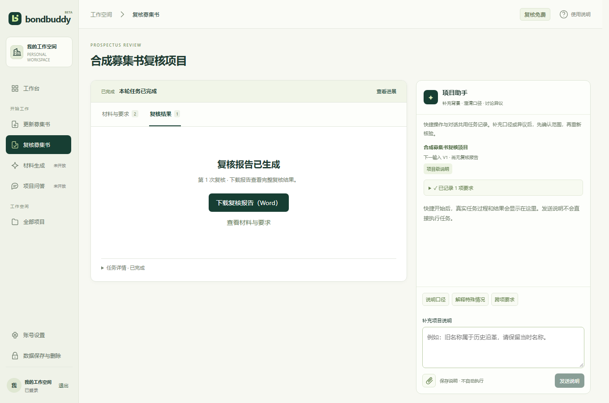
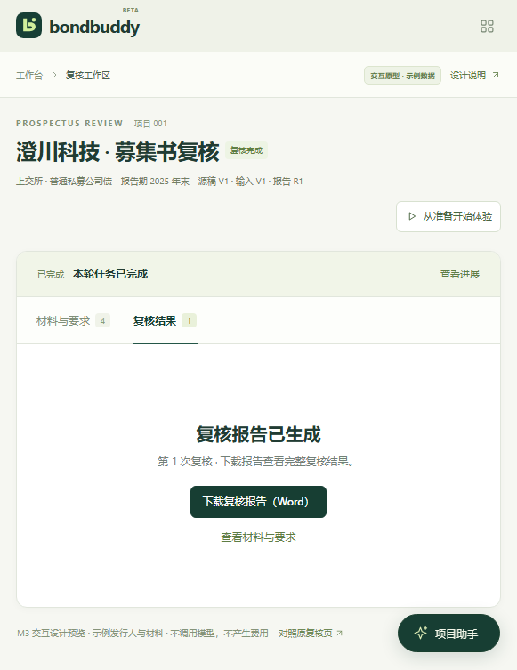
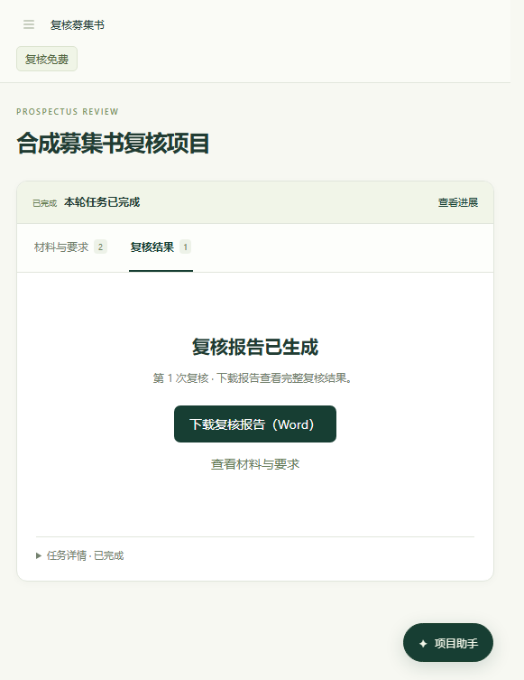

# 复核结果文件下载：页面对照

用户 2026-10-05 明确要求直接下载 Codex CLI 复核结果，暂不在 UX 展示报告正文/结构化发现。按该要求收窄结果区，原有导航、材料页、助手保持既有迁移。

原型源码：`product-prototype/public/review-v2.html?delivery=files`、`review-v2.js`、`review-v2.css`。实现：`apps/web/src/review-workspace.ts`、`review-workspace.css`。两边截图的源码 commit 均为 `3fa2593`；数据全部为 synthetic，没有客户报告或原文。桌面 viewport 1360×900，窄屏 581×753，截图裁剪到对应 viewport。

| 视口 | 原型 | 实现 |
| --- | --- | --- |
| 桌面 |  |  |
| 窄屏 |  |  |

逐项核对：原页面内的“材料与要求 / 复核结果”页签与任务状态保留；结果区只含“复核报告已生成”、版本说明、居中的 Word 下载按钮及材料返回入口；不生成问题列表、维度计数、覆盖率或逐问题修订入口；窄屏下载可见，助手仍为既有折叠入口。结果数量按文件报告计数，不能把没有结构化 report 记录解释为没有结果。

本次结果区简化的确认人：用户本人，依据上述原话。新下载行为在实现中通过私有 API 取真实文件；原型下载按钮仅提示演示，这是原型与实现的功能性差异。项目名、材料/要求数量、助手记录为两套合成数据；原型原有演示标签与实现已有任务详情并非本次新增布局偏离。本次未更改它们，也不把两套示例记录当成同一运行。

验证：复核工作区浏览器回归 34/34 通过；按钮居中后重复两项文件模式测试 2/2 通过，覆盖桌面/窄屏下载及刷新保留。工程结果不替代用户真实项目复核或专业验收。
