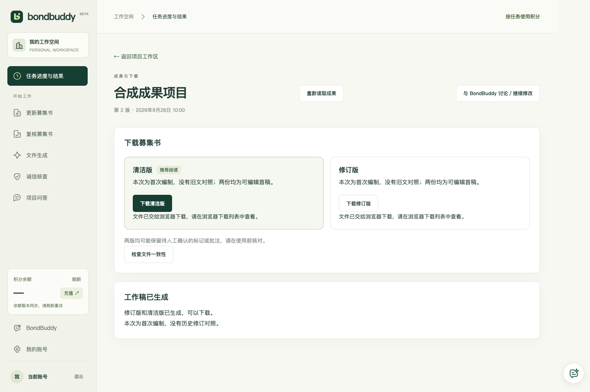
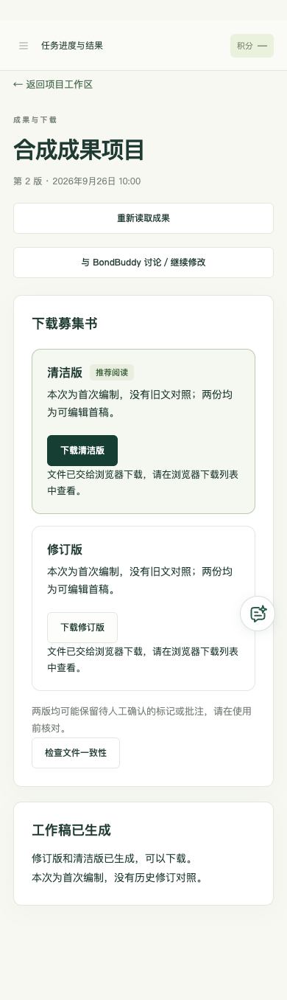
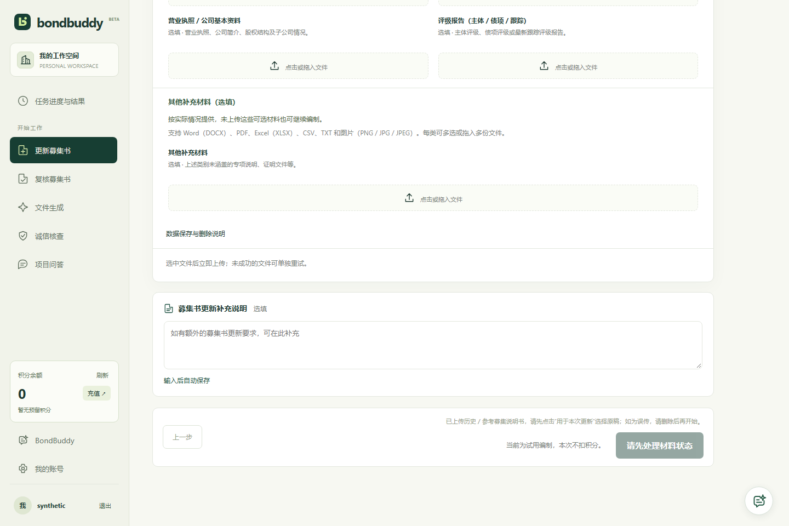
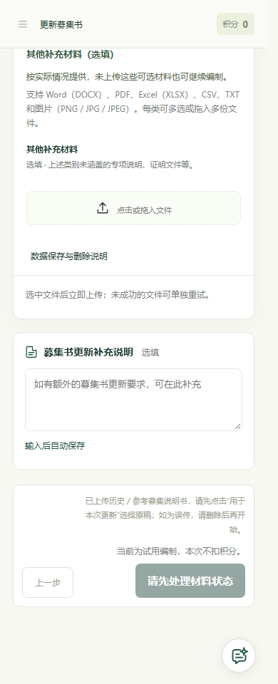
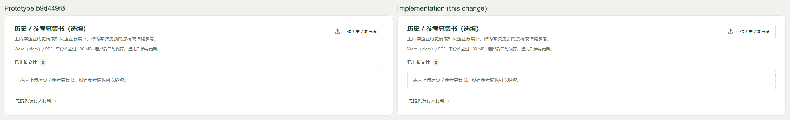
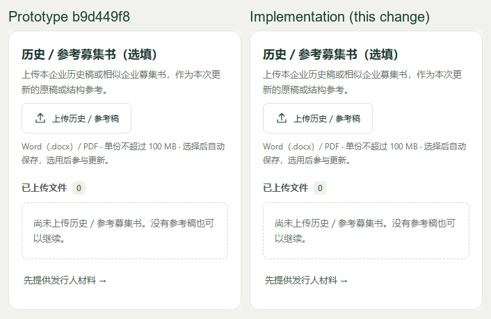
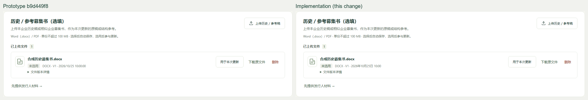
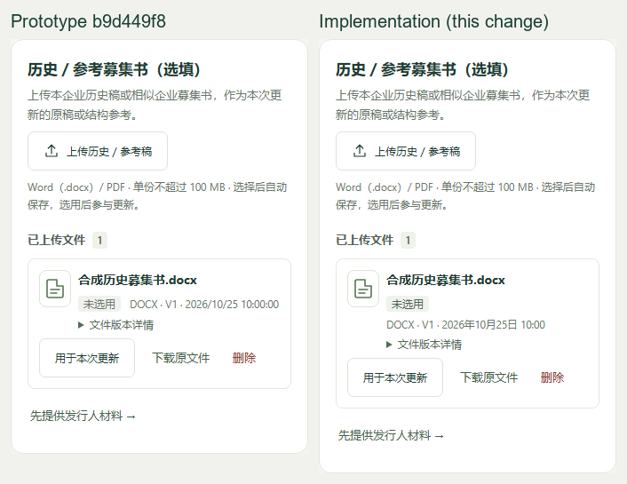

# 已上传原稿漏入更新输入的修复

## 同日集成补充

在 `aa8ca0cc` 的入口修复上补齐执行与下载边界：

- 先准备无稿输入/助手确认卡，再上传未采用原稿，不能继续用旧输入创建新 run。服务端在项目锁内检查，已有 run 的相同请求先幂等返回；拒绝不创建任务、不预留积分。
- 原稿采用提示通过现有错误协议的白名单 `field_errors` 传给页面与助手，不被通用“其他页面修改”覆盖；不直接显示任意服务端文案。
- 首稿的修订/清洁字节相同、复用同一 artifact 时，清洁按钮可下载并使用清洁版文件名。仅对 `baseline_kind=none` 且双版引用、SHA、run/version一致的配对接受该别名；其他错配、授权失败、坏字节继续拒绝。
- 生命周期测试统一删除时间与零日阈值检查的测试时钟，消除 PostgreSQL 微秒与 JavaScript 毫秒精度竞争；生产清理代码不变。

本次增量基于独立 macOS 工作区和最新 `develop 6efbb5fc`，使用 Node 24.14.0、隔离 PostgreSQL 16.15、Azurite、真实 Python 编辑器及独立 Edge。Browser plugin 不可用，采用仓库 Playwright；没有操作用户浏览器会话。数据库和文件均为 synthetic；无真实供应商调用、生产任务重跑或发布。

集成验证：全工作区 build、check:contracts 通过；web 单元 964/964；API/worker 定向组合最终 21/21（0跳过，含真实上传/输入锁定/报价/任务/账务/双Word下载）；Python 25/25；PPN离线3/3及框架一致性检查通过。上传/更新浏览器35项、成果下载44项通过；补充服务端采用提示用例及相邻回归单独复验，结果见本PR验证记录，不与前轮重复计数。

首轮21项为17通过/4失败：3项固定编辑测试因macOS临时目录软链接与文件realpath守卫不一致，改用规范绝对TMPDIR后6/6通过，未放宽安全校验；1项生命周期测试因上述时钟竞争失败，测试时钟修正后最终21项全部通过。失败记录保留，不能称首轮全绿。

关键命令：

```text
npm run build
npm run check:contracts
npm run test:unit -w @bondbuddy/web
node --test --test-concurrency=1 apps/api/dist/update-project-e2e.pg.test.js apps/api/dist/source-format.pg.test.js apps/api/dist/source-format-lifecycle.pg.test.js apps/api/dist/source-format.test.js apps/api/dist/unified-authoring.test.js apps/worker/dist/file-authoring-format.test.js apps/worker/dist/ppn-writing-workspace.test.js
BB_E2E_BASE_URL=http://127.0.0.1:5188 BB_E2E_BROWSER_CHANNEL=msedge npm test -w @bondbuddy/web -- tests/artifact-page.spec.ts
BB_E2E_BASE_URL=http://127.0.0.1:5207 BB_E2E_BROWSER_CHANNEL=msedge npm test -w @bondbuddy/web -- tests/prospectus-panel.spec.ts tests/project-execution.spec.ts --grep 'unselected|upload|source|no-history|no reference|unified|new-document'
```

PG/Blob用显式本地 `BB_TEST_DATABASE_URL` / `BB_TEST_AZURITE_CONNECTION_STRING`；编辑器用 `BONDBUDDY_TEST_PYTHON`。macOS固定编辑测试设置规范 `TMPDIR`，不使用`/var`软链接路径。未配置环境导致的跳过不计作通过。

下载页面没有布局或新增交互偏离：复用既有下载按钮/成功反馈；1440/390截图为合成首稿两个按钮均完成下载。入口原型对照沿用下文记录。




GitHub #860 的托管检查没有启动（steps为空），annotation明确为账户付款/消费额度限制。不得把它记为远端测试通过；正常PR合并仍遵守分支保护，不使用管理员绕过。此次代码合并不等于已部署或该客户原稿已重新生成。

## 原入口修复的验收记录

状态：开发和自测完成；用户集成验收、生产发布及真实模型复验未执行。无数据库迁移、无新增依赖。发布需协调 API、web、worker 和随 worker 打包的 Python/知识文件。

## 问题与原因

只读核验的一次更新任务中，历史／相似募集说明书在开始前已经保存，但未被选为当前采用稿。版本列表将它标为 inactive，页面从材料列表中排除它，服务端又允许锁定不含任何原稿的输入。最终 `source_prospectuses=[]`、`format_policy.mode=new_document`，模型按无原稿首稿编制。

#804 已合并并包含于该次生产版本；它保护已绑定原稿的受控编辑，但无法保护根本没有进入输入的上传稿。既有端到端测试甚至明确允许“有未采用上传稿、提交空原稿列表”，漏掉了这个边界。此次更正该断言并增加页面到输入提交的回归。

实际源/结果目录对照确认章节换序，结果没有针对上传稿的插入/删除修订记录。客户原文、任务标识、账号信息及诊断日志仅保存在获授权本地诊断目录，不提交到仓库。

## 行为

- 统一更新项目存在上传原稿但没有当前采用稿时，页面在现有开始按钮旁提示选择“用于本次更新”，阻止开始；服务端在项目事务锁内用同一判断拒绝创建漏稿输入（409 `INPUT_REVISION_CONFLICT`），包括直接调用接口。
- 上传仍不自动采用；误传且尚未使用的文件仍可删除。删除后真正没有原稿的项目仍可新编；已选定原稿和生成成果继续使用原有准确版本锁定逻辑。复核、文件生成等入口不套用更新页面的选择提示。
- 有编辑基线时沿用原目录、标题、编号、层级、顺序和段表组织；相似企业关系影响事实沿用，不解除结构保留。PPN 专家框架用于披露内容映射，只有无稿首稿才默认采用其章序。用户明确结构要求或确有必要的目标转换只允许最小调整并记录依据。
- manifest 增加识别出的有效标题和目录；格式诊断独立比较接受修订后的结构，发现变化记 `SOURCE_OUTLINE_CHANGED`。记录了操作不等于已核实结构变化的业务授权。诊断不阻断下载，不替代专业审核或页面验收；未标注大纲的中文标题含启发式候选，须人工复核。
- 不修改旧输入快照、不替换已交付成果、不改任务费用。PPN 原来源版本保留，当前知识内容以 SHA-256 锁定；108 条批注、90 张表框架完整保留，旧任务读取旧快照。

## 验证

全部使用本机独立工作区。数据库为本次新建 PostgreSQL 16 容器，存储为本次新建 Azurite；不连接生产数据库，不调用真实模型。

| 检查 | 结果 |
| --- | --- |
| contracts/domain/registry/applicability/API/worker/web TypeScript + Vite 构建 | 通过；Vite 保留既有大包提示 |
| 公共契约标准测试和示例校验 | 72 通过；171 合成示例、12 库内示例、4 生命周期示例通过 |
| API：update-project-e2e、source-format、source-format-lifecycle、unified-authoring | 14 通过，0 跳过；真实本地 DB/Blob、合成文件/队列成果 |
| worker：file-authoring-format、ppn-writing-workspace | 7 通过，0 跳过；包含可信重放、旧快照与知识完整传递 |
| Python：test_fixed_edit、test_source_outline | 25 通过；覆盖继承样式、目录域、页码、标题改写/换序/层级、财务更新和非阻断交付 |
| PPN 离线测试及框架重新生成检查 | 3 通过；框架与生成器一致 |
| Playwright/Edge 浏览器 | 9 通过；未采用时阻止、采用后精确提交、上传重试、删除、复核隔离及视觉对照 |
| Git diff whitespace | 通过 |

关键命令：

```text
node --test --test-concurrency=1 apps/api/dist/update-project-e2e.pg.test.js apps/api/dist/source-format.pg.test.js apps/api/dist/source-format-lifecycle.pg.test.js apps/api/dist/source-format.test.js apps/api/dist/unified-authoring.test.js
node --test --test-concurrency=1 apps/worker/dist/ppn-writing-workspace.test.js apps/worker/dist/file-authoring-format.test.js
python -m unittest test_fixed_edit test_source_outline -q
python scripts/test_ppn_writing_framework.py
python scripts/build_ppn_writing_framework.py --check
```

Python 使用仓库 `python` 和 `python/tests` 模块路径；Windows 设置 UTF-8 环境。浏览器用例使用合成 HTTP 边界，不能据此声称完整真实模型链路验收。首次 Vite 冷启动曾超时；测试夹具的提示定位及类型定义修正后，最终定向回归全部通过。

## 页面与原型

对应页面为现有材料与要求页及历史／参考募集书区域：`apps/web/src/main.ts`、`apps/web/src/prospectus-panel.ts`。对应原型为 `product-prototype/public/prospectus-reference.html`，原型提交 `b9d449f8dd6938651da61d525161754c1c7e8a3c`，本次基线 `6efbb5fcc342c21561f1397523dbcc1c5d7b9354`；实现与本记录同一提交。

保持原型的上传、已上传列表、采用及删除位置和布局；此次按用户“上传原稿应作为更新基线”的要求，复用现有材料状态提示和禁用开始按钮，补齐漏稿检查，没有新增页面或对话框。文件名、日期等使用合成数据。旧 `prospectus-panel.html` 是较早通用面板，不作为本次历史／参考稿区域的验收基准。

对照中既有日期格式差异为原型 `2026/10/25 10:00:00`、实现 `2026年10月25日 10:00`；在手机已上传状态多换一行，卡片高 22px，无裁切或横向溢出。本次不修改该日期展示。新行为的依据为用户本轮原稿漏用缺陷修复要求；用户集成验收仍待执行。




同尺寸原型（左）与实现（右）对照：






## 集成与真实成果验收待办

统一集成版验证：上传 DOCX/PDF 但不采用时页面不得开始、直接锁定接口返回 409；采用后新输入包含对应材料版本、hash 和原稿格式策略；删除误传稿后无稿新编仍可用。已有生成稿续改和旧任务快照回放应保持准确版本。

本次线上错误成果仍保留。后续真实复验应明确选回上传原稿，再按用户授权执行；不能沿用这次误生成的首稿作为目录基准。比对原稿和新结果各级目录、正文顺序与真实修订，另做内容和页面验收。自动化通过不等于用户已验收或已部署。
