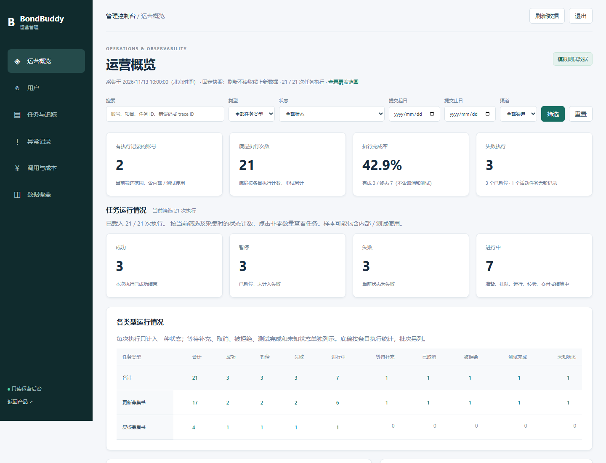
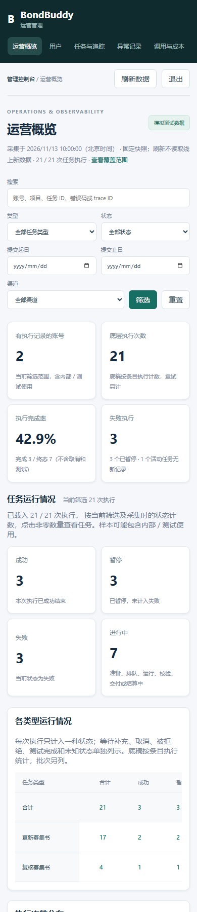

# 运营看板任务运行统计

需求：[#1298](https://github.com/ITSophiaXu/BondBuddy/issues/1298)。基于 develop `92bbba8fe04ef7f367c8ecba814ff834bea2a677`，独立分支 `feat/admin-task-status-20261113`。

状态：开发和自测完成，尚未部署，待统一发布；用户尚未验收。

## 功能与口径

`/admin/` → 运营概览增加成功、暂停、失败、进行中数量，以及每种业务类型的状态分布和合计。每次执行按当前状态只计一次，历史失败事件不会把已恢复成功的任务再次计为失败。

进行中包括准备、排队、运行、校验、交付及等待结算；等待补充、取消、被拒绝、测试完成、未知单列。底稿按条目执行统计，批次仍单独展示。

统计沿用现有账号、类型、状态、日期、渠道和搜索筛选。点击非零数量进入对应任务列表；保留更严格的排队、无新记录等筛选条件，避免点击后列表扩大。各类型合计等于各状态之和，整体合计等于各类型之和。原有逐任务耗时、平均和最长耗时统计保留。

数据范围仍为现有接口载入的最近1000次执行。截断、未采集和历史快照明确提示，不宣称覆盖全历史或真实客户全量；未知状态单独保留。历史记录不代表当前线上状态。无新增接口、依赖、迁移或模型调用。

## UI 对照

沿用现有真实运营后台的侧栏、筛选、卡片、表格和追踪页，按本次用户要求在原指标卡后增加状态卡和分类表。原型目录没有独立运营后台原型，本次以 develop 同路径页面为对照。新增表格在窄屏内滚动，页面本身不横向溢出。

以下为本地真实 Chromium 浏览器、合成 API 快照的截图裁剪，未调用生产接口或展示真实客户运行数字。原始全页截图和浏览器日志保留在本任务工作区 `work/admin-task-status-browser-final/` 及 `work/admin-task-status-browser-final.log`。





## 验证

- TypeScript：contracts、domain、rule-pack-registry、rule-applicability-context、API 构建及完整 web `tsc --noEmit` 通过；web 测试编译通过。初次 web 检查因新工作区缺少后端构建产物失败，补齐本工作区构建后通过，未改动后端源码。
- 定向单测37项通过，0失败、0跳过：状态分组与勾稽、当前状态与历史错误、筛选与下钻、批次状态兼容、旧计时和管理后台模型。
- 浏览器18项通过，0失败、0跳过：原7项后台筛选/刷新/退出/权限回归及新增11项状态统计回归。全部 API 请求被合成夹具拦截；真实 Chromium、1440×1000 与390×844视口。本地入口仅用于前端自动化，不是全后端集成验收版。
- Vite生产打包和 `git diff --check` 通过。独立代码审查发现的“进行中筛选隐藏排队/运行中的底稿批次”已修复，并增加2项单测和1项浏览器回归。
- 首轮浏览器启动受沙箱 `spawn EPERM` 阻止；获工具额外权限后运行。首次实际运行的一个用户名定位器存在歧义，修正为精确角色/文本后，最终整组18项全部通过。失败记录保留，不以跳过替代。

复现命令（先完成正常工作区依赖安装与依赖包构建）：

```powershell
node node_modules/typescript/bin/tsc -p apps/web/tsconfig.test.json
node --test apps/web/dist-test/admin-inspection-status.test.js apps/web/dist-test/admin-inspection-timing.test.js apps/web/dist-test/admin-inspection-model.test.js apps/web/dist-test/admin-inspection-attention.test.js
node node_modules/typescript/bin/tsc --noEmit -p apps/web/tsconfig.json
node node_modules/vite/bin/vite.js build apps/web
# 在独立终端启动本任务网页，再运行浏览器测试：
node node_modules/vite/bin/vite.js apps/web --host 127.0.0.1 --port 5328 --strictPort
$env:BB_E2E_BASE_URL='http://127.0.0.1:5328'
node node_modules/@playwright/test/cli.js test --config apps/web/playwright.config.ts apps/web/tests/admin-inspection.spec.ts apps/web/tests/admin-inspection-status.spec.ts
```

后续集成仅需更新 Web。服务器数据查询、身份和权限接口未改变；需要在统一测试版用具备日志读取权限的账号确认实际记录，并由用户验收。未进行生产部署、迁移或服务重启。
